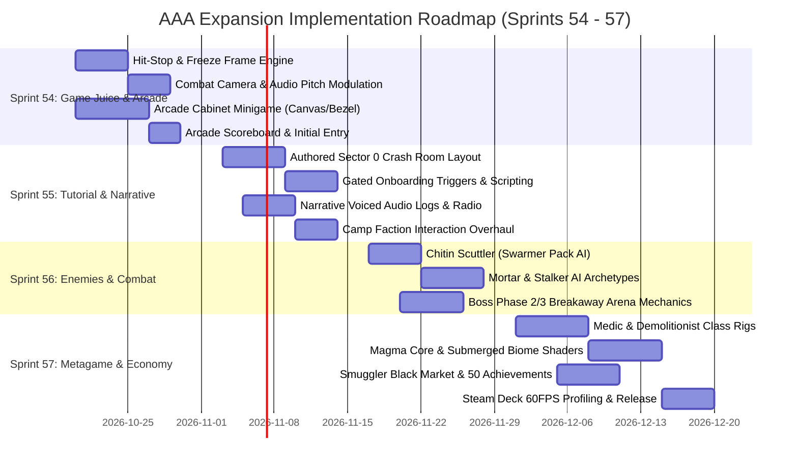

# Hunker Bunker AAA Master Expansion Plan: Game Feel, Narrative, Tutorial, Economy, Enemies & Arcade Minigame

**Status:** Architecture & Design Specification, partly built (see §11, verified 2026-10-16 evening) · **Target Milestone:** Sprints 54–57 (v2.5.0–v3.0.0) · **Date:** 2026-10-16  
**Document ID:** `PLAN-20261016-AAA-EXPANSION` · **Author:** Antigravity Engineering & Design Lead  
**Scope:** Complete game feel audit, narrative unification, gated interactive tutorial, AAA polish roadmap, economy & trading market audit, enemy archetype suite, playable arcade cabinet minigame with scoreboard, new operator classes, new biomes, and achievement suite.

---

## 1. Executive Summary & Vision: The Leap to AAA Quality

*Hunker Bunker* possesses an exceptional core: deterministic seed-carved subterranean mazes, rich retro-futuristic 3D props, Steam inventory infrastructure, and high-tension tactical extraction loops. However, comparing the current build to genre-defining AAA/high-end indie titles (*Deep Rock Galactic*, *Hades*, *Helldivers 2*, *Returnal*, *Darkest Dungeon*) reveals key areas where the player experience feels prototype-rough rather than tactile and polished:

| Dimension | Current State | AAA Target State |
| :--- | :--- | :--- |
| **Game Juice & Feel** | Basic screen shake (`TraumaManager`) and muzzle flash decals; flat enemy deaths and floaty movement. | Visceral physical feedback: 40–70ms hit-stop freeze frames, directional damage vignettes, normal-aligned impact sparks, audio pitch modulation, and landing squash/stretch. |
| **Story & Lore** | Fragmented blend of Soviet cosmonauts, Horizon corporate debt, and Giger fungal alien queens. Wall-of-text infodump at launch. | Coherent "Deep Crust Initiative" universe: high-stakes corporate salvage of Cold War subterranean biosphere tests, delivered through diegetic radio, environmental logs, and nuanced survivor camps. |
| **Tutorial & Onboarding** | 11 passive text prompts overlaid across live, deadly procedural maze runs with 45s wait timers. | Scripted "Sector 0: Impact Zone" crash site slice: safe, gated interaction rooms teaching movement, shooting, salvage collection, banking, and combat in isolation before releasing into the wild. |
| **Economy & Trading** | Solid inventory schema, but charms carried combat stats; soft currencies lack late-game sinks; no in-run trading. | Strict zero-pay-to-win separation; in-camp Smuggler's Black Market; tactile 5→1 trade-up terminal sequences; dynamic scrap/med sinks. |
| **Enemies & Combat** | Primarily 4 snail variations (`cybersnail`, `cryosnail`, `sporesnail`, `sentinel`) + 1 boss. Predictable charge AI. | 6 distinct tactical archetypes (Swarmer, Artillery Mortar, Ambush Stalker, Armored Crusher, EMP Leech, Aerial Shrieker) with multi-state behavior trees. |
| **Sidequests & Minigames** | Props are static interaction text boxes. `life_arcade_cabinet.glb` prints a one-line string. | Fully playable 8-bit vector arcade minigame (`SUB-CRUST 1984`) inside the cabinet bezel with persistent high scores, initials entry, buffs, and cosmetic rewards. |
| **Metagame Variety** | 3 classes (Scout, Tank, Engineer), 3 biomes (Active, Cryo, Bio), 20 achievements. | 6 specialized operator classes (adding Medic, Demolitionist, Infiltrator), 6 depth biomes (adding Magma Abyss, Submerged Lab, Void Rift), 50+ Steam achievements. |

---

## 2. Game Feel & "Juice" Total Audit & Engineering Spec

A game without juice feels sterile and cheap. Following the principles in the `game-dev` skill, physical feedback must be layered onto every interaction to turn tactical math into exhilarating sensory impact.

### 2.1 The Current Juice Deficits

1. **Impact Weightlessness:** Enemies flash red when damaged, but bullets feel like they pass through paper. There is no physical pause, no flinch reaction, and no spatial impact debris on hit.
2. **Missing Hit-Stop (Freeze Frame):** Impactful hits (shotgun blasts, railgun shots, melee staggers, enemy death blows) currently do not freeze the simulation. Time continues uninterrupted, robbing large caliber hits of their visceral weight.
3. **Rigid Character Kinematics:** Player avatars glide across floors without squash on landing, stretch on sprint kickoff, or recoil impulse when firing high-caliber weapons like the `siege_breaker`.
4. **Static Prop Collisions:** Shooting or bumping into tables, crates, generators, and consoles yields static collision sounds without spark ejection along collision surface normals.
5. **Auditory Ear Fatigue:** Weapon fire sounds and footstep audio loop with static frequency and volume. Without dynamic pitch modulation (±8–12%), repetitive fire during extended combat triggers subconscious ear fatigue.
6. **Passive Critical States:** When O₂ drops below 15% or health drops to 1 heart, the game merely blinks a HUD icon instead of communicating biological panic through audio-visual feedback.

### 2.2 Concrete Juice Implementation Architecture

```
[Weapon Discharge / Enemy Hit Event]
        │
        ├──> HitStopManager.trigger(durationMs: 40-75ms, timeDilation: 0.05)
        ├──> TraumaManager.addTrauma(WEAPON_TRAUMA_TABLE[weaponId])
        ├──> DirectionalVignette.pulse(hitAngleRadians, intensity)
        ├──> ParticlePool.emitSurfaceNormalSparks(impactPos, surfaceNormal, count: 12)
        ├──> AudioBus.playModulated(sfxId, { pitchVar: 0.10, duckMusicDb: -6 })
        └──> MeshSquashStretch.applyImpulse(entityMesh, recoilVector)
```

#### A. Hit-Stop / Frame-Freeze Engine (`src/engine/hitStop.js`)
- Implement a simulation pause that does not freeze rendering or UI animations:
  ```javascript
  export class HitStopManager {
      constructor() {
          this.remainingMs = 0;
          this.timeScale = 1.0;
      }
      trigger(durationMs = 50, scale = 0.0) {
          this.remainingMs = Math.max(this.remainingMs, durationMs);
          this.timeScale = scale;
      }
      update(deltaMs) {
          if (this.remainingMs > 0) {
              this.remainingMs -= deltaMs;
              if (this.remainingMs <= 0) {
                  this.timeScale = 1.0;
              }
          }
          return this.timeScale;
      }
  }
  ```
- **Trigger Presets:**
  - Standard sidearm kill: `35ms`
  - Shotgun / Scatter blast point-blank: `60ms`
  - Railgun / Sniper penetration: `75ms`
  - Boss phase stagger / Queen carapace crack: `120ms` + full-screen chromatic snap.

#### B. Camera Trauma & Weapon Recoil Upgrades (`src/combatJuice.js`)
- Elevate `TraumaManager` with directional impulse vectors:
  - Add angular kickback based on weapon recoil direction.
  - Apply an instantaneous camera FOV punch (e.g. `FOV - 2.5°` for 60ms, smoothly recovering with spring physics).
  - Add directional damage vignette: when hit from behind, the bottom-screen red vignette pulses with high intensity, directing the player's spatial awareness.

#### C. Environmental & Prop Interaction Juice
- **Surface Normal Sparks:** Integrate normal-aligned GPU spark bursts when projectiles hit walls, steel bulkheads, or metal props (`life_arcade_cabinet`, `prop_filing_cabinet`).
- **Dynamic Decal Depth:** Bullet holes leave glowing hot orange burn decals that cool to ash grey over 4.0 seconds.
- **Low O₂ Panic Mode:** When O₂ < 20%:
  - Audio bus engages a resonant 400Hz low-pass filter on all background music.
  - A rhythmic biometric heartbeat sound modulates volume in sync with a subtle red vignette pulse.
  - Operator respiration VO plays heavy breathing and visor condensation mist appears at the screen edges.

---

## 3. Story & World Narrative Overhaul: The Deep Crust Lore Bible

### 3.1 The Diagnostic: Why the Narrative Currently Feels Weak & Jarring
1. **The Identity Crisis:** Players hear from the "Soviet Sub-Commander" (Cold War bunker aesthetics, vacuum tubes, cyrillic markings), then "Mothership Command" (corporate extraction sci-fi), then "Mayor Tina" and "Sister Martha" (grungy post-apocalyptic cults), and finally fight biomechanical alien snails. It feels like four unrelated design concepts collided without an in-universe justification.
2. **The "Why Am I Here?" Void:** The opening text states: *"Your ship took a hypersonic strike on descent... crashed in Sector 9... bank salvage at the console."* Why did an orbital ship crash *inside* an underground cave complex? How did it breach subterranean miles of bedrock? Who shot it down?
3. **Passive NPC Interactions:** Survivor camps (`Camp Vanguard`, `Tallow Convent`, `Neon Drift`) contain static props with button prompts that dump paragraphs of lore rather than giving the player meaningful choices, tension, or conflicting loyalties.

### 3.2 The Unified Narrative Bible: "Project Tartarus & The Deep Crust Protocol"

```
1977-1989: PROJECT TARTARUS (Soviet Subterranean Geo-Bunker)
   │  Cold War superpowers drill past the Earth's mantle into a pre-Cambrian void.
   │  They discover "Xenochitin": a biomechanical fungal biomass with infinite energy potential.
   │  The installation falls silent in 1991.
   ▼
2024-2088: HORIZON DEEP-CORE EXTRACTION CORP
   │  Horizon Corp buys orbital mining rights to the dead permafrost sector.
   │  They deploy synthetic, expendable clones ("Operators") in descent pods to retrieve
   │  lost Cold War research cores, encrypted relics, and Xenochitin samples.
   ▼
PRESENT DAY: SECTOR 9 CRASH
   │  Your descent capsule breaches the collapsed ceiling fissure of Sector 9.
   │  Automated defense grid flak from ancient automated Soviet silos crippled your pod.
   │  The Brood (The Queen) is awakening. You must harvest salvage to power the beacon,
   │  confront survivor remnants, and choose who controls the planet's core.
```

### 3.3 The Three Camp Factions & Conflicting Agendas

To make the story gripping, the camps must represent distinct, irreconcilable philosophies that force the player to make moral choices impacting the run endings:

| Faction & Camp | Leader & Personality | Core Philosophy | Conflict with Player |
| :--- | :--- | :--- | :--- |
| **Camp Vanguard** (Sector 1 - Active Bunker) | **Sub-Commander Briggs** (Hardline, cynical, surviving cosmonaut clone) | "Scuttle the complex. The biomass cannot reach orbital space." | Demands player scrap to arm a thermonuclear demolition charge at the core. |
| **The Sallow Convent** (Sector 2 - Cryo Tunnels) | **Sister Martha** (Eerie, serene, mutated biological mystic) | "Surrender the flesh. The fungal lattice offers eternal consciousness." | Offers powerful biomutations in exchange for sabotaging Horizon extractors. |
| **Neon Drift Outpost** (Sector 3 - Deep Hive) | **Mayor Tina (The Teacup Siren)** (Rogue scavenger, witty, pirate radio operator) | "Extract the loot, play the arcade games, and escape Horizon's debt collar." | Runs black market trading; offers escape route if player retrieves master core. |

### 3.4 Narrative Delivery Upgrades
- **Environmental Storytelling:** Replace plain text logs with voice-acted cassette tapes, flickering CRT terminals, and autopsy tables showing infected suits.
- **Dynamic Radio Chatter:** Instead of modal dialogue interruptions that freeze gameplay, play localized helmet radio chatter while moving through sectors (with subtle audio static, squelch tones, and companion responses).

---

## 4. Interactive Onboarding & Tutorial: "Sector 0: Impact Zone"

### 4.1 The Flaws of the Existing 11-Step Dialogue Sequence
The current implementation in `src/dialogue.js` attempts to teach mechanics while the player is inside the live procedural maze. If an enemy spawns near the player during Step 3, or if the player cannot locate a randomly scattered pickup within the 45-second timeout, the sequence desyncs, confuses the player, or leads to cheap early deaths.

### 4.2 The Solution: An Authored Preamble Slice ("Sector 0")

Before generating the infinite procedural maze, every first-time player (or anyone selecting "Tactical Tutorial") loads into a deterministic, linear crash-site room with sequential mechanical locks:

```
┌─────────────────────────────────────────────────────────────────────────────────┐
│ [ROOM 1: WRECKAGE]          [ROOM 2: AIRLOCK BARRIER]    [ROOM 3: SALVAGE BAY] │
│ • Wake up in pod           • Grab Sidearm from locker   • First Scrap Cache     │
│ • Camera look & WASD       • Shoot cracked power conduit• Observe Magnet Pull   │
│ • Suit boots (HUD lights)  • Door opens                 • Bank at Console       │
└──────────────┬──────────────────────────┬──────────────────────────┬────────────┘
               │                          │                          │
               ▼                          ▼                          ▼
┌─────────────────────────────────────────────────────────────────────────────────┐
│ [ROOM 4: PROVING GROUND]                     [ROOM 5: PERIMETER BLAST GATE]    │
│ • 1 Crippled 1-HP Snail crawls from vent     • O₂ Generator boots up           │
│ • Teaches aim, fire, stagger, and kill sound • Radio: "Perimeter clear. Gate 9 │
│ • Drops ammo + scrap                         • opens to the deep crust."       │
└─────────────────────────────────────────────────────────────────────────────────┘
```

### 4.3 Step-by-Step Scripted Flow

1. **Phase 1: Boot Sequence & Locomotion (Room 1 - Escape Capsule)**
   - Screen fades from black with CRT raster lines. Suit diagnostic readout: `NEURAL SYNC: 100% | CHASSIS: NOMINAL`.
   - Onscreen glyph prompts: `[WASD / Left Stick] TO STAND & MOVE`.
   - Player moves across the capsule floor to exit hatch.
2. **Phase 2: Weapon Acquisition & Destructible Obstacle (Room 2 - Maintenance Duct)**
   - Sidearm rests on a glowing emergency rack. Floating prompt: `[E / Button A] EQUIP SIDEARM`.
   - The exit blast door is blocked by a jammed hydraulic cable.
   - Prompt: `[Left Click / RT] AIM & DISCHARGE WEAPON`.
   - Shooting the conduit triggers instant hit-stop, spark normal VFX, and hydraulic door hiss.
3. **Phase 3: Economy & Survival Loop (Room 3 - Wreckage Outpost)**
   - Room contains a glowing salvage cache and a deactivated console.
   - Walking within 2.5m vacuums salvage into the suit with an audible chime and counter tick.
   - Vitals HUD blinks: `O₂ RESERVES: 45% - CONNECT TO TERMINAL`.
   - Player interacts with the console: `[E] BANK SALVAGE & RESTORE LIFE SUPPORT`. O₂ fills to 100%, unlocking the next door.
4. **Phase 4: Combat Threat Engagement (Room 4 - Breach Trench)**
   - A single crippled `alien_proto_crawler` (1 HP, slow speed) drops from an overhead ventilation duct.
   - Combat music sting plays. Time dilates to 50% for 1.5s to allow reaction.
   - Player fires: enemy staggers, carapace shatters into gib particles with a crunchy audio crack.
5. **Phase 5: Departure into the Procedural World**
   - Mothership/Soviet Commander voice line triggers: *"Telemetry confirmed, Operator. Sector 9 gate unlocked. Survive, salvage, and rebuild."*
   - Massive hydraulic blast gates grind open, seamlessly connecting the player into the main procedural WFC maze.

---

## 5. Economy, Trading, and Marketplace Architecture

### 5.1 Audit of the Current Economy & Market Setup

Reviewing `docs/planning/economy-master-plan-2026-09-30.md`, `src/itemOwnership.js`, and `steam/inventory_schema_hunker_bunker.json`:

1. **The P1 Vulnerability (Charm Combat Stats on Market Items):**
   - *Issue:* Marketable charms (itemdefs 4130–4139) originally carried gameplay stat modifiers (pierce, fire rate, damage). Even with attunement gating, selling items with combat stats on the Steam Community Market violates the core principle: **"Power is earned, never bought."**
   - *Resolution:* Strictly separate visual cosmetics from gameplay modifiers. The tradeable Steam item is purely an aesthetic cosmetic 3D attachment. Stat perks are unlocked exclusively via in-run Foundry weapon calibration and career milestones.
2. **Soft Currency Accumulation Without Sinks:**
   - Players accumulate thousands of `Tech`, `Coin`, `Med`, and `Shells` during runs. Once ship modules are restored, currencies lose value, causing player motivation to plateau.
3. **Lack of In-Run Player Agency in Trading:**
   - Trading is currently restricted to out-of-game Steam inventory or static crafting menus. There is no dynamic merchant or risk/reward gambling during active expeditions.

### 5.2 The Triple-Tier Economy Loop

```
┌────────────────────────────────────────────────────────────────────────┐
│                        TIER 1: RUN SOFT CURRENCIES                     │
│  • Scrap / Shells: Earned in corridors; spent at In-Run Fabricators    │
│  • Med / Bio-Goo: Sunk into medical beds and Hive bond stabilization   │
│  • Tech Nodes: Reset upon run end; powers temporary expedition buffs   │
└───────────────────────────────────┬────────────────────────────────────┘
                                    │ Extracted via Ship Console
                                    ▼
┌────────────────────────────────────────────────────────────────────────┐
│                      TIER 2: METAGAME PERSISTENCE                      │
│  • Deep Core Shards: Recycled from duplicate cosmetics / run milestones│
│  • Foundry Blueprints: Unlocks weapon frame archetypes & class mods    │
│  • Smuggler's Black Market: In-camp merchant trading scrap for cosmetics│
└───────────────────────────────────┬────────────────────────────────────┘
                                    │ Synchronized with Steamworks
                                    ▼
┌────────────────────────────────────────────────────────────────────────┐
│                     TIER 3: STEAM INVENTORY & MARKET                   │
│  • Seasonal Cosmetic Caches & Retiring Collections (8-week cycles)     │
│  • 5→1 Collection Trade-Up Terminal (with tactile CRT animations)      │
│  • Steam Community Market sales (with 7-day trade & market hold)       │
└────────────────────────────────────────────────────────────────────────┘
```

### 5.3 The Smuggler's Black Market (In-Camp Trading)
In *Camp 3 (Neon Drift)*, introduce NPC merchant **"Scrap-Tooth Sal"**:
- Allows players to trade surplus run scrap (e.g. 500 scrap) for:
  - Rare run modifiers (e.g. `Bio-Radar Drone`, `Cryo Core Stabilizer`).
  - Non-marketable vintage weapon polishes.
  - Arcade Tokens for the cabinet minigame.
- Provides a high-stakes salvage gamble: wager 250 scrap on a mysterious encrypted bunker lockbox.

---

## 6. Enemy Roster & Combat Ecosystem: Beyond Snails

### 6.1 The Problem: Tactical Monotony
Currently, players fight predominantly snail variants (`cybersnail`, `cryosnail`, `sporesnail`, `sentinel_A/B`). Because all snails share the same basic tracking movement (glide toward the player and deal contact damage), combat devolves into simple circle-strafing or backward kiting.

### 6.2 The Expanded Bestiary (6 New Tactical Archetypes)

To create AAA combat depth, enemies must force distinct spatial decisions (flanking, target prioritization, cover usage, crowd control):

```
                       [COMBAT ECOSYSTEM ROSTER]
                                  │
    ┌─────────────────────────────┼─────────────────────────────┐
    ▼                             ▼                             ▼
[SWARM / PRESSURE]        [AREA DENIAL / RANGED]      [AMBUSH & DISRUPTION]
• Chitin Scuttler         • Spore Mortar Sentry       • Mycelium Stalker
• Bio-Charger             • Tesla Shock Drone         • Parasitic EMP Leech
```

| Enemy Archetype | Health & Speed | Weapon / Attack Behavior | Tactical Counter & Player Decision |
| :--- | :--- | :--- | :--- |
| **1. Chitin Scuttler** *(The Swarmer)* | HP: 1<br>Speed: 3.2 | Fast pack runners (groups of 5–8) that scuttle along walls and leap from vents. Low damage, high panic. | Demands shotgun spread, automatic SMG spray, or environmental barrel traps. Punishes slow sniper rifles. |
| **2. Spore Mortar Sentry** *(Artillery)* | HP: 6<br>Speed: 0.0 | Stationary biomechanical turret that arches toxic mortar spores over walls, creating lingering corrosive damage pools. | Denies stationary camping; forces player out of cover to hunt and eliminate the artillery line of sight. |
| **3. Mycelium Stalker** *(Ambush Predator)* | HP: 5<br>Speed: 2.4 | Camouflages against dark cave walls (90% transparency). Uncloaks when player turns away, striking from behind with high bleed damage. | Requires flashlight scanning, sonar radar pings, and listening for distinctive organic chitin clicks. |
| **4. Sub-Crust Crusher** *(Armored Bruiser)* | HP: 12<br>Speed: 1.1 | Heavily reinforced frontal chitin plate (deflects 90% frontal damage). Charges forward with a ground-pounding battering ram. | Player must bait the charge into a wall, dodge sideways, and shoot the glowing vulnerable exhaust core on its back. |
| **5. Parasitic EMP Leech** *(Disrupter)* | HP: 2<br>Speed: 2.8 | Small, bio-electric leech that leaps onto the player's chassis. While latched: O₂ drains at 2x rate, HUD flickers, and radar is jammed. | Demands quick melee button mash or explosive roll to dislodge before life support collapses. |
| **6. Biolume Shrieker** *(Aerial Harasser)* | HP: 3<br>Speed: 2.6 | Hovering biomechanical moth that swoops down in evasive sine-wave trajectories, emitting disorienting sonic screech blasts. | Requires precision anti-air aiming; shooting wing joints causes it to tumble and crash into enemies. |

### 6.3 Boss Encounter Enhancements: Multi-Phase Behavior
Elevate the existing `boss_cybersnail` and `boss_queen` encounters:
- **Phase 1 (Carapace Integrity):** Frontal armor active. Spawns Chitin Scuttlers from side sacs.
- **Phase 2 (Breach & Rage):** Armor cracks open at 50% HP. Movement speed increases by 35%. Boss launches radial volley attacks and destroys environment walls (`bossWallDestruction`).
- **Phase 3 (Core Meltdown / Bio-Spore Surge):** Arena floor floods with rising toxic mist; player must use raised platforms or destroy cooling conduits to finish the encounter.

---

## 7. The Arcade Cabinet Minigame: "SUB-CRUST PROTOCOL: 1984"

### 7.1 Concept & Immersion Flow

The 3D model `life_arcade_cabinet.glb` (`/3d/runtime/new3ds/life_arcade_cabinet.glb`), currently sitting in the camp recreation bay, will become a fully playable, retro CRT arcade minigame:

```
[World 3D: Player approaches life_arcade_cabinet.glb]
                   │ Press [E]
                   ▼
[Camera Smooth Zoom: Locks to Cabinet Screen (0.45s)]
                   │
                   ▼
[Arcade UI Overlay Opens with CRT Scanlines & Bezel]
┌─────────────────────────────────────────────────────────────┐
│ ╔═════════════════════════════════════════════════════════╗ │
│ ║               SUB-CRUST PROTOCOL: 1984                  ║ │
│ ║                                                         ║ │
│ ║   1ST: 104,200  T.I.N.A. (MAYOR)                        ║ │
│ ║   2ND:  88,500  B.R.I.G.G.S. (SUB-CDR)                  ║ │
│ ║   3RD:  62,100  C.H.E.N. (CHIEF)                        ║ │
│ ║   4TH:  45,000  P.V.T. REYES                            ║ │
│ ║                                                         ║ │
│ ║        [PRESS FIRE / SPACE TO INSERT TOKEN]             ║ │
│ ╚═════════════════════════════════════════════════════════╝ │
└─────────────────────────────────────────────────────────────┘
```

### 7.2 Minigame Design & Mechanics: Vector Asteroid-Bunker Defense
- **Theme:** Authentic 1980s monochrome green/amber vector graphics on an authentic CRT curved shader (using the existing `#cabinet-bezel` styling from `style.css`).
- **Gameplay:**
  - Control a vector mining pod at the center of the screen.
  - Rotate 360° and thrust through vector space.
  - Waves of 8-bit geometric snails, space boulders, and spore tentacles swarm from the screen edges.
  - Power-ups: Triple-Shot, EMP Smart Bomb, Magnetic Collector.
  - Score multipliers for consecutive hits without missing.
- **Controls:**
  - Keyboard: `A/D` or Left/Right to rotate, `W` to thrust, `Space` to shoot, `Shift` for bomb.
  - Gamepad: Left stick to aim/move, `RT` to shoot, `Button B` for bomb.
  - Exit: `ESC` / `Start` smoothly pans camera back out to first-person/third-person operator view.

### 7.3 Scoreboard & Persistent High Score Table (`src/minigames/arcadeCabinet.js`)
- Store high scores in `localStorage` under `hb_arcade_scores_v1` and sync with Steam Leaderboards (`LEADERBOARD_ARCADE_1984`).
- **Initial Default High Scores (Lore Integration):**
  1. `104,200` — `T.I.N.A.` (Mayor Tina)
  2. `88,500` — `B.R.I.` (Briggs)
  3. `62,100` — `C.H.E.` (Chen)
  4. `45,000` — `R.E.Y.` (Reyes)
  5. `25,000` — `M.A.R.` (Martha)
- **Initials Entry Screen:** When a player earns a top-5 score, trigger an arcade letter-wheel selector (`A-Z`, `0-9`) accompanied by retro 8-bit sound chimes.

### 7.4 In-Game Metagame Rewards
- **Score > 25,000:** Grants in-run buff: *"Arcade Reflexes"* (+10% Weapon Handling & Reload Speed for the remainder of the expedition).
- **Score > 65,000:** Unlocks Steam Achievement: `ARCADE WIZARD` + grants `Decal: Retro Pixel Snail`.
- **Score > 104,200 (Beating Mayor Tina):**
  - Triggers custom voice line / radio transmission from Mayor Tina: *"Well, well, hotshot... looks like somebody finally cracked my record. Stop by the drift outpost; your drinks are on me."*
  - Unlocks exclusive legendary weapon sheen: `CHROMA_VECTOR_84`.

---

## 8. Expanded Metagame: Operators, Worlds, and Achievements

### 8.1 Expanding Operator Classes from 3 to 6

Currently, the game supports `SCOUT`, `TANK`, and `ENGINEER`. To achieve AAA tactical depth and rich co-op role composition, three new operator chassis will be introduced:

```
                          [OPERATOR ROSTER: 6 SPECIALIZATIONS]
                                            │
        ┌───────────────────────────────────┼───────────────────────────────────┐
        ▼                                   ▼                                   ▼
 [RECON & TACTICAL]                [HEAVY & ORDNANCE]                 [SUPPORT & TECH]
 • Scout (Speed/Sensors)            • Tank (Armor/Aggro)               • Engineer (Foundry/Turrets)
 • Infiltrator (Cloak/Crit)         • Demolitionist (Explosives/Area)  • Field Medic (Heals/Bio-Immune)
```

| Class Name | Signature Trait | Primary Weapon Archetype | Unique Active Skill | Co-op Role |
| :--- | :--- | :--- | :--- | :--- |
| **1. Scout** *(Existing)* | Extended pickup radius & base sprint speed | `talon` SMG | Quick Dash / Radar Echo | Scout ahead, loot grabber |
| **2. Tank** *(Existing)* | High health pool & low O₂ drain rate | `siege_breaker` Autocannon | Kinetic Barrier Shield | Aggro holder, frontline anchor |
| **3. Engineer** *(Existing)* | 20% discount at Fabricators & Consoles | `tesla_lock` Arc Driver | Deployable Sentry Turret | Base fortification, tech crafter |
| **4. Field Medic** *(NEW)* | Organic sample harvester & passive HP regeneration | `biolume_needle` Injector Carbine | **Nano-Stim Mist**: Heals self & nearby allies; cures status ailments. | Sustain healer, hazard reviver |
| **5. Demolitionist** *(NEW)* | Explosives deal +40% radius and destroy reinforced walls | `thumper_gl` 40mm Rotary Launcher | **Seismic Breaching Charge**: Blows open secret walls & staggers bosses. | Crowd control, room clearer |
| **6. Infiltrator** *(NEW)* | Silent footsteps, undetectable by radar sentries | `obsidian_suppressed` DMR | **Active Camouflage**: 6s full invisibility; next shot deals 3x critical hit. | High-value target assassin |

### 8.2 Expanding Biomes / Worlds from 3 to 6 Depths

Currently, the map progresses radially: Active Bunker (Depth 1) → Cryo Tunnels (Depth 2) → Bio Hive (Depth 3). Expanding this progression creates a true deep-crust descent:

```
SURFACE CRASH SITE (Depth 0)
   │
   ▼
SECTOR 1: ACTIVE SOVIET BUNKER (Depth 1 - Industrial Steel, Fluorescent lights, Sparks)
   │
   ▼
SECTOR 2: CRYO PERMAFROST SECTOR (Depth 2 - Ice rifts, Sleet, Slippery terrain, Freezing hazard)
   │
   ▼
SECTOR 3: FUNGAL BIO-HIVE (Depth 3 - Bioluminescent spores, Fleshy conduits, Toxic gas vents)
   │
   ▼
SECTOR 4: GEOTHERMAL MAGMA CORE (Depth 4 - Obsidian crust, Lava pools, Heat dissipation hazard)
   │
   ▼
SECTOR 5: SUBMERGED RESEARCH LAB (Depth 5 - Flooded corridors, Electric water, Reduced gravity swim)
   │
   ▼
SECTOR 6: THE VOID RIFT (Depth 6 - Anti-gravity platforms, Exposed planetary core, Cosmic distortion)
```

- **Sector 4 (Geothermal Core) Gameplay Twist:** Players must manage *Heat Build-up* instead of cold. Firing weapons generates heat; resting near cooling vents prevents exosuit emergency shutdowns.
- **Sector 5 (Submerged Labs) Gameplay Twist:** Wading through water slows movement by 30%, but electric weapons chain across wet floors, hitting multiple enemies at once.
- **Sector 6 (The Void Rift) Gameplay Twist:** Low-gravity physics; jumping allows long floating arcs over bottomless chasms while dodging floating biomechanical debris.

### 8.3 The Expanded 50-Achievement Suite
Expanding from the current 20 achievements to 50 comprehensive Steam/in-game milestones:

```
[ACHIEVEMENT CATEGORIES]
  ├── Combat Feats (12): Multi-kills, Weakpoint snipes, Carapace breaks, Boss speedruns
  ├── Exploration & Lore (10): Map all 6 biomes, Collect 30 audio logs, Uncover Soviet secrets
  ├── Class Mastery (12): Complete victory runs with each of the 6 classes on Hardcore
  ├── Arcade & Minigames (6): High score milestones, Beat Tina, Clear Wave 20 without dying
  ├── Economy & Sinks (5): Execute 10 trade-ups, Forge a Masterwork weapon, Tip the Smuggler
  └── Secret Narrative Endings (5): Full Brood, Cleansing Fire, Corporate Escape, Void Transcendence
```

---

## 9. What Elevates This Game to AAA? Technical Polish Spec

### 9.1 Visual & Rendering Polish
1. **Material Harmonization:** Ensure all 80+ runtime GLBs share calibrated PBR roughness, metalness, and ambient occlusion ranges. Props must look like they inhabit the same universe rather than disparate asset stores.
2. **Post-Processing Stack:**
   - Subtle Bloom on neon indicators and muzzle blasts.
   - Screen-Space Contact Shadows for props grounded on floors.
   - Optional Film Grain & Retro CRT raster toggle for players who love the 80s arcade aesthetic.
3. **Volumetric Fog & Lighting:** Add localized Three.js light probes and dust motes in corridors, with dense spore fog in Bio sectors that dynamically reacts to player movement.

### 9.2 Audio Engineering Excellence
1. **Dynamic Interactive Audio States:**
   - Layered music stems: `Exploration (Bass/Synth)` → `Tension (Hi-hats/Drums)` → `Full Combat (Distorted Guitars/Arps)` → `Boss Climax`.
   - Smooth 1.2-second crossfades triggered by `CombatSignalManager`.
2. **Spatial Web Audio Integration:**
   - 3D spatial panning with distance attenuation curves for enemy footsteps and dripping water.
   - Distinct acoustic convolution reverbs: metallic slap-back echo in steel bunker corridors vs deadened, fleshy muffling in fungal caverns.
3. **Haptic Gamepad Feedback:** Use the Web Gamepad API `vibrationActuator` to provide subtle motor rumbles for weapon firing, taking damage, and low O₂ heartbeats.

### 9.3 Performance Budgets for Locked 60 FPS (Steam Deck & PC)
- **Draw Calls:** Capped at ≤ 180 draw calls per frame via instanced static prop rendering (`InstancedMesh`).
- **Triangle Budget:** Capped at ≤ 850,000 visible triangles per view frustum.
- **Shader Stability:** Eliminate mid-game shader compilation freezes by ensuring the pre-warm pass compiles all material permutations during the boot screen.

---

## 10. Implementation Roadmap & Sprint Breakdown



### Verification & Testing Plan
- **Unit & System Tests:**
  - `tests/unit/hitStop.test.js`: Verifies simulation accumulator pauses without distorting frame deltas.
  - `tests/unit/arcadeMinigame.test.js`: Validates high score sorting, persistence, initials validation, and reward dispatch.
  - `tests/unit/sectorZeroTutorial.test.js`: Confirms sequential lock progression and gate unlocking.
  - `tests/unit/economyCharmIntegrity.test.js`: Enforces that no marketable inventory items possess combat modifiers.
- **E2E Integration Probes:**
  - `tests/e2e/gameJuiceImpact.spec.js`: Verifies camera shake, audio bus ducking, and spark emissions.
  - `tests/e2e/arcadeCabinetFlow.spec.js`: Simulates player walking to cabinet, pressing E, playing 1 wave, submitting initials, and returning to 3D world.

---

## 11. Implementation status (verified 2026-10-17)

Checked against the code and in the test suite (all 750 test files, 6,379 tests passing; localization coverage clean). The first build of this plan landed as `4b052801`. Subsequent fixes and finishes landed in `21d28fd6`, `ec8a94b4`, `a3e2cd6d`, `cb5f80da`, and the scuttler archetype commit. The 2026-10-17 quality pass also hardened the arcade clock/storage boundary, audio telemetry inputs, and the reusable Sector 0 state machine.

| Item | State | What is true in play |
|---|---|---|
| Arcade cabinet (§7) | **Live, fixed** | CRT overlay freezes the world; held keys and gamepad steer; owns input until Esc or B. Simulation now runs at a bounded fixed 60 Hz regardless of render refresh or a resumed browser tab. A snail shot dead no longer costs a life. Leaderboard storage is schema-normalized, authored defaults cannot be mutated by callers, and initials entry uses the visible top-five cutoff while storage retains ten records. Verified in game. |
| Arcade rewards (§7.4) | **Live, verified** | Finished games announce `arcade-score-recorded` once; score ≥ 25,000 grants `Arcade Reflexes` (reloads x0.9 for the rest of the run, cleared on deploy); beating Tina (104,200) awards the `CHROMA VECTOR 84` weapon sheen and her radio transmission. Notices wait for cabinet close so nothing hides behind the CRT. |
| Achievements (§8.3) | **Live, held for Steamworks** | Persistent achievement stats track `arcadeBestScore`. `ARCADE WIZARD` (65,000) and `TINA'S CHALLENGER` (>104,200) are real definitions marked `comingSoon: true` to preserve catalog parity with Steamworks until published. Unreachable placeholder class achievements removed. |
| Hit-stop (§2.2 A) | **Single unified system, live** | `src/hitStop.js` defines the game's one freeze system (`ThreeGame.hitstopTimer`), preserving shipped feel: `HIT_CONFIRM` 60ms, `KILL` 45ms, `BOSS_KILL` 90ms. `extendHitStop` ensures a kill landing during a hit's freeze extends rather than shortens the pause. |
| Audio juice (§2.2, §9.2) | **Live** | One SFX pitch spread: `audio.js` takes it from `audioJuice` (`SFX_PITCH_VARIANCE`, the shipped ±5%; unclamped there, because some calls run above 2.5×). The low-O2 muffle is graded (700 Hz at 20% O2 to 380 Hz at empty). A **heartbeat** joins it: synthesized lub-dub (there is no asset) at the module's tempo, 65–135 bpm as O2 falls; it stops when O2 recovers or the operator dies. Invalid telemetry now fails healthy instead of feeding `NaN` to Web Audio parameters. Verified in game: 8% O2 → 109 bpm; restored → silent. Music ducking is not used: music already runs through the same low-pass. |
| Sector 0 tutorial (§4) | **Module only, hardened** | `sectorZeroTutorial.js` and its tests exist. Restart/redeploy clears every flag and door, and generic prop/enemy events can no longer bypass the authored weapon or crawler gates. Wiring still requires an authored five-room layout and an owner decision on whether/when Sector 0 replaces the procedural crash-site first-night layout. |
| Enemy archetypes (§6.2) | **Chitin scuttler live end to end** | `src/chitinScuttler.js`. A swarmer: the crawler AI (`isCrawler`) with its own tuning (wind-up 0.28 s, charge 9 m/s for 0.7 s, recovery 1.2 s). It spawns in packs of up to three, in tier 2+ chambers outside the bio biome (where the lone crawler lives), on a 30% per-chunk roll. The pack comes from its own hash, so the chunk's seeded scatter stream is unchanged. It reuses the crawler's sprite and parasite model, at 0.8 height in amber `0xffb347`, and has a death-report name (7 locales), a death cause, contact-drop and bio-enemy membership, and a debug `spawn chitin_scuttler`. Verified headed on Vulkan (Xvfb :77): smaller amber scuttlers beside a crawler, wind-up → charge at 0.29 s. A point-blank pack at the first tuning (0.18 s / 0.9 s) killed a standing 3-HP operator in 2.5 s, so it was softened; balance still needs a playtest. The other three §6.2 rows were removed until each is built the same way. |
| Classes 4–6 (§8.1) | **Plan only** | Socket offsets dropped in `cb5f80da` to keep code clean until class rigs and skill trees are authored. |

**Next, in value order:**
1. Owner decision on Sector 0 tutorial integration replacing the crash site first night.
2. Publish `arcade_wizard` and `tinas_challenger` achievements in Steamworks partner dashboard.
3. A second §6.2 archetype end to end (`subcrust_crusher`, `tesla_leech` or `biolume_shrieker`; `spore_mortar` already ships). Each needs art first.

