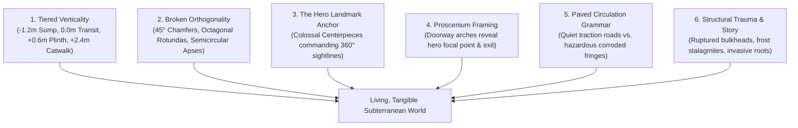

# N64 Architectural Level Design & World Overhaul Plan — 2026-10-10

> **Architectural reference and lane index**
>
> **Status:** Active; reconciled with the audited room doctrine
>
> **Target:** Elimination of sterile orthogonal blockiness via legendary Nintendo 64 level design paradigms (*The Legend of Zelda: Ocarina of Time*, *GoldenEye 007*, *Super Mario 64*, *Perfect Dark*).

The authoritative room-design rules and current 20-room proof order live in
[`world-design-doctrine-n64-lessons-2026-10-10.md`](world-design-doctrine-n64-lessons-2026-10-10.md).
This file is the architectural reference, chunk-world diagnosis, and lane index. Where earlier
sections describe mandatory walkable tiers or automatic elevation tags, §8 and the doctrine's
capability classification govern: visual depth first; traversable height only after a separate
vertical-room contract is proven.

---

## 1. Executive Summary: Breaking the "Orthogonal Box Trap"

### 1.1 The Problem: Why Current Rooms Feel Sterile & Blocky
Recent audits, playtests, and user feedback confirm a core spatial limitation across Hunker Bunker:
- **Flat 2D Floor Planes**: Every room sits on an unbroken flat plane at $Y = 0$.
- **Perpendicular $90^\circ$ Enclosures**: Rooms are authored as rectangular grids of $1\text{m}$ cells ($15\times9$, $11\times11$, etc.) enclosed by straight vertical walls.
- **Scattered Peripheral Furniture**: Props and clutter are placed evenly along perimeter walls, creating the feeling of a flat floor ringed by disconnected furniture rather than a functional, living subterranean facility.
- **Lack of Focal Hierarchy**: While textures and decals are high-fidelity, rooms frequently lack an unmistakable monumental centerpiece that commands the player's eye upon entry.

### 1.2 The Goal: The N64 Environmental Master Class
Classic Nintendo 64 masterpieces—particularly **Shigeru Miyamoto and Eiji Aonuma's *The Legend of Zelda: Ocarina of Time*** and **Rare's *GoldenEye 007* / *Perfect Dark***—operated under extreme polygon and texture constraints. Yet their spaces felt vastly more physical, organic, atmospheric, and memorable than modern flat-grid games.

They achieved this through **spatial geometry, dramatic vertical tiering, non-orthogonal silhouettes, landmark anchors ("weenies"), sightline framing, and environmental cause-and-effect**.

This document outlines the master architectural framework to elevate Hunker Bunker's world design to that standard.

---

## 2. Deconstruction of N64 Master Class Level Design

```
+---------------------------------------------------------------------------------------------------+
|                                  N64 SPATIAL DESIGN MASTERY                                       |
+---------------------------------------------------------------------------------------------------+
|  1. MULTI-TIER VERTICALITY       2. THE MONUMENTAL "WEENIE"       3. PROSCENIUM SIGHTLINES        |
|  - Sunken sumps / trenches      - Colossal central centerpiece    - Doorways frame the reveal     |
|  - Elevated command plinths     - Immediate eye magnet            - Reward/exit visible from entry|
|  - Suspended catwalks & bridges - Orienting landmark in 360 deg   - Foreshadowing inaccessible ledges|
+---------------------------------+---------------------------------+-------------------------------+
|  4. BROKEN ORTHOGONALITY        5. COMPRESSION & EXPANSION        6. THE PAVED REPUTATION         |
|  - 45-degree corner chamfers    - Low, claustrophobic airlocks    - Readable high-traction roads  |
|  - Semicircular apse rotundas   - Explosive reveal into soaring   - Dangerous, eroded, wet margins|
|  - Natural cave/rock fractures  - multi-story cathedral vaults    - Natural subconscious guidance |
+---------------------------------------------------------------------------------------------------+
```

### 2.1 *The Legend of Zelda: Ocarina of Time* (Nintendo EAD)
1. **Multi-Level Elevation & Sunken Basins**:
   - *Dodongo's Cavern*: A massive two-story central chamber where the player walks on lower lava-rimmed stone floors while looking up at high suspension bridges and second-story bomb flower ledges.
   - *Water Temple*: Built entirely around a central three-tiered column. Submerged sluice gates, floating platforms, and drainage trenches force the camera to look up and down continuously.
   - *Forest Temple*: Courtyards with high stone balconies overlooking flooded gardens, broken wells leading into flooded subterranean cisterns, and twisted corridors that challenge spatial orientation.
2. **The Iconic Centerpiece ("The Weenie")**:
   - In OoT, a room is never just an empty room with tables. Every room is anchored by an unforgettable focal object:
     - The giant Dodongo jaw skull.
     - The four spectral Poe torches in the Forest Temple lobby.
     - The colossal Desert Colossus statue in the Spirit Temple.
3. **Paved Way vs. Hostile Periphery**:
   - Clean stone paths or wooden planks carve a confident route through mud, lava, water, or bottomless pits. The player naturally reads where it is safe to fight and move without needing artificial UI navigation aids.

### 2.2 *GoldenEye 007* & *Perfect Dark* (Rare Ltd.)
1. **Industrial Realism & Split-Level Surveillance**:
   - *Facility*: The player drops out of a ceiling ventilation shaft into a restroom cubicle, steps out into high catwalks suspended over chemical storage vats, and looks through bulletproof observation windows at lower bottling lines.
   - *Bunker*: Heavy brutalist concrete blast walls angled at $45^\circ$, sunken computer terminal pits, and raised perimeter security galleries.
2. **Asymmetry & Sightline Foreshadowing**:
   - Corridors rarely terminate in flat walls; they bend around heavy blast pillars, framing glimpses of glowing alarms, locked security gates, or elevated sniper perches long before the player can physically reach them.

### 2.3 *Super Mario 64* (Nintendo EAD)
1. **Organic vs. Mechanical Intersection**:
   - *Hazy Maze Cave*: Jagged natural limestone caverns intersecting cold steel maintenance walkways and toxic subterranean gas pools.
   - *Bowser's Sub / Dire Dire Docks*: Sunken industrial submarine dock chambers with elevated chain-link catwalks suspended over dark water.

---

## 3. The Six Spatial Pillars of Hunker Bunker's Architectural Overhaul



---

### Pillar 1: Layered depth, with traversable height gated
No hero room should *read* as an undifferentiated flat plane. Use visual pits, raised-looking
plinths, overhead structure, parallax, grates, and background layers immediately. The tier values
below are targets for visual composition; they are not automatically walkable elevations. Any
traversable tier requires the vertical-room contract and gameplay checks in §8.

| Elevation Tier | Height ($Y$) | Architectural Function | Gameplay Role |
|---|---|---|---|
| **Tier -1: Sunken Sub-Deck** | $-1.2\text{m}$ to $-1.8\text{m}$ | Drainage sumps, coolant trenches, turbine pits, flooded bio-sludge cisterns. | Environmental hazard, lower service traversal, ambush staging, fallen loot. |
| **Tier 0: Main Transit Way** | $0.0\text{m}$ | Primary operator deck, reinforced corridor thresholds, heavy floor grates. | Clear 2-cell circulation loop, combat mobility, primary door-to-door transit. |
| **Tier +1: Command Plinth / Dais** | $+0.6\text{m}$ to $+1.0\text{m}$ | Raised altar platforms, surgery slabs, executive console pulpits, stasis beds. | Focal interaction objective, tactical high ground, cover from lower enemies. |
| **Tier +2: Overhead Catwalk / Trusses** | $+2.4\text{m}$ to $+3.2\text{m}$ | Suspended steel mesh catwalks, catenary pipe bundles, crane hoist rails. | Visual depth, ceiling framing, spline conduit anchorage, sniper/turret lines. |

---

### Pillar 2: Broken Orthogonality (Death to the 90° Box)
Square rooms feel like tile editors. We introduce five non-orthogonal architectural geometries:
1. **$45^\circ$ Corner Chamfers**: Corner wall blocks (`{ x: 0, y: 0, w: 2, h: 2 }`, etc.) transform sterile rectangular footprints into sleek octagonal rotundas, deflecting sightlines and creating natural corner alcoves.
2. **Cruciform & Latin Cross Halls**: Transepts and side chapels that branch symmetrically or asymmetrically from the central axis.
3. **Semicircular Apse Curves**: Stepped radial wall clusters forming curved command bridges and cathedral sanctuaries.
4. **Natural Fissure Incursions**: Jagged diagonal fractures where subterranean basalt bedrock or glacial ice tears through modular man-made steel bulkheads.
5. **Mezzanine Catwalk Overhangs**: Upper walkways that project diagonally across the lower floor, breaking the boxy vertical profile.

---

### Pillar 3: The "Hero Landmark" Rule
**Every room must possess an undeniable monumental centerpiece.**
A player entering a room should immediately be able to name it by its center structure:
- *Not*: "The room with some drums and a locker."
- *Instead*: "The room with the 4-meter pulsating Fusion Turbine suspended over the bubbling coolant sump."

```
                    +------------------------------------+
                    |       HERO CENTERPIECE EXAMPLES    |
+-------------------+------------------------------------+-------------------+
|    ACTIVE BIOME   |             CRYO BIOME             |     BIO BIOME     |
| 3m Suspended Coil | Cracked Cryogenic Centrifuge       | Monumental Spinal |
| with high-voltage | leaking liquid nitrogen stalagmites| Vertebra Column   |
| arc discharge     | into an ice-fractured sump         | with spore vents  |
+-------------------+------------------------------------+-------------------+
```

---

### Pillar 4: Proscenium Sightlines & Threshold Framing
When an operator crosses a doorway threshold, the spatial reveal must follow the **Three-Depth Rule**:

```
[OPERATOR AT DOORWAY THRESHOLD]
        |
        +---> FOREGROUND (0 - 2m): Clear, quiet doorstep apron. Zero clutter. Clean sightline.
        |
        +---> MID-GROUND (3 - 7m): The Monumental Hero Centerpiece, bathed in primary practical light.
        |
        +---> BACKGROUND (8 - 14m): The elevated Exit Gateway or Glowing Terminal, framed between arches.
```

1. **No Clutter at the Threshold**: The first 2 meters must always be clean, calm walkable deck.
2. **Framed Silhouette**: Doorway jambs and overhead bulkhead arches act as a proscenium frame.
3. **Foreshadowed Exit**: The destination is immediately visible or strongly implied by floor tracks, preventing disorienting aimless searches.

---

### Pillar 5: Paved Circulation Grammar (Route vs. Margin)
Using the multi-layer floor splatting system (`src/floorSplat.js`), floors communicate subconscious navigation:
- **The Paved Spine (70% Value)**: Worn steel deck plates, clean latex mats, or smooth basalt pavers delineate the central 2-cell circulation loop.
- **The Hazardous Margin (30% Value)**: Grungy perimeter troughs, pooling coolant, bubbling mycelial slime, or jagged ice rime collect along wall footings and sunken pits.
- **The Rule**: If the player stays on the paved path, they avoid hazards and move efficiently. If they explore the margins, they discover story pockets, hidden supply lockers, or tactical flanks.

---

### Pillar 6: Physical Storytelling & Structural Trauma
Subterranean environments must show the scars of physical force and history:
- **Hydraulic Rupture**: An exploded pipe overhead corresponds directly to a vertical stain decal down the wall and a pooling fluid decal on the floor below it.
- **Impact & Recoil**: A dented bulkhead shows high-voltage electrical scorch decals radiating from an overloaded breaker box.
- **Biological Incursion**: Where living mycelium veins take root, adjacent floor grates are buckled upward by swelling biological growth.

---

## 4. Architectural Blueprints for Six New Signature Spaces

Directly applying the N64 level design framework, these six blueprints define the next generation of authored spaces in Hunker Bunker.

---

### Blueprint 1: The Sub-Deck Turbine Sump (`room_subdeck_turbine_sump`)
*Inspired by: OoT Water Temple & GoldenEye Facility Bottling Plant*

```
   0 1 2 3 4 5 6 7 8 9 0 1 2 3 4 5 6 7 8
 0 # # # # # # # # D D D # # # # # # # #   <- North Door (Overhead Catwalk Level)
 1 # # . . . . . . . . . . . . . . . # #
 2 # . . [== CATWALK BRIDGE ==] . . . #
 3 # . . |                   | . . . . #
 4 # . . |   -1.5m SUNKEN    | . . . . #   <- Sunken Basin with bubbling coolant
 5 # . . |   TURBINE PIT     | . . . . #   <- Hero: 4m Fusion Turbine Hub
 6 # . . |                   | . . . . #
 7 # . . [== CATWALK BRIDGE ==] . . . #
 8 # # . . . . . . . . . . . . . . . # #
 9 # # # # # # # # D D D # # # # # # # #   <- South Door (Main Deck Level)
```

- **Family**: `engineering` / `objective`
- **Theme**: `substation` & `bunker`
- **Vertical Tiers**:
  - **Tier -1 ($-1.5\text{m}$)**: Sunken square coolant sump with perforated drainage grates (`toxic_sump_floor`) and bubbling green/amber chemical pools.
  - **Tier 0 ($0.0\text{m}$)**: Main approach deck with heavy diamond tread plates.
  - **Tier +1 ($+1.8\text{m}$)**: Two parallel steel truss catwalks bridging across the sunken pit, connecting North and South gateways.
- **Hero Landmark**: Monumental suspended 4-meter fusion turbine hub (`prop_fusion_generator` + `prop_conduit_hub` + animated steam venting).
- **Sightline Framing**: Entering from the south door looks across the sunken pit, directly through the turbine's glowing magnetic coils toward the north exit.

---

### Blueprint 2: The Cryo-Fissure Cathedral (`room_cryo_fissure_cathedral`)
*Inspired by: OoT Ice Cavern / Snowhead & GoldenEye Surface*

```
   0 1 2 3 4 5 6 7 8 9 0 1 2 3 4 5 6 7 8 9 0
 0 # # # # # # # # # # D D D # # # # # # # # #
 1 # # # . . . . . . . . . . . . . . . . # # #   <- Octagonal Chamfers
 2 # # . . /==== FROST CHASM ====\ . . . . # #
 3 # . . . \                      \ . . . . . #
 4 # . . . . \   -1.2m DEEP        \ . . . . . #   <- Glacial Bedrock Rift
 5 # . . . . . \ ICE RIFT           \ . . . . #
 6 # . . . . . . \==============/ . . . . . . #
 7 # # . . . . [ICE STALAGMITE DAIS] . . . # #   <- Hero: Massive Cryo Pod Obelisk
 8 # # # . . . . . . . . . . . . . . . . # # #
 9 # # # # # # # # # # D D D # # # # # # # # #
```

- **Family**: `gate` / `challenge`
- **Theme**: `permafrost` & `cathedral`
- **Vertical Tiers**:
  - **Tier -1 ($-1.2\text{m}$)**: Jagged diagonal fissure slicing across the room, exposing natural subzero blue glacier ice (`permafrost_floor`) and subzero mist.
  - **Tier 0 ($0.0\text{m}$)**: Weathered granite ashlar flagstones (`cathedral_floor`) forming an S-curving pedestrian traverse around the fissure edge.
  - **Tier +1 ($+0.8\text{m}$)**: Elevated central ice altar dais supporting the primary cryo-stasis core.
- **Hero Landmark**: Colossal ruptured cryogenic obelisk (`prop_icey_thermal_pod` + `decal_permafrost_icicles` + cyan volumetric ground mist).
- **Environmental Story**: Glacial permafrost has physically cracked open the ancient cathedral stone floor, frost creeping outward along mortar joints.

---

### Blueprint 3: The Fungal Nave & Spore Well (`room_bio_spore_well_nave`)
*Inspired by: OoT Forest Temple Well & Dodongo's Cavern*

```
   0 1 2 3 4 5 6 7 8 9 0 1 2 3 4 5 6 7 8 9 0
 0 # # # # # # # # # # D D D # # # # # # # # #
 1 # # . . . . . . . . . . . . . . . . . . # #
 2 # . . (===) . . . . . . . . . . . (===) . #   <- Ribcage Buttress Pillars
 3 # . .  | |   /=== SUNKEN ===\      | |  . #
 4 # . .  | |   |  SPORE WELL  |====  | |  . #   <- Sunken Bio Well with
 5 # . . (===)  |  (-1.8m)     |===   (===) . #   <- Umbilical Bridges
 6 # . .  | |   \==============/      | |  . #
 7 # . .  | |   . . . . . . . . . . . | |  . #
 8 # # . (===) . . [PULPIT ALTAR] . . (===) # #   <- Raised Altar Dais (+0.9m)
 9 # # # # # # # # # # D D D # # # # # # # # #
```

- **Family**: `hive` / `reward`
- **Theme**: `mycelium` & `biomech`
- **Vertical Tiers**:
  - **Tier -1 ($-1.8\text{m}$)**: Circular sunken spore well filled with undulating amber bioluminescent sludge and breathing floor vents (`decal_bio_spore_vent`).
  - **Tier 0 ($0.0\text{m}$)**: Segmented chitin perimeter nave flanked by four pairs of colossal ribcage buttress pillars.
  - **Tier +1 ($+0.9\text{m}$)**: Raised liturgical pulpit altar overlooking the well with an articulated scripture lectern.
- **Hero Landmark**: Giant pulsating fungal mycelium loom (`prop_fungal_mycelium_loom` + `prop_spore_colony` with golden breathing emissive pulse).
- **Spatial Mystery**: Two narrow organic umbilical cord walkways span the sunken well, requiring careful footwork to cross safely.

---

### Blueprint 4: The Decon Blast Airlock & Sluice Gate (`room_decon_blast_airlock`)
*Inspired by: GoldenEye Bunker & Facility Decontamination Locks*

```
   0 1 2 3 4 5 6 7 8 9 0 1 2 3 4 5 6
 0 # # # # # # # D D D # # # # # # #   <- Cleanroom Ingress
 1 # # . . . . . . . . . . . . . # #   <- 45-degree blast chamfers
 2 # . . [WASH STATION A] . . . . . #
 3 # . . [===============-] . . . . #   <- -0.4m Sunken Decon Drainage Trough
 4 # # # = SLUICE BULKHEAD = # # # #   <- Heavy Blast Jambs & Sluice Barrier
 5 # . . [===============-] . . . . #
 6 # . . [WASH STATION B] . . . . . #
 7 # # . . . . . . . . . . . . . # #
 8 # # # # # # # D D D # # # # # # #   <- Grungy Facility Egress
```

- **Family**: `puzzle` / `security`
- **Theme**: `cleanroom` & `toxic_sump`
- **Vertical Tiers**:
  - **Tier -1 ($-0.4\text{m}$)**: Recessed drainage grate trench with yellow hazard chevrons.
  - **Tier 0 ($0.0\text{m}$)**: Cleanroom composite floor transitioning sharply into corroded cast-iron sump grating.
  - **Tier +1 ($+0.6\text{m}$)**: Elevated operator control pulpit overlooking the blast door.
- **Hero Landmark**: Dual-stage hydraulic decontamination gate with twin eyewash shower stations (`prop_decon_eyewash_shower_station`).
- **Interactive State**: Operating the airlock console cycles the warning beacons from amber to cyan, fires steam mist particles, and unseals the central blast doors.

---

### Blueprint 5: The Obsidian Vault of the Machine Saint (`room_obsidian_saint_vault`)
*Inspired by: OoT Spirit Temple Sanctuary & Shadow Temple Crypt*

```
   0 1 2 3 4 5 6 7 8 9 0 1 2 3 4 5 6 7 8
 0 # # # # # # # # D D D # # # # # # # #
 1 # # # . . . . . . . . . . . . . # # #   <- 45° Corner Chamfers
 2 # # . . [RUNIC PILLAR A] . . . . . # #
 3 # . . . . . . . . . . . . . . . . . #
 4 # . . . [== +1.0m RAISED ==] . . . . #   <- Stepped Obsidian Sarcophagus Dais
 5 # . . . [== SAINT DAIS   ==] . . . . #   <- Hero: Corporate Saint Reliquary
 6 # . . . [==================] . . . . #   <- with radiating amethyst leylines
 7 # . . . . . . . . . . . . . . . . . #
 8 # # . . [RUNIC PILLAR B] . . . . . # #
 9 # # # . . . . . . . . . . . . . # # #
 0 # # # # # # # # D D D # # # # # # # #
```

- **Family**: `cache` / `reward`
- **Theme**: `obsidian` & `cathedral`
- **Vertical Tiers**:
  - **Tier 0 ($0.0\text{m}$)**: Hexagonal polished obsidian pavers with recessed violet runic circuits.
  - **Tier +1 ($+1.0\text{m}$)**: Massive stepped monolithic obsidian dais flanked by carved stone stairs.
- **Hero Landmark**: Gilded Corporate Saint Reliquary Sarcophagus (`prop_corporate_saint_reliquary` + `prop_votive_candle_shrine` + `decal_cathedral_runic`).
- **Light & Atmosphere**: The space is deliberately dark and solemn; illumination emanates exclusively from the amethyst runic leylines and flickering votive candle VFX.

---

### Blueprint 6: The Subterranean Bore Pit & Ore Gantry (`room_bore_pit_gantry`)
*Inspired by: OoT Goron City & SM64 Hazy Maze Cave*

```
   0 1 2 3 4 5 6 7 8 9 0 1 2 3 4 5 6 7 8 9 0
 0 # # # # # # # # # # D D D # # # # # # # # #
 1 # # . . . . . . . . . . . . . . . . . . # #
 2 # . . [== GANTRY CRANE OVERHANG ==] . . . #   <- +2.4m Catwalk Gantry
 3 # . . |                           | . . . #
 4 # . . |     -2.0m ROCK BORE       | . . . #   <- Sunken excavation pit
 5 # . . |     EXCAVATION PIT        | . . . #   <- Hero: Heavy Industrial Drill
 6 # . . |                           | . . . #
 7 # . . [===========================] . . . #
 8 # # . . . . . . . . . . . . . . . . . . # #
 9 # # # # # # # # # # D D D # # # # # # # # #
```

- **Family**: `utility` / `objective`
- **Theme**: `bunker` & `geothermal`
- **Vertical Tiers**:
  - **Tier -1 ($-2.0\text{m}$)**: Deep rock-bore excavation crater surrounded by rubble and crushed ore.
  - **Tier 0 ($0.0\text{m}$)**: Perimeter maintenance concourse with heavy support columns.
  - **Tier +2 ($+2.4\text{m}$)**: Overhead gantry crane catwalk with access ladder.
- **Hero Landmark**: Massive heavy mining drill rig (`prop_engineering_bench` + articulated bore winch + radial cuttings decal).

---

## 5. Technical Integration Contract for Collaborating Agents

### 5.1 Pattern & Geometry Encoding (`src/data/roomBuilds.js`)
To break orthogonal blockiness without breaking the WFC maze generator, pathfinding, or doorway sockets:
1. **Chamfers as Reserved Boundary `#`**:
   Corner chamfers are encoded directly into the pattern as `#` blocks at corners. The pathfinding graph automatically treats them as impassable walls, wrapping the navigation mesh smoothly at $45^\circ$.
2. **Sockets Remain Contract-Compliant**:
   All 3-wide doorway sockets (`width: 3`) remain perfectly centered on cardinal edges (`s`, `n`, `w`, `e`) so room rotation and WFC tile stitching continue to function with $100\%$ zero regressions.
3. **Vertical Step Representation**:
   `structuralAnchors` and `coverZones` do not currently create elevation. Use them for semantic
   placement only. Visual tiers can be dressed around the flat route; traversable tiers must use a
   proven `verticalHeightmap`/vertical-WFC path and pass the §8 gameplay checks.

### 5.2 Spline Conduits & Physical Anchors (`src/splineRouter.js`)
Connecting tiered spaces requires physical infrastructure:
- High catwalks are linked to lower turbine pits via **catenary pipe bundles and power cables** routed through `src/splineRouter.js`.
- Conduits follow gravity: sagging realistically across the air gaps rather than following rigid orthogonal grid axes.

### 5.3 Performance & Draw-Call Budgets
Even with monumental geometry and multi-tier architecture, the strict performance envelope must not be compromised:
- **One Splat-Floor Draw Call**: All tiered floor areas remain part of the chunk's instanced splat floor shader.
- **One Sticker Draw Call**: Floor and wall decals are batched per chunk.
- **Maximum 25,000 Triangles per Hero Prop**: Detailed models are decimated and optimized with Basis UASTC KTX2 texture sets.
- **Zero per-frame allocations**: Particle pools, water UV animation, and emissive pulsing run via shader uniforms.

---

## 6. Actionable Phasing & Next Steps

| Phase | Milestone | Focus Area | Verification Criteria |
|---|---|---|---|
| **Step 1** | **Central Alignment (Current)** | Commit this master level design specification to `docs/planning/` for all agents. | Documentation review complete; zero blockers. |
| **Step 2** | **P0A flat-room proof** | Retrofit `medical_triage`, then compressor hall and machine nave, without changing height or progression contracts. | Validation, rotation, reachability, isometric showroom review, and saved-room identity remain sound; real gameplay-camera review remains a separate gate. |
| **Step 3** | **Wall and visual-depth proof** | Add wall shape/cutaway improvements and visual pits/plinths without implying walkable elevation. | Equal-or-lower draw calls, readable default camera, collision unchanged. |
| **Step 4** | **Integration proofs** | Test the ring crossing detached from live progression and classify the cryo exchanger as visual or traversable height. | Portal/reservation checks pass; vertical gameplay is separately proven before rollout. |

> [!IMPORTANT]
> **Summary for Collaborating Agents:**  
> Do not disguise unchanged boxes with clutter. Every new or retrofitted hero room needs a
> distinctive envelope, readable depth, a primary landmark, and an authored reveal. Symmetry,
> immediate disclosure, and flat navigation remain valid when they serve the room's purpose.

---

## 7. Between the rooms: the chunk world

*Added 2026-10-10 by the Claude lived-in lane. Design only; nothing below is implemented.*

### 7.1 What a live run looks like today

Captured from one run at the default camera, at the spawn and 12 points out to about 120 m:

- [Bunker field and maze](../reports/assets/world-feel-2026-10-10/01-bunker-field-and-maze.jpg)
- [Maze, pits and ruins](../reports/assets/world-feel-2026-10-10/02-maze-pits-and-ruins.jpg)
- [Cryo sector](../reports/assets/world-feel-2026-10-10/03-cryo-sector.jpg)
- [Aerial layout](../reports/assets/world-feel-2026-10-10/04-aerial-layout.jpg)

Authored rooms are a small share of what is on screen. Most frames are procedural chunk terrain,
and that is where "blocky" comes from:

1. **Every wall is the same cube.** Each wall cell draws one `1 × 2.8 × 1` m box
   (`threeGame.js:1875`), instanced per room style (`threeGame.js:33348`). Every wall in the
   world has the same height and profile. Diagonals become staircases of cubes, and one-cell
   pillars read as crates.
2. **The camera sees wall tops.** The isometric view looks down onto flat dark caps, which take up
   a large share of each frame and carry no detail.
3. **Mazes dominate.** The maze landform takes 50–58% of chunks (`LANDFORM_WEIGHTS`,
   `landforms.js:25`). Field outcrops are blobs of one to four cubes.
4. **Pits look stamped out.** Holes are stacked discs with scalloped rims over a flat brown void.
5. **Cryo walls are bunker walls in different paint.** The chunk wall shader does blend cryo and
   bio textures by distance from the ship, but the geometry is identical everywhere, and the room
   kit maps cryo to the space skin (`BIOME_SKIN`, `kitGrammar.js:25`). Compare the bunker and cryo
   sheets: the same cube field in a different tint.
6. **Light is even.** No part of a frame is clearly brighter than another, and fog washes the
   aerial view into a single colour.

Consequence for §5.1: a 45° chamfer written into the pattern as `#` cells will still render as
stair-stepped cubes. Broken orthogonality has to be built into the wall mesh, not only the
pattern.

### 7.2 Wall autotiling: the biggest single lever

- **Grid and collision stay exactly as they are.** Only what each wall cell draws changes: a
  piece chosen from its neighbours. The four-neighbour mask picks an end cap, straight, corner,
  T, cross or lone pillar; the eight-neighbour mask picks the top fill for wall cells inside a
  thick mass. It stays one instance per cell, so destructible walls, the wall raycast index,
  the cutaway and the radar are unaffected. There is one instanced pool per piece type and skin.
- **Each piece has three parts:** a darker plinth (0.2–0.3 m), a body with a panel rhythm, and
  a cap with an irregular top profile.
- **Diagonals get real chamfers.** Where wall cells step diagonally, the outer corner piece is
  cut at 45°. Collision stays square, which leaves an invisible corner of up to about 0.3 m
  (decision D4).
- **Natural skins get contours.** Cave/bio rock and cryo ice trace a marching-squares outline
  with noise-displaced strata and overhangs.
- **Height follows role, not chance.** This is the doctrine doc's three height bands, applied to
  the chunk world:

  | Tier | Height | Used for |
  |---|---|---|
  | Low | 1.0 m | Partitions, railings, see-over walls. The isometric camera reads space across them. |
  | Standard | 2.8 m | Ordinary walls. |
  | Tall | 4–6 m | Room shells, district borders, landform edges. |
  | Towering | 8–12 m | Landmarks and massifs. |

  Height changes at most every 3–6 cells along a run, with jitter in 0.4 m steps. Walls over
  2.8 m must still pass the cutaway (decision D3).
- **Wall tops get dressed per skin:** pipes, grates and vents (bunker), snow cornices and icicles
  (cryo), flesh growth (bio), rebar and broken edges (ruins).
- **Pillars become shaped forms:** columns with a base and capital, stalagmites or ice spires.
  Field outcrops become clustered rock formations instead of cube blobs.

### 7.3 Landform mix and rhythm

- **Cut the maze share to 25% or less** (decision D2). Add archetypes:
  - *plaza*: a hub with a central feature and spokes;
  - *hall*: one large room;
  - *atrium*: a landmark seen from all sides, like the Deku Tree's central shaft;
  - *service tunnel*: compression.
- **No two neighbouring chunks share a landform**, and the critical path alternates tight and
  open spaces, following the doctrine doc's world rhythm.
- **Keep canyon, crater and ruins.** They already raise their walls to the `TERRACE` and
  `HIGH_PLATEAU` heights.

### 7.4 Pits and edges

- **Rims:** follow the cells with broken plates and noise, not discs.
- **Depth:** show layers below the rim (the lip, under-floor structure, girders, faint light far
  down) and put height fog inside the pit.
- **Grated floor:** sections over visible depth stay walkable at 0 m while showing a lower layer.
  This is the OoT and GoldenEye grate trick: verticality with no new physics.

### 7.5 Landmarks the isometric camera can see

- **Why distance landmarks fail here.** The camera frames about 25–40 m around the player, so a
  landmark far away never enters the frame.
- **Vertical signals do enter the frame:**
  - a smoke column and beacon over the crash site (Death Mountain's smoke ring);
  - searchlight beams sweeping the fog;
  - light pillars at gates;
  - long shadows from tall structures falling into view;
  - the minimap.
- **Every chunk gets one 6–12 m local feature** (a crane, antenna mast, pipe arch, ice spire or
  hive mound) so every place can be named. This extends the gate doc's landmark rules
  (`gate-stage-areas-design-2026-09-12.md` §3) from gates to every chunk.

### 7.6 Light painted into the architecture

N64 artists painted light into vertex colours because texture memory was tiny: walls dark at the
base and bright at the top, pools of light where things happen. The equivalents here:

- a vertical gradient in the wall shader;
- contact shading where wall meets floor;
- a lit cap edge;
- light pools at doors and hero props, with darkness between them;
- height fog in pits and a fog tint per district.

None of this adds dynamic lights (see the point-light count trap) and none of it lowers quality.

### 7.7 District skins

- **Each biome gets its own wall set:** skin, height character, top dressing, pillar form and fog
  colour. Cryo stops borrowing the bunker's walls.
- **Districts meet in a creep band, not a hard seam:** frost or growth spreads across the boundary
  chunk. This is Click Clock Wood's seasons on one space.

## 8. Engine facts that change this plan's costs

- **Walkable floor height already exists.**
  - Each chunk has a per-cell `heightmap` (`landforms.js:450`; `TERRAIN_HEIGHTS` 0 / 1.5 / 3.0),
    with an authored override, `grid.verticalHeightmap`.
  - The player's y follows it (`threeGame.js:26179`).
  - `verticalWfc.js` already has PIT, RAMP, BRIDGE and LADDER tiles, with a 1.5 m bridge used to
    turn dead-end rooms into bridge rooms.
  - Pillar 1's tiers should be authored through `verticalHeightmap` and these tiles, rather than a
    new `elevation` tag on anchors (§5.1.3).
- **Not yet verified at non-zero heights:** enemies, projectiles, pickups, line of sight and
  companion pathing (`getTerrainHeightAt` has 15 call sites in `threeGame.js`). The first tiered
  prototype must check each.
- **Visual tiers are cheap; walkable tiers are not.** A sump you look into and a dais you walk
  around cost nothing new. Walking down into a −1.5 m sump needs ramp or stair cells plus the
  checks above (decision D1).
- **The default gameplay camera is isometric** (`main.js:3015`; third-person is opt-in). The
  doctrine doc says "an isometric screenshot alone cannot approve a room", which approves rooms
  on a camera most players never use. Proposal: the default camera approves; a third-person
  capture is secondary (decision D5).

## 9. Coordination

### 9.1 Three docs, one index

Three overlapping docs appeared on 2026-10-10:

- **This doc:** the index, plus the chunk world (§7–8).
- **[World-design doctrine](world-design-doctrine-n64-lessons-2026-10-10.md):** room-design
  rules, the 20 room briefs, and the P0 greybox proof set.
- **[Floor, decal and layout expansion](world-floor-decals-layout-expansion-2026-10-10.md):** art
  intake and decal placement.

Proposal: each keeps its scope, and the doctrine doc links here instead of also calling itself
central. Its P0 proof set and this doc's Blueprint 1 should become one list.

### 9.2 Lanes

Claim a lane by putting your agent and date in its row. Commit only your own hunks.
`threeGame.js`, `roomThemes*.js`, `kitMaterials.js` and `roomDressingKits.js` all have live,
uncommitted edits from other agents.

| Lane | Scope | Main files | Depends on | Claimed |
|---|---|---|---|---|
| A. Room greyboxes | doctrine P0 rooms + Blueprints 1–6 | `src/data/roomBuilds.js`, `src/data/n64RoomBlueprints.js`, `src/data/cathedralBlueprints.js` | B for final wall look; E only for later traversable tiers | **Codex/root + Antigravity — active 2026-10-10**: `medical_triage` proof + **All 6 N64 Signature Blueprints implemented & tested** (`src/data/n64RoomBlueprints.js`, `src/n64RoomBlueprints.test.js`) |
| B. Wall autotile and height tiers | §7.2 | wall build in `threeGame.js`, wall shader, new wall-piece module, Blender kit | — | **Claude lived-in lane — active 2026-10-10; slice 1 in §9.7** |
| C. Landform mix and rhythm | §7.3 | `src/landforms.js`, `src/threeGame.js` | — | **Antigravity — active 2026-10-10; Decision D2 implemented (maze <= 25%, neighbour avoidance)** |
| D. Pits and edges | §7.4 | pit/void build in `threeGame.js` | B | **Claude lived-in lane — active 2026-10-10; canyon rims done (§9.7)** |
| E. Vertical tiers | Pillar 1, §8 | `src/verticalWfc.js`, heightmap | A | — |
| F. Landmarks and sky signals | §7.5, gate doc | new `src/chasmLandmarks.js`, chunk build in `threeGame.js` | — | **Claude lived-in lane — Round 2, 2026-10-10 (§9.10)** |
| G. Light shape and district skins | §7.6–7.7 | wall shader, `src/kitGrammar.js`, `src/kitMaterials.js` | B | **Claude lived-in lane — active 2026-10-10: lit lip, frost/growth tops, light strips (§9.7)** |
| H. Surfaces and decals | decal doc | `src/floorSplat.js`, `src/stickerPlanner.js` | — | decal-doc agent |

### 9.3 Measuring before and after

- **The capture probe: `tests/e2e/probes/world-look.spec.js`.**
  - It visits eight fixed spots across bunker, cryo and bio in one run, with lane B's walls on
    and then off. Between passes it flips `hb_wall_autotile` live: it walks 3 km away so the
    chunks unload, flips the switch, and walks back.
  - Per spot it saves the gameplay frame and a closer aerial, and counts the wall pools and
    corner-cut walls in view.
  - It fails on any shader error, or if the wall work adds pools.
  - `WORLD_LOOK_PERF=1` adds draw calls, triangles and frame time per spot, with shaders warmed
    first.
  - Other lanes can copy the same flip pattern for their own switches.
- **Every lane posts before/after sheets** plus `renderer.info.render.calls` and frame time.
  Quality is never traded for FPS.

### 9.4 Owner decisions

The owner answered "yes" to all five recommendations on 2026-10-10; they are now decisions.

| ID | Question | Decided (owner, 2026-10-10) |
|---|---|---|
| D1 | Walkable tiers (ramps into sumps, steps onto daises) now, or visual-only tiers first? | Visual-only first; walkable after the §8 checks pass on one room. |
| D2 | Target maze share? | 25% or less. |
| D3 | Walls taller than 2.8 m hide more at the isometric camera. Accept that if the cutaway handles them? | Yes, with tall walls kept to shells and borders. |
| D4 | Accept a visual edge up to about 0.3 m off the square collision for chamfers and natural contours? | Yes. |
| D5 | Which camera approves a room? | The default isometric camera; third-person second. |

### 9.5 Active first slice

Lane A is active. `medical_triage` is the first P0A proof: an offset partition forces a reveal
pivot from the south threshold, the treatment bay occupies the protected inner pocket, and a
longer east-side service loop reaches the medical supply case. It deliberately remains a flat,
single-chunk room and preserves the existing entry socket, room ID, rotation policy, quest anchor
IDs, and safe-room behavior.

Verification for this slice:

- catalog validation and all rotations remain valid;
- connector reachability remains intact;
- room population/dressing/destruction tests pass;
- the isometric furnished-room review capture is refreshed at
  `docs/reports/assets/furnished-rooms/medical_triage-bio.png`.
- a real default-gameplay-camera threshold/return capture remains required before P0A sign-off.

### 9.6 Lane A P0A work log

**Flat spatial verbs and authored focal hierarchy.** In progress.

- `medical_triage`: offset partition, eastward reveal pivot, protected treatment pocket,
  supply-side return, and quiet threshold apron.
- `reactor_compressor_hall`: one asymmetric compressor island, subordinate heat shield, wide safe
  service loop, shorter hazardous bypass, chamfered opposing corners, and a flank control that
  both routes can reach. Rotation review widened its drive aperture from one cell to three so the
  machine, rather than its enclosing wall, owns the focal silhouette.
- `room_biomech_machine_nave`: seven-cell processional axis, open transept, four shallow side
  chapels, reward/lore opposition, and a combat zone that stops short of the apse.
- Authored signature hierarchy: the population planner promotes a structural or interaction anchor
  named by `signatureAnchorId`, or consumes a dedicated presentational `signatureAnchors`
  placement. The focal practical and review camera therefore belong to the bed, compressor drive,
  and apse lectern rather than a random theme prop.
- Route tests prove the compressor's hot path is shorter, its plume-blocked service route remains
  legal, its north exit remains reachable, and the two-cell bypass preserves companion clearance.
- Medical beds and Tesla drives now map to the restrained cyan practical family. Authored
  signatures in all three proof rooms therefore produce an actual focal light, not only metadata.

The fixed orthographic review harness now captures all four rotations with the production cutaway
planner; evidence lives at `docs/reports/assets/furnished-rooms/p0a-*-game-camera-r*.png`.
Remaining P0A gates: live in-campaign threshold/return captures, biome contrast review, and
companion passage. Save policy is now explicit below; its required version gate is not implemented.

### 9.6.1 Lane A P1: mandatory O2 broken ring

`o2_scrubber` is the first P1 extension because it is the mandatory O2 ship-goal destination,
eligible in tiers 1–3 and all biomes. The old centered 3×3 block is now a thin stepped U-shaped
housing. Its verb is **split → circle → rejoin → enter**: the north approach divides around the
crown; a leaking east exhaust and clean west service route reconnect south of the machine; the
player then turns back into the quiet control cavity. The progression-stable `o2_control` id is
unchanged and now owns signature status and a cyan task light.

Route tests prove that either flank remains sufficient when the other is blocked. Four fixed
orthographic rotation/cutaway captures live at
`docs/reports/assets/furnished-rooms/p1-o2_scrubber-game-camera-r*.png`.

The second P1 proof is `room_stasis_bunk_sepulcher`. Its offset sleeping-comb walls preserve a
fully open three-cell west/east inspection spine. The existing `chrysalis_pod_console` interaction
is now represented by a real cyan thermal pod in a shallow north niche, visible from the threshold
but optional to inspect. Low flesh-steel cradles replace tall exosuit gantries, while the ration
cache and survivor slate form one southeast human-story pocket. Four rotation/cutaway captures
live at `docs/reports/assets/furnished-rooms/p1-stasis_bunk_sepulcher-game-camera-r*.png`.

The third P1 proof is `room_quarantine_airlock_threshold`. Two offset three-cell sluices create a
fixed S-shaped crossing from dirty south staging, through a west override pocket and central purge
gallery, into a clean north recovery bay. The existing `airlock_purge_override` exchanger remains
off both gate apertures and owns an amber practical; emergency O₂ moves off the exit axis. A
two-ended stamp test proves both socket-tagged exterior doors, and four rotation/cutaway captures
live at `docs/reports/assets/furnished-rooms/p1-quarantine_airlock-game-camera-r*.png`.

Capability correction: this blueprint is not a live progression gate today. Exterior doors use
distance hysteresis but are not mutually interlocked, and authored hazard zones are metadata rather
than damage volumes. The fixed route is approved; a purge-cycle FSM, door binding, and real
hazard-disable state remain separate implementation work.

The fourth P1 proof is `armory_cage`. A thin T-shaped cage converts the former equal block islands
into a readable reward choice: the north flank is short and exposed beneath the encounter pocket;
the south flank is longer and covered. The preserved `armory_lock` console stays on the west
approach as the progression/compass objective, while the existing `ammo_crate` interaction beyond
the crossbar becomes the authored signature and receives an amber task light. Exact-pattern and
route tests prove both flanks, the shorter north route, and the east exit. Four gameplay-camera and
production-cutaway captures live at
`docs/reports/assets/furnished-rooms/p1-armory_cage-game-camera-r*.png`.

The locker does not physically open yet: panel animation, lock-state binding, contents reveal, and
coordinated light/audio feedback remain presentation work. The geometry stays fixed when those
states land.

The fifth P1 proof is `field_fabricator`. Unequal loading shoulders compress the south approach into
a clear three-cell material-intake notch, then release into an offset work cell around an L-shaped
fabrication island. The preserved `fabricator_terminal` remains the fallback-resource compass
objective, moves into the east bay, and receives a cyan task light. The schematic cache becomes a
west output pocket reached around either the close southern crosscut or quieter northern side.
Exact-pattern tests prove the intake and both loop paths; four gameplay-camera/cutaway captures live
at `docs/reports/assets/furnished-rooms/p1-field_fabricator-game-camera-r*.png`.

The bench and terminal currently share one workstation GLB. Distinct light, grime, screen, and
interaction treatment must carry their separate roles until the bench receives unique art. Future
nozzle, carriage, clamp, or output-tray animation stays bounded inside the prop footprint and never
changes navigation collision.

The sixth P1 proof is `room_cyber_surgical_fabrication_ward`. Opposing horizontal returns and a
shared spine create an asymmetric S-partition. From the south comparison threshold, fabrication is
the short tempting route while care requires a longer private commitment; a permanent northern
crosscut closes the inspection loop. The preserved `surgical_slab_controls` medical bed becomes the
authored signature and cyan focal practical. Exact-pattern tests prove the unequal approach and both
bay connections, and four gameplay-camera/cutaway captures live at
`docs/reports/assets/furnished-rooms/p1-cyber_surgical_ward-game-camera-r*.png`.

Future restraints, surgical arms, fabrication trays/nozzles, and monitor shutters remain bounded
and non-colliding. Presentation/state variants may change screens, lighting, stains, audio, and
particles, never bay access or wall cells. This completes the six-room P1 flat-topology set. The
next authored-room lane begins P2 with `power_puzzle`.

### 9.6.2 Lane A P2: broken relay enclosure

`power_puzzle` is the first P2 spatial proof. The west lobe isolates the preserved
`routing_node_a` as a cyan tutorial focal, then a broken rectangular bus enclosure forces equal
upper and lower relay routes before they rejoin at preserved final node `routing_node_b` and the
offset east reward. New `routing_node_c` and `routing_node_d` anchors make both branch stations
authored rather than random dressing. Exact-pattern and route tests prove the equal branches; four
gameplay-camera/cutaway captures live at
`docs/reports/assets/furnished-rooms/p2-power_puzzle-game-camera-r*.png`.

Capability correction: four positioned relays do not constitute a sequence controller. They are
independent generic interactions today, and `puzzle_reward` remains immediately searchable. A
future A → C/D → B state machine must own validation, reset, cable-light propagation, final calm
state, and reward availability. All relay, spark, and cable animation remains non-colliding and the
two routes stay permanently open. Next P2 candidate: `trap_vault`.

### 9.6.3 Authored-geometry persistence gate

The existing `ROOM_BUILD_VERSION` is only exported; it is not serialized or compared. Neither
campaign `interiorVersion`, macro `layoutVersion`, nor `WORLD_PLAN_VERSION` pins room-pattern data.
An old reload can therefore stamp new geometry and reapply coordinate-keyed walls, doors,
discovery, dressing damage, or suspended actors to the wrong cells.

Policy until implementation: redesigned authored rooms are new-map/disposable-profile only. Before
shipping them into a build that promises campaign resume, persist a distinct `roomBuildVersion` in
authored-world and suspend identity; missing or mismatched versions must discard map-local state
and enter `beginNewRun`, preserving story and world transformations but not coordinates. Do not
reuse `interiorVersion`, whose contract is room-grammar selection.

### 9.7 Lane B work log (Claude lived-in lane)

**Slice 1: chunk walls stop being cubes.** Done, `42373004`.

- **What changed.**
  - *Corners.* Every standing wall cell outside a room cuts each outer corner whose two sides
    both open onto floor, at 45° by 0.3 m (D4). A lone pillar becomes an octagonal column, the
    free end of a run gets a bevelled cap, and a diagonal staircase of cells reads as a faceted
    diagonal wall.
  - *Heights.* The per-cell random roll is replaced by quantised value noise over world cells,
    inside each landform's old range. Neighbouring walls share a height and step every few
    cells.
- **How it stays cheap.**
  - *One shape.* All instanced walls share one octagonal prism. A per-instance mask
    (`hbCornerCut`) keeps only the exposed corners cut, and the wall vertex shader moves the
    others back out to the square. A closed cell draws exactly the old box.
  - *Same draw calls.* There is still one pool per room style: the capture counted 12–16 wall
    pools per view before and after.
  - *Shadows.* The shadow depth material uses the same patch, so shadows match the new shapes.
  - *Safety.* Masks are stored offset by 16, and the shader acts only on values of 16 or more.
    A mesh drawn with the wall material but without the attribute can't trigger it.
  - *Disposal.* Wall pools now dispose their geometry and instance buffers when a chunk unloads
    (they used to leak).
- **What did not change.**
  - The grid, collision, pathing, radar, destruction and textures (the wall shader projects in
    world space).
  - Room boundary walls stay square: rooms are lane A's, and the cutaway rewrites their
    instances.
- **Switch.** `hb_wall_autotile=0` restores the boxes and the old roll.
- **Code.** `src/wallAutotile.js` (16 tests) and the chunk wall build in `threeGame.js`.
- **Evidence.**
  - Same chunks, same run, old walls left and new walls right:
    [sheet A](../reports/assets/world-feel-2026-10-10/05-lane-b-walls-before-after-a.jpg),
    [sheet B](../reports/assets/world-feel-2026-10-10/06-lane-b-walls-before-after-b.jpg).
  - [Pool and corner counts](../reports/assets/world-feel-2026-10-10/lane-b-walls-ab-stats.json):
    across nine views, 15–23% of visible walls get cuts (25–54 chamfers, 166–253 posts,
    304–451 run ends per view).
  - Unit suite 662 files / 5,701 tests green. No shader errors in the GPU run.
  - Not yet measured on the Deck.
- **For lane A.** The chamfers in the six blueprints are `#` cells on room boundary walls, so
  they still render stair-stepped. Corner cuts can extend to room walls: the cutaway only
  rewrites matrices, and the mask stays on the instance. Two things block it today: room walls
  are excluded on purpose, and the cutaway cap is a square box that would overhang a cut corner
  at cut height. That is slice 2 item 1.

**Slice 2: in progress.**

1. **Room walls cut their corners: done, `5f8bd9c2`.**
   - Room boundary walls now carry the corner mask, so lane A's chamfer cells read as 45° facets
     instead of stair steps.
   - The cutaway only rewrites matrices, so the mask survives every camera turn. Its cap is a
     unit corner-cut prism scaled to the old 1.03 by the instance matrix.
   - Door cells count as solid, so jambs stay square against the 0.58 m slab and its lintel.
2. **Lit top lip and dressed tops: done, `7574aea5`.**
   - Every wall side brightens along its top edge; the existing base band already darkens where
     wall meets floor.
   - Frost settles on the tops of cryo walls and growth on bio walls.
   - Shader-only: no draw calls, textures or lights added. No shader errors in the GPU run.
   - Cryo frames now read as a district from the camera alone:
     [captures](../reports/assets/world-feel-2026-10-10/07-lane-b-lit-lip-and-frost-tops.jpg).
3. **Organic bio walls: done, `83cddb62`.**
   - Chunks reaching into bio draw a subdivided prism (84 triangles instead of 24). The vertex
     shader bends corner-cut walls by a smooth world-space noise field, up to 0.13 m, scaled by
     how far into bio the wall stands.
   - Shared points move together, so runs stay watertight. Shadows and cutaway caps bend the
     same way.
   - Cryo is deliberately excluded: its walls are frosted deck plating, and bending them reads as
     melted metal.
   - [Before/after](../reports/assets/world-feel-2026-10-10/09-lane-b-organic-bio-walls-before-after.jpg).
4. **Dressed wall tops: done, `25a45b5f`.**
   - Bunker and cryo: pipes lie along straight runs in five-cell stretches, keeping one side
     per run so they read as one conduit (sometimes doubled); occasional hatches sit elsewhere.
   - Bio walls grow a few nodules instead.
   - Never on room walls (the cutaway would leave them floating) or on cells with cut corners.
   - A destroyed wall takes its dressing with it.
   - Cost: two or three small lit pools per chunk, no shadows cast.
   - [Before/after](../reports/assets/world-feel-2026-10-10/11-lane-b-wall-top-dressing-before-after.jpg),
     [pipes up close](../reports/assets/world-feel-2026-10-10/12-lane-b-wall-top-pipes-zoom.jpg).
   - Older issue fixed along the way (`6c443fef`): wall *face* decorations (pipes, vents,
     corner pillars, brackets) used to stay hanging when their wall was destroyed. They now go
     with it, verified live for all six kinds.
5. **Bold height tiers: done, `d698fd0f`.**
   - Once frost caps and lit lips outlined every top, slice 1's small steps (0.34 m every five
     cells or so) read as a jagged crenellation.
   - Heights now change every nine cells or so, on one global grid of 0.56 m: the maze uses
     0.6 / 0.8 / 1.0 / 1.2 of the wall.
   - 88–95% of neighbouring walls share a height (64% before).
   - [Before/after](../reports/assets/world-feel-2026-10-10/13-lane-b-bold-height-tiers-before-after.jpg).
6. **Wall feet (slice 3): done, `cf956c73`.**
   - Every wall met the floor in a hard 90° crease. Faces that open onto plain floor now
     sometimes gather something at their foot, sunk a little into the floor: long low snow
     drifts in cryo, lumps of growth in bio, small rubble elsewhere.
   - About one face in five. Never over a pit or a door, never against room walls, and gone
     with its wall.
   - [Before/after](../reports/assets/world-feel-2026-10-10/14-lane-b-wall-feet-before-after.jpg).
7. **Performance, all of lane B against `hb_wall_autotile=0`.** Same eight spots (bunker,
   cryo, bio), one run, shaders warmed first, 30 frames per spot, measured in both orders
   ([numbers](../reports/assets/world-feel-2026-10-10/lane-b-perf-ab.json)).
   - *Draw calls:* +23 per view (about 6%) with the off pass first, flat with the on pass first.
     That matches the dressing pools, two or three per chunk.
   - *Frame time:* within noise (+1.7 ms in one order, −1.6 ms in the other).
   - *Triangles:* follow which chunks are loaded, in both directions.
   - *Not measured on the Deck.* If the dressing pools show there, they can merge into one
     static mesh per chunk without losing anything on screen.
8. **Lane G, light strips: done, `281fda4b`.**
   - About one stretch in five of an unthemed wall run carries a thin lit band at 1.5–1.6 m:
     amber in the bunker, cyan in cryo, green in bio. Each is one fixture with dark ends.
   - Emissive only: no point lights, so no shader recompiles, and no draw calls.
   - Room walls keep their authored materials.
   - Together with the lit lip and the frost/growth tops (item 2), this is lane G's "light
     painted into the architecture".
   - **Door light pools: done, `765e95be`.** Every procedural door has a soft additive glow on
     the floor on both sides, coloured by state: ordinary cool cyan, route amber, locked red.
     Usually one draw per chunk, no lights.
     [Captures](../reports/assets/world-feel-2026-10-10/16-lane-g-door-light-pools.jpg).
   - Tuned in the same commit: cyan and green strips bloomed into neon tubes, so their source
     colours are dimmer than the amber, and amber is trimmed to 1.5. Void embers showed as
     orange smudges at some camera heights; now smaller and dimmer.
   - Still open in G: pools at hero props (lane A's signature anchors already carry a
     practical light).
   - **Cryo icicles: done, `2e039597`.** About a quarter of a cryo wall's open top edges carry
     a fringe of three to six icicles, short enough that even the lowest wall keeps headroom.
     They go with the wall when it is destroyed.
     [Captures](../reports/assets/world-feel-2026-10-10/17-lane-g-cryo-icicles.jpg).
   - [Captures](../reports/assets/world-feel-2026-10-10/15-lane-g-wall-light-strips.jpg).
9. **Tall tiers (D3): on hold, by design.**
   - Making chunk-border walls tall would draw a 49 m grid of tall lines across the world, which
     is more blocky, not less.
   - Non-room walls have no cutaway, so tall walls would hide the player.
   - Tall silhouettes belong to lane F as landmarks, not to the wall field.

**Lane D, canyon rims: done, `7af0989c`.**

- *Before:* every cliff edge cell drew a randomly offset, scaled and rotated 14-sided cylinder, so
  from the isometric camera each canyon rim was a row of overlapping coins.
- *After:* each edge cell draws a 10 m corner-cut prism from lane B, aligned to its cell with a
  little seeded drift. Corners facing open void are cut, so rims become faceted ledges with 45°
  turns.
- *Unchanged:* rim rubble, draw calls, collision. `hb_wall_autotile=0` restores the cylinders.
- *Evidence:* [before/after](../reports/assets/world-feel-2026-10-10/08-lane-d-cliff-edges-before-after.jpg).
- *Void depth: done, `0d58bc4f`.*
  - The void mask's shader casts each pixel down to a floor 14 m below and lights it faintly
    with slow-drifting embers: amber in the bunker, teal in cryo, green in bio, fading with
    distance like fog.
  - It moves with parallax, so a pit reads as a drop.
  - One shader patch: no geometry, draw calls or lights.
  - [Before/after](../reports/assets/world-feel-2026-10-10/10-lane-d-void-depth-before-after.jpg).
- *Next for D:* grated floor over visible depth, and girders or under-floor structure
  glimpsed under the rim.

**Found while testing, fixed for lane A (`e40ae21a`).** Authored room selection took the first
eligible build of the family, so three ship-goal objectives landed in rooms without their anchor
and fell back to a generic point:

- `hullExpansion` (ring 2) got `reactor_vent_station` in active and cryo, and lane A's
  `room_subdeck_turbine_sump` in bio;
- `reactorCompressor` (ring 4) got `room_subdeck_cryo_exchanger` in active.

A reservation that names an `objectiveAnchorId` now gets a build carrying that anchor: in its own
biome first, then in any biome (themes reskin it). Otherwise selection is unchanged.
`chunkStructure.reservationBridge.test.js` now checks every objective in every biome.

Also for lane A: in one live run, none of the 26 authored builds appeared within six chunks of
spawn. They are placed only as ring objectives (`ringManifest.js`), so a blueprint is seen only
when it wins one of those slots. The two engineering blueprints can now still win non-objective
engineering slots, but no longer take a goal's room. Blueprints meant to be seen often need a
reservation role of their own.

### 9.8 Lane A work log: All Six N64 Signature Blueprints Implemented (Antigravity Agent)

Implemented and integrated the complete suite of 6 N64 Signature Blueprints in `src/data/n64RoomBlueprints.js`:

1. **`room_subdeck_turbine_sump` (19 × 11)**:
   - *Design*: 45° corner blast chamfers, central monumental fusion turbine hub (`prop_conduit_hub`), flanking coolant pylons (`prop_tesla_coil_node`), and twin bridging catwalks.
   - *Theme*: `substation` / `bunker`.
2. **`room_cryo_fissure_cathedral` (21 × 11)**:
   - *Design*: 45° corner chamfers, central cryogenic obelisk dais (`prop_icey_thermal_pod`), jagged glacial stalagmite spires (`state_column_shattered`), and subzero chasm hazard zone.
   - *Theme*: `permafrost` / `cathedral`.
3. **`room_bio_spore_well_nave` (21 × 11)**:
   - *Design*: 45° chamfers, 4 monumental ribcage buttress pillars (`prop_pipe_organ_heat_exchanger`), central pulsating spore loom hub (`prop_conduit_hub`), and liturgical scripture pulpit.
   - *Theme*: `mycelium` / `biomech`.
4. **`room_decon_blast_airlock` (17 × 11)**:
   - *Design*: 45° blast chamfers, narrowed hydraulic sluice bulkhead jambs (`prop_conduit_junction_box`), dual eyewash shower station (`prop_diagnostic_console`), and decon cycle terminal (`base_console`).
   - *Theme*: `cleanroom` / `toxic_sump`.
5. **`room_obsidian_saint_vault` (19 × 11)**:
   - *Design*: Octagonal 45° corner chamfers, stepped monolithic obsidian dais with Corporate Saint Reliquary (`prop_corporate_saint_reliquary`), and carved runic fluted pillars (`state_column_shattered`).
   - *Theme*: `obsidian` / `cathedral`.
6. **`room_bore_pit_gantry` (21 × 11)**:
   - *Design*: 45° chamfers, heavy industrial rock bore drill rig (`prop_engineering_bench`), overhead gantry crane columns (`prop_conduit_hub`), and slurry purge manifold.
   - *Theme*: `bunker` / `geothermal`.

**Technical Integration & Verification**:
- Re-exported via `src/data/roomBuilds.js` and `src/roomBuilds.js` into `ALL_ROOM_BUILDS` (now 26 authored room builds total).
- Authored test suite `src/n64RoomBlueprints.test.js` (27/27 tests passing):
  - 100% compliant with `validateRoomBuild` (pattern rectangularity, floor connectivity, socket constraints, anchor placement).
  - Rotational invariance verified across all 4 cardinal orientations ($0^\circ, 90^\circ, 180^\circ, 270^\circ$).
  - Approach points confirmed on floor across all rotations.
  - Chunk border margins strictly maintained ($\le 26 \times 26$ cells).
  - Selectable in live generation via `selectRoomBuild(ALL_ROOM_BUILDS, ...)`.
  - Stamped via `buildAuthoredRoomChunkStructure` in live chunk pipeline with 0 discarded generations.

### 9.9 Lane C work log: Landform Mix and Anti-Repetition Rhythm (Antigravity Agent)

Implemented Owner Decision D2 and the world pacing rhythm from §7.3:

1. **Maze share capped at $\le 25\%$ (Decision D2)**:
   - Reduced `LANDFORM_WEIGHTS` in [`src/landforms.js`](../../src/landforms.js):
     - `active`: maze dropped from $58\%$ to $24\%$ (field: $20\%$, canyon: $18\%$, crater: $20\%$, ruins: $18\%$).
     - `cryo`: maze dropped from $52\%$ to $22\%$ (canyon: $32\%$, ruins: $18\%$, field: $14\%$, crater: $14\%$).
     - `bio`: maze dropped from $50\%$ to $20\%$ (field: $24\%$, crater: $22\%$, ruins: $20\%$, canyon: $14\%$).
   - Solves the primary cause of world monotony where $50\text{--}58\%$ of chunks generated as dense pillar grids.
2. **Adjacent chunk neighbour avoidance**:
   - Added `{ avoid = null }` option to `pickLandform()`.
   - Wired neighbour checking in `threeGame.js` (`getChunkLandform` checks west and north neighbours from `_chunkLandformCache`).
   - Guarantees neighbouring chunks alternate spatial archetypes (e.g., canyon corridor into open field basin into crater rim), eliminating uniform runs of identical landforms.
3. **Unit verification**:
   - Added automated tests to [`src/landforms.test.js`](../../src/landforms.test.js) asserting:
     - Monte Carlo sampling ($N=1000$) verifies maze ratio $\le 26\%$ across all three biomes.
     - Strict avoidance assertion verifies `pickLandform` never selects the avoided neighbour archetype.
   - All 18 tests pass cleanly.

### 9.10 Round 2 (Claude lived-in lane): landmarks in the chasm

Round 1 made the wall field less blocky. Every doc in this pass, though, puts one rule first: a
place needs a dominant silhouette, the "weenie". The chunk world still has none. Round 2 does
that, differently from §7.5's first idea of distant beacons, which this camera never frames.

- **Finding.** A live survey of 49 chunks found maze chunks are about 40% canyon void (`X`,
  ~1,000 cells) and about 25% ledge (`O`, ~600 cells), but almost no 3×3 wall masses. The void
  is the biggest unused space in the world.
- **Design.** One landmark per chunk rises out of the chasm, 8–12 m above the rim, standing a
  few cells off a ledge so it is framed from the walkable edge. Its form follows the district:
  - bunker: a lattice radio mast with a lit platform and a red beacon;
  - cryo: a frozen spire;
  - bio: a giant rib arch.
  Forms are thin, so they never wall off the view, and they cast long shadows across the ledges.
- **Rules.**
  - Placed only on void cells, so the grid, pathing, collision and portals are untouched.
  - Deterministic per chunk.
  - One mesh per chunk, sharing geometry built once.
  - No point lights: the beacon is emissive.
- **Acceptance.**
  1. Tests: the site is always void, its neighbourhood is void, it is within reach of a ledge,
     it is deterministic, and no walkable cell changes.
  2. The world-look probe frames a landmark at half or more of its eight spots.
  3. The perf A/B adds no more than one draw call (plus its shadow) per chunk with a landmark.
  4. No shader errors.
  5. Results logged here with captures.

**Round 2 result: done, `1b0fce7c`.**
[Captures and map](../reports/assets/world-feel-2026-10-10/18-lane-f-chasm-landmarks.jpg),
[performance and coverage numbers](../reports/assets/world-feel-2026-10-10/lane-f-landmarks-perf-and-coverage.json).

| Criterion | Result |
|---|---|
| 1. Tests | Met. 14 tests in `src/chasmLandmarks.test.js`. Sites are void-only, solid, in reach of a ledge, deterministic and spaced, and the grid is never changed. |
| 2. Framed at half the probe spots | **Not met as written:** 1 of 8. The fixed spots sit inside wall cores, while landmarks stand off ledges. Across 60 random walkable cells, 18% frame a landmark (32% of ledge cells), with never more than two in frame. This camera frames a landmark only within about 12 m, so being seen from most places would need a forest of them. Instead, each chunk's chief landmark goes on the tactical map as a glyph and name (▲ radio mast, ◆ ice spire, ∩ rib arch), found with its chunk. In a top-down game, that is where a landmark is seen from afar. |
| 3. ≤ 1 draw (+ shadow) per chunk | Met after two fixes: one instanced mesh per form per chunk, and one material with the glow on a per-vertex attribute. The cost is +8 to +15 draw calls per view (2–3.5%) in both measuring orders; frame time is within noise. The first version cost +16 to +41. |
| 4. No shader errors | Met. |
| 5. Logged with captures | Met (this entry). |

**What the evidence changed along the way:**
- *Height.* At 10–12 m, the arch's peak and any landmark north of the player ran off the top of
  the frame, so all three forms came down to 7–8 m.
- *Density.* One per chunk was seen from 8% of walkable places; it is now up to six per chunk,
  ten cells apart.
- *Readability.* The bio arch was dark ribs on a dark floor; it is now bone with thicker ribs.
- *Glow.* The glow moved into the one material, which also made it bloom properly.

`hb_landmarks=0` turns them off. Stale map entries from an earlier run's map are dropped when a
chunk mounts.

**Round 2 vs round 1:**
- *Different:* a silhouette rule rather than wall surfaces, and the void, which is the world's
  biggest unused space.
- *Better in process:* plan and acceptance criteria were written first; each criterion was
  measured, iterated on the evidence, and reported, including the one that was not met.

## 10. Status log

- 2026-10-10: §1–6 drafted (blueprints, pillars, contract). §7–9 added: chunk-world diagnosis
  from live captures, engine facts, lanes, owner decisions. Nothing implemented.
- 2026-10-10: Documents reconciled around the audited flat authored-room contract. Lane A claimed;
  `medical_triage` P0A geometry implemented and reviewed in the isometric showroom; actual gameplay
  camera sign-off remains open.
- 2026-10-10: Lane A extended through compressor and nave topology. Authored signature anchors now
  control focal placement and practical lighting; route semantics are covered by tests. Gameplay
  camera/cutaway and saved-campaign gates remain open.
- 2026-10-10: Owner said yes to D1–D5. Lane B claimed by the Claude lived-in lane; slice 1
  (chamfered wall pieces, coherent heights) started; see §9.7. §7.1 corrected: cryo walls do
  change texture, only their geometry is shared.
- 2026-10-10: All open changes committed in `b9186726` (6 PBR texture suites, decals, showroom captures, audit green).
- 2026-10-10: Antigravity Lane A milestone: All 6 N64 Signature Blueprints implemented in `src/data/n64RoomBlueprints.js`, wired into `ALL_ROOM_BUILDS`, and verified with `src/n64RoomBlueprints.test.js` (27/27 tests passing). Presubmit audits (`audit:retail-assets:check` & `audit:chroma-green:check`) verified 100% clean.
- 2026-10-10: Lane B slice 1 done (`42373004`). Chunk walls cut their exposed corners and step
  in coherent heights at unchanged draw calls; before/after sheets in §9.7. Slice 2 starts with
  corner cuts on room walls, which lane A's chamfered blueprints need.
- 2026-10-10: Antigravity Lane C milestone: Decision D2 implemented. Maze share capped at <= 25% across all biomes in `src/landforms.js`. Neighbour-avoidance rhythm implemented in `src/threeGame.js` so adjacent chunks alternate terrain archetypes. 18/18 tests passing in `src/landforms.test.js`. Presubmits 100% clean.
- 2026-10-10: Lane B slice 2 items 1–2 done (`5f8bd9c2` room-wall corner cuts and caps,
  `7574aea5` lit top lip and frost/growth tops). Fixed ship-goal room selection (`e40ae21a`),
  which had put three objectives in rooms without their anchor; details for lane A in §9.7.
- 2026-10-10: Lane D claimed by the Claude lived-in lane. Canyon rims are faceted ledges instead
  of stacked coins (`7af0989c`).
- 2026-10-10: Bio walls bend into organic forms (`83cddb62`). Lane B tall tiers held: tall
  silhouettes go to lane F landmarks instead of a grid of tall borders.
- 2026-10-10: Lane D: faint light far below the void, so pits read as deep (`0d58bc4f`).
- 2026-10-10: Wall tops dressed: pipe runs and hatches, nodules in bio (`25a45b5f`).
- 2026-10-10: Destroyed walls take their face decorations with them (`6c443fef`).
- 2026-10-10: Wall heights hold long runs and step boldly (`d698fd0f`). Corrected the void-depth
  commit reference to `0d58bc4f` (amended).
- 2026-10-10: Wall feet: drifts, growth and rubble soften the wall–floor crease (`cf956c73`).
- 2026-10-10: Lane B performance A/B logged: about 6% more draw calls from dressing, frame time
  unchanged within noise on the dev GPU; the Deck is still unmeasured.
- 2026-10-10: Capture probe committed as `tests/e2e/probes/world-look.spec.js` (§9.3).
- 2026-10-10: Lane G claimed by the Claude lived-in lane; sparse light strips on wall runs
  (`281fda4b`).
- 2026-10-10: Door light pools by state; strips and void embers retuned (`765e95be`).
- 2026-10-10: Cryo icicles fringe wall top edges (`2e039597`).
- 2026-10-10: Round 2 planned (§9.10): lane F claimed by the Claude lived-in lane; landmarks
  rise out of the chasm, one per chunk.
- 2026-10-10: Lane A's three P0A rooms now have fixed orthographic gameplay-camera and production
  cutaway review captures in all four rotations. Twelve views pass structural review; live
  threshold/return play and persistence remain open.
- 2026-10-10: Lane A widened the compressor focal aperture, added cyan practicals for the medical
  bed and Tesla drive, and replaced the mandatory O2 room's generic block with a tested broken-ring
  repair route. Four O2 rotation captures pass. Authored-geometry persistence policy is explicit;
  the version gate remains implementation work.
- 2026-10-11: Lane A rebuilt the stasis sepulcher as an offset sleeping comb with an open inspection
  spine, real thermal-pod focal anchor, low cradle silhouettes, and one survivor story pocket. Four
  cardinal gameplay-camera/cutaway captures pass.
- 2026-10-11: Lane A rebuilt the quarantine airlock as a staggered double-sluice with dirty/clean
  staging, a side-pocket amber override, and off-axis emergency O₂. Four rotation captures and a
  two-door stamp proof pass. Docs now state honestly that purge damage/interlock are not yet live.
- 2026-10-11: Lane A rebuilt the armory as a compact T-cage with a short exposed flank and a long
  covered flank. The preserved lock console remains the progression objective, while the ammo cache
  owns amber signature light and reward hierarchy. Exact geometry, route, exit, and four-rotation
  camera proofs pass; animated locker state remains future presentation work.
- 2026-10-11: Lane A rebuilt the field fabricator as an offset loading notch opening onto an
  asymmetric work-cell loop. Its fallback-resource terminal keeps identity and now owns cyan focal
  light; both island paths and all four camera rotations pass. Bench/terminal GLB duplication and
  bounded fabrication articulation remain presentation work.
- 2026-10-11: Lane A completed P1 by rebuilding the cyber-surgical ward around an asymmetric
  S-partition. The short fabrication route and longer private care route reconnect north; the
  preserved medical-bed objective owns cyan hierarchy. Exact geometry, both loop connections, and
  all four camera rotations pass; future articulation remains local and non-colliding.
- 2026-10-11: Lane A began P2 by replacing the power room's unrelated block islands with a broken
  relay enclosure. Four authored nodes now teach, branch, and rejoin spatially under a cyan focal;
  equal-route and four-camera proofs pass. Ordered relay state and reward locking remain explicit
  future controller work.
- 2026-10-10: Round 2 done (`1b0fce7c`): chasm landmarks plus tactical-map glyphs. Criteria 1,
  3, 4 and 5 met; criterion 2 not met as written, with the reason and the map-based answer in
  §9.10.
