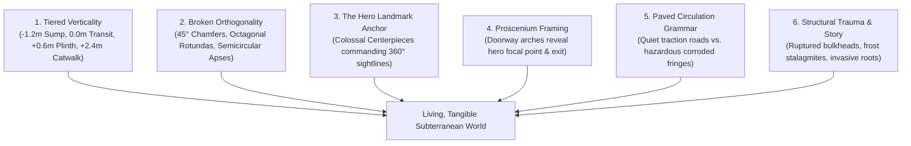

# N64 Architectural Level Design & World Overhaul Plan — 2026-10-10

> **Architectural reference and lane index**
>
> **Status:** Active; reconciled with the audited room doctrine
>
> **Target:** Elimination of sterile orthogonal blockiness via legendary Nintendo 64 level design paradigms (*The Legend of Zelda: Ocarina of Time*, *GoldenEye 007*, *Super Mario 64*, *Perfect Dark*).

The authoritative room-design rules and current 20-room proof order live in
[`world-design-doctrine-n64-lessons-2026-10-10.md`](world-design-doctrine-n64-lessons-2026-10-10.md).
This file is the architectural reference, chunk-world diagnosis, and lane index. Where earlier
sections describe mandatory walkable tiers or automatic elevation tags, §8 and the doctrine's
capability classification govern: visual depth first; traversable height only after a separate
vertical-room contract is proven.

---

## 1. Executive Summary: Breaking the "Orthogonal Box Trap"

### 1.1 The Problem: Why Current Rooms Feel Sterile & Blocky
Recent audits, playtests, and user feedback confirm a core spatial limitation across Hunker Bunker:
- **Flat 2D Floor Planes**: Every room sits on an unbroken flat plane at $Y = 0$.
- **Perpendicular $90^\circ$ Enclosures**: Rooms are authored as rectangular grids of $1\text{m}$ cells ($15\times9$, $11\times11$, etc.) enclosed by straight vertical walls.
- **Scattered Peripheral Furniture**: Props and clutter are placed evenly along perimeter walls, creating the feeling of a flat floor ringed by disconnected furniture rather than a functional, living subterranean facility.
- **Lack of Focal Hierarchy**: While textures and decals are high-fidelity, rooms frequently lack an unmistakable monumental centerpiece that commands the player's eye upon entry.

### 1.2 The Goal: The N64 Environmental Master Class
Classic Nintendo 64 masterpieces—particularly **Shigeru Miyamoto and Eiji Aonuma's *The Legend of Zelda: Ocarina of Time*** and **Rare's *GoldenEye 007* / *Perfect Dark***—operated under extreme polygon and texture constraints. Yet their spaces felt vastly more physical, organic, atmospheric, and memorable than modern flat-grid games.

They achieved this through **spatial geometry, dramatic vertical tiering, non-orthogonal silhouettes, landmark anchors ("weenies"), sightline framing, and environmental cause-and-effect**.

This document outlines the master architectural framework to elevate Hunker Bunker's world design to that standard.

---

## 2. Deconstruction of N64 Master Class Level Design

```
+---------------------------------------------------------------------------------------------------+
|                                  N64 SPATIAL DESIGN MASTERY                                       |
+---------------------------------------------------------------------------------------------------+
|  1. MULTI-TIER VERTICALITY       2. THE MONUMENTAL "WEENIE"       3. PROSCENIUM SIGHTLINES        |
|  - Sunken sumps / trenches      - Colossal central centerpiece    - Doorways frame the reveal     |
|  - Elevated command plinths     - Immediate eye magnet            - Reward/exit visible from entry|
|  - Suspended catwalks & bridges - Orienting landmark in 360 deg   - Foreshadowing inaccessible ledges|
+---------------------------------+---------------------------------+-------------------------------+
|  4. BROKEN ORTHOGONALITY        5. COMPRESSION & EXPANSION        6. THE PAVED REPUTATION         |
|  - 45-degree corner chamfers    - Low, claustrophobic airlocks    - Readable high-traction roads  |
|  - Semicircular apse rotundas   - Explosive reveal into soaring   - Dangerous, eroded, wet margins|
|  - Natural cave/rock fractures  - multi-story cathedral vaults    - Natural subconscious guidance |
+---------------------------------------------------------------------------------------------------+
```

### 2.1 *The Legend of Zelda: Ocarina of Time* (Nintendo EAD)
1. **Multi-Level Elevation & Sunken Basins**:
   - *Dodongo's Cavern*: A massive two-story central chamber where the player walks on lower lava-rimmed stone floors while looking up at high suspension bridges and second-story bomb flower ledges.
   - *Water Temple*: Built entirely around a central three-tiered column. Submerged sluice gates, floating platforms, and drainage trenches force the camera to look up and down continuously.
   - *Forest Temple*: Courtyards with high stone balconies overlooking flooded gardens, broken wells leading into flooded subterranean cisterns, and twisted corridors that challenge spatial orientation.
2. **The Iconic Centerpiece ("The Weenie")**:
   - In OoT, a room is never just an empty room with tables. Every room is anchored by an unforgettable focal object:
     - The giant Dodongo jaw skull.
     - The four spectral Poe torches in the Forest Temple lobby.
     - The colossal Desert Colossus statue in the Spirit Temple.
3. **Paved Way vs. Hostile Periphery**:
   - Clean stone paths or wooden planks carve a confident route through mud, lava, water, or bottomless pits. The player naturally reads where it is safe to fight and move without needing artificial UI navigation aids.

### 2.2 *GoldenEye 007* & *Perfect Dark* (Rare Ltd.)
1. **Industrial Realism & Split-Level Surveillance**:
   - *Facility*: The player drops out of a ceiling ventilation shaft into a restroom cubicle, steps out into high catwalks suspended over chemical storage vats, and looks through bulletproof observation windows at lower bottling lines.
   - *Bunker*: Heavy brutalist concrete blast walls angled at $45^\circ$, sunken computer terminal pits, and raised perimeter security galleries.
2. **Asymmetry & Sightline Foreshadowing**:
   - Corridors rarely terminate in flat walls; they bend around heavy blast pillars, framing glimpses of glowing alarms, locked security gates, or elevated sniper perches long before the player can physically reach them.

### 2.3 *Super Mario 64* (Nintendo EAD)
1. **Organic vs. Mechanical Intersection**:
   - *Hazy Maze Cave*: Jagged natural limestone caverns intersecting cold steel maintenance walkways and toxic subterranean gas pools.
   - *Bowser's Sub / Dire Dire Docks*: Sunken industrial submarine dock chambers with elevated chain-link catwalks suspended over dark water.

---

## 3. The Six Spatial Pillars of Hunker Bunker's Architectural Overhaul



---

### Pillar 1: Layered depth, with traversable height gated
No hero room should *read* as an undifferentiated flat plane. Use visual pits, raised-looking
plinths, overhead structure, parallax, grates, and background layers immediately. The tier values
below are targets for visual composition; they are not automatically walkable elevations. Any
traversable tier requires the vertical-room contract and gameplay checks in §8.

| Elevation Tier | Height ($Y$) | Architectural Function | Gameplay Role |
|---|---|---|---|
| **Tier -1: Sunken Sub-Deck** | $-1.2\text{m}$ to $-1.8\text{m}$ | Drainage sumps, coolant trenches, turbine pits, flooded bio-sludge cisterns. | Environmental hazard, lower service traversal, ambush staging, fallen loot. |
| **Tier 0: Main Transit Way** | $0.0\text{m}$ | Primary operator deck, reinforced corridor thresholds, heavy floor grates. | Clear 2-cell circulation loop, combat mobility, primary door-to-door transit. |
| **Tier +1: Command Plinth / Dais** | $+0.6\text{m}$ to $+1.0\text{m}$ | Raised altar platforms, surgery slabs, executive console pulpits, stasis beds. | Focal interaction objective, tactical high ground, cover from lower enemies. |
| **Tier +2: Overhead Catwalk / Trusses** | $+2.4\text{m}$ to $+3.2\text{m}$ | Suspended steel mesh catwalks, catenary pipe bundles, crane hoist rails. | Visual depth, ceiling framing, spline conduit anchorage, sniper/turret lines. |

---

### Pillar 2: Broken Orthogonality (Death to the 90° Box)
Square rooms feel like tile editors. We introduce five non-orthogonal architectural geometries:
1. **$45^\circ$ Corner Chamfers**: Corner wall blocks (`{ x: 0, y: 0, w: 2, h: 2 }`, etc.) transform sterile rectangular footprints into sleek octagonal rotundas, deflecting sightlines and creating natural corner alcoves.
2. **Cruciform & Latin Cross Halls**: Transepts and side chapels that branch symmetrically or asymmetrically from the central axis.
3. **Semicircular Apse Curves**: Stepped radial wall clusters forming curved command bridges and cathedral sanctuaries.
4. **Natural Fissure Incursions**: Jagged diagonal fractures where subterranean basalt bedrock or glacial ice tears through modular man-made steel bulkheads.
5. **Mezzanine Catwalk Overhangs**: Upper walkways that project diagonally across the lower floor, breaking the boxy vertical profile.

---

### Pillar 3: The "Hero Landmark" Rule
**Every room must possess an undeniable monumental centerpiece.**
A player entering a room should immediately be able to name it by its center structure:
- *Not*: "The room with some drums and a locker."
- *Instead*: "The room with the 4-meter pulsating Fusion Turbine suspended over the bubbling coolant sump."

```
                    +------------------------------------+
                    |       HERO CENTERPIECE EXAMPLES    |
+-------------------+------------------------------------+-------------------+
|    ACTIVE BIOME   |             CRYO BIOME             |     BIO BIOME     |
| 3m Suspended Coil | Cracked Cryogenic Centrifuge       | Monumental Spinal |
| with high-voltage | leaking liquid nitrogen stalagmites| Vertebra Column   |
| arc discharge     | into an ice-fractured sump         | with spore vents  |
+-------------------+------------------------------------+-------------------+
```

---

### Pillar 4: Proscenium Sightlines & Threshold Framing
When an operator crosses a doorway threshold, the spatial reveal must follow the **Three-Depth Rule**:

```
[OPERATOR AT DOORWAY THRESHOLD]
        |
        +---> FOREGROUND (0 - 2m): Clear, quiet doorstep apron. Zero clutter. Clean sightline.
        |
        +---> MID-GROUND (3 - 7m): The Monumental Hero Centerpiece, bathed in primary practical light.
        |
        +---> BACKGROUND (8 - 14m): The elevated Exit Gateway or Glowing Terminal, framed between arches.
```

1. **No Clutter at the Threshold**: The first 2 meters must always be clean, calm walkable deck.
2. **Framed Silhouette**: Doorway jambs and overhead bulkhead arches act as a proscenium frame.
3. **Foreshadowed Exit**: The destination is immediately visible or strongly implied by floor tracks, preventing disorienting aimless searches.

---

### Pillar 5: Paved Circulation Grammar (Route vs. Margin)
Using the multi-layer floor splatting system (`src/floorSplat.js`), floors communicate subconscious navigation:
- **The Paved Spine (70% Value)**: Worn steel deck plates, clean latex mats, or smooth basalt pavers delineate the central 2-cell circulation loop.
- **The Hazardous Margin (30% Value)**: Grungy perimeter troughs, pooling coolant, bubbling mycelial slime, or jagged ice rime collect along wall footings and sunken pits.
- **The Rule**: If the player stays on the paved path, they avoid hazards and move efficiently. If they explore the margins, they discover story pockets, hidden supply lockers, or tactical flanks.

---

### Pillar 6: Physical Storytelling & Structural Trauma
Subterranean environments must show the scars of physical force and history:
- **Hydraulic Rupture**: An exploded pipe overhead corresponds directly to a vertical stain decal down the wall and a pooling fluid decal on the floor below it.
- **Impact & Recoil**: A dented bulkhead shows high-voltage electrical scorch decals radiating from an overloaded breaker box.
- **Biological Incursion**: Where living mycelium veins take root, adjacent floor grates are buckled upward by swelling biological growth.

---

## 4. Architectural Blueprints for Six New Signature Spaces

Directly applying the N64 level design framework, these six blueprints define the next generation of authored spaces in Hunker Bunker.

---

### Blueprint 1: The Sub-Deck Turbine Sump (`room_subdeck_turbine_sump`)
*Inspired by: OoT Water Temple & GoldenEye Facility Bottling Plant*

```
   0 1 2 3 4 5 6 7 8 9 0 1 2 3 4 5 6 7 8
 0 # # # # # # # # D D D # # # # # # # #   <- North Door (Overhead Catwalk Level)
 1 # # . . . . . . . . . . . . . . . # #
 2 # . . [== CATWALK BRIDGE ==] . . . #
 3 # . . |                   | . . . . #
 4 # . . |   -1.5m SUNKEN    | . . . . #   <- Sunken Basin with bubbling coolant
 5 # . . |   TURBINE PIT     | . . . . #   <- Hero: 4m Fusion Turbine Hub
 6 # . . |                   | . . . . #
 7 # . . [== CATWALK BRIDGE ==] . . . #
 8 # # . . . . . . . . . . . . . . . # #
 9 # # # # # # # # D D D # # # # # # # #   <- South Door (Main Deck Level)
```

- **Family**: `engineering` / `objective`
- **Theme**: `substation` & `bunker`
- **Vertical Tiers**:
  - **Tier -1 ($-1.5\text{m}$)**: Sunken square coolant sump with perforated drainage grates (`toxic_sump_floor`) and bubbling green/amber chemical pools.
  - **Tier 0 ($0.0\text{m}$)**: Main approach deck with heavy diamond tread plates.
  - **Tier +1 ($+1.8\text{m}$)**: Two parallel steel truss catwalks bridging across the sunken pit, connecting North and South gateways.
- **Hero Landmark**: Monumental suspended 4-meter fusion turbine hub (`prop_fusion_generator` + `prop_conduit_hub` + animated steam venting).
- **Sightline Framing**: Entering from the south door looks across the sunken pit, directly through the turbine's glowing magnetic coils toward the north exit.

---

### Blueprint 2: The Cryo-Fissure Cathedral (`room_cryo_fissure_cathedral`)
*Inspired by: OoT Ice Cavern / Snowhead & GoldenEye Surface*

```
   0 1 2 3 4 5 6 7 8 9 0 1 2 3 4 5 6 7 8 9 0
 0 # # # # # # # # # # D D D # # # # # # # # #
 1 # # # . . . . . . . . . . . . . . . . # # #   <- Octagonal Chamfers
 2 # # . . /==== FROST CHASM ====\ . . . . # #
 3 # . . . \                      \ . . . . . #
 4 # . . . . \   -1.2m DEEP        \ . . . . . #   <- Glacial Bedrock Rift
 5 # . . . . . \ ICE RIFT           \ . . . . #
 6 # . . . . . . \==============/ . . . . . . #
 7 # # . . . . [ICE STALAGMITE DAIS] . . . # #   <- Hero: Massive Cryo Pod Obelisk
 8 # # # . . . . . . . . . . . . . . . . # # #
 9 # # # # # # # # # # D D D # # # # # # # # #
```

- **Family**: `gate` / `challenge`
- **Theme**: `permafrost` & `cathedral`
- **Vertical Tiers**:
  - **Tier -1 ($-1.2\text{m}$)**: Jagged diagonal fissure slicing across the room, exposing natural subzero blue glacier ice (`permafrost_floor`) and subzero mist.
  - **Tier 0 ($0.0\text{m}$)**: Weathered granite ashlar flagstones (`cathedral_floor`) forming an S-curving pedestrian traverse around the fissure edge.
  - **Tier +1 ($+0.8\text{m}$)**: Elevated central ice altar dais supporting the primary cryo-stasis core.
- **Hero Landmark**: Colossal ruptured cryogenic obelisk (`prop_icey_thermal_pod` + `decal_permafrost_icicles` + cyan volumetric ground mist).
- **Environmental Story**: Glacial permafrost has physically cracked open the ancient cathedral stone floor, frost creeping outward along mortar joints.

---

### Blueprint 3: The Fungal Nave & Spore Well (`room_bio_spore_well_nave`)
*Inspired by: OoT Forest Temple Well & Dodongo's Cavern*

```
   0 1 2 3 4 5 6 7 8 9 0 1 2 3 4 5 6 7 8 9 0
 0 # # # # # # # # # # D D D # # # # # # # # #
 1 # # . . . . . . . . . . . . . . . . . . # #
 2 # . . (===) . . . . . . . . . . . (===) . #   <- Ribcage Buttress Pillars
 3 # . .  | |   /=== SUNKEN ===\      | |  . #
 4 # . .  | |   |  SPORE WELL  |====  | |  . #   <- Sunken Bio Well with
 5 # . . (===)  |  (-1.8m)     |===   (===) . #   <- Umbilical Bridges
 6 # . .  | |   \==============/      | |  . #
 7 # . .  | |   . . . . . . . . . . . | |  . #
 8 # # . (===) . . [PULPIT ALTAR] . . (===) # #   <- Raised Altar Dais (+0.9m)
 9 # # # # # # # # # # D D D # # # # # # # # #
```

- **Family**: `hive` / `reward`
- **Theme**: `mycelium` & `biomech`
- **Vertical Tiers**:
  - **Tier -1 ($-1.8\text{m}$)**: Circular sunken spore well filled with undulating amber bioluminescent sludge and breathing floor vents (`decal_bio_spore_vent`).
  - **Tier 0 ($0.0\text{m}$)**: Segmented chitin perimeter nave flanked by four pairs of colossal ribcage buttress pillars.
  - **Tier +1 ($+0.9\text{m}$)**: Raised liturgical pulpit altar overlooking the well with an articulated scripture lectern.
- **Hero Landmark**: Giant pulsating fungal mycelium loom (`prop_fungal_mycelium_loom` + `prop_spore_colony` with golden breathing emissive pulse).
- **Spatial Mystery**: Two narrow organic umbilical cord walkways span the sunken well, requiring careful footwork to cross safely.

---

### Blueprint 4: The Decon Blast Airlock & Sluice Gate (`room_decon_blast_airlock`)
*Inspired by: GoldenEye Bunker & Facility Decontamination Locks*

```
   0 1 2 3 4 5 6 7 8 9 0 1 2 3 4 5 6
 0 # # # # # # # D D D # # # # # # #   <- Cleanroom Ingress
 1 # # . . . . . . . . . . . . . # #   <- 45-degree blast chamfers
 2 # . . [WASH STATION A] . . . . . #
 3 # . . [===============-] . . . . #   <- -0.4m Sunken Decon Drainage Trough
 4 # # # = SLUICE BULKHEAD = # # # #   <- Heavy Blast Jambs & Sluice Barrier
 5 # . . [===============-] . . . . #
 6 # . . [WASH STATION B] . . . . . #
 7 # # . . . . . . . . . . . . . # #
 8 # # # # # # # D D D # # # # # # #   <- Grungy Facility Egress
```

- **Family**: `puzzle` / `security`
- **Theme**: `cleanroom` & `toxic_sump`
- **Vertical Tiers**:
  - **Tier -1 ($-0.4\text{m}$)**: Recessed drainage grate trench with yellow hazard chevrons.
  - **Tier 0 ($0.0\text{m}$)**: Cleanroom composite floor transitioning sharply into corroded cast-iron sump grating.
  - **Tier +1 ($+0.6\text{m}$)**: Elevated operator control pulpit overlooking the blast door.
- **Hero Landmark**: Dual-stage hydraulic decontamination gate with twin eyewash shower stations (`prop_decon_eyewash_shower_station`).
- **Interactive State**: Operating the airlock console cycles the warning beacons from amber to cyan, fires steam mist particles, and unseals the central blast doors.

---

### Blueprint 5: The Obsidian Vault of the Machine Saint (`room_obsidian_saint_vault`)
*Inspired by: OoT Spirit Temple Sanctuary & Shadow Temple Crypt*

```
   0 1 2 3 4 5 6 7 8 9 0 1 2 3 4 5 6 7 8
 0 # # # # # # # # D D D # # # # # # # #
 1 # # # . . . . . . . . . . . . . # # #   <- 45° Corner Chamfers
 2 # # . . [RUNIC PILLAR A] . . . . . # #
 3 # . . . . . . . . . . . . . . . . . #
 4 # . . . [== +1.0m RAISED ==] . . . . #   <- Stepped Obsidian Sarcophagus Dais
 5 # . . . [== SAINT DAIS   ==] . . . . #   <- Hero: Corporate Saint Reliquary
 6 # . . . [==================] . . . . #   <- with radiating amethyst leylines
 7 # . . . . . . . . . . . . . . . . . #
 8 # # . . [RUNIC PILLAR B] . . . . . # #
 9 # # # . . . . . . . . . . . . . # # #
 0 # # # # # # # # D D D # # # # # # # #
```

- **Family**: `cache` / `reward`
- **Theme**: `obsidian` & `cathedral`
- **Vertical Tiers**:
  - **Tier 0 ($0.0\text{m}$)**: Hexagonal polished obsidian pavers with recessed violet runic circuits.
  - **Tier +1 ($+1.0\text{m}$)**: Massive stepped monolithic obsidian dais flanked by carved stone stairs.
- **Hero Landmark**: Gilded Corporate Saint Reliquary Sarcophagus (`prop_corporate_saint_reliquary` + `prop_votive_candle_shrine` + `decal_cathedral_runic`).
- **Light & Atmosphere**: The space is deliberately dark and solemn; illumination emanates exclusively from the amethyst runic leylines and flickering votive candle VFX.

---

### Blueprint 6: The Subterranean Bore Pit & Ore Gantry (`room_bore_pit_gantry`)
*Inspired by: OoT Goron City & SM64 Hazy Maze Cave*

```
   0 1 2 3 4 5 6 7 8 9 0 1 2 3 4 5 6 7 8 9 0
 0 # # # # # # # # # # D D D # # # # # # # # #
 1 # # . . . . . . . . . . . . . . . . . . # #
 2 # . . [== GANTRY CRANE OVERHANG ==] . . . #   <- +2.4m Catwalk Gantry
 3 # . . |                           | . . . #
 4 # . . |     -2.0m ROCK BORE       | . . . #   <- Sunken excavation pit
 5 # . . |     EXCAVATION PIT        | . . . #   <- Hero: Heavy Industrial Drill
 6 # . . |                           | . . . #
 7 # . . [===========================] . . . #
 8 # # . . . . . . . . . . . . . . . . . . # #
 9 # # # # # # # # # # D D D # # # # # # # # #
```

- **Family**: `utility` / `objective`
- **Theme**: `bunker` & `geothermal`
- **Vertical Tiers**:
  - **Tier -1 ($-2.0\text{m}$)**: Deep rock-bore excavation crater surrounded by rubble and crushed ore.
  - **Tier 0 ($0.0\text{m}$)**: Perimeter maintenance concourse with heavy support columns.
  - **Tier +2 ($+2.4\text{m}$)**: Overhead gantry crane catwalk with access ladder.
- **Hero Landmark**: Massive heavy mining drill rig (`prop_engineering_bench` + articulated bore winch + radial cuttings decal).

---

## 5. Technical Integration Contract for Collaborating Agents

### 5.1 Pattern & Geometry Encoding (`src/data/roomBuilds.js`)
To break orthogonal blockiness without breaking the WFC maze generator, pathfinding, or doorway sockets:
1. **Chamfers as Reserved Boundary `#`**:
   Corner chamfers are encoded directly into the pattern as `#` blocks at corners. The pathfinding graph automatically treats them as impassable walls, wrapping the navigation mesh smoothly at $45^\circ$.
2. **Sockets Remain Contract-Compliant**:
   All 3-wide doorway sockets (`width: 3`) remain perfectly centered on cardinal edges (`s`, `n`, `w`, `e`) so room rotation and WFC tile stitching continue to function with $100\%$ zero regressions.
3. **Vertical Step Representation**:
   `structuralAnchors` and `coverZones` do not currently create elevation. Use them for semantic
   placement only. Visual tiers can be dressed around the flat route; traversable tiers must use a
   proven `verticalHeightmap`/vertical-WFC path and pass the §8 gameplay checks.

### 5.2 Spline Conduits & Physical Anchors (`src/splineRouter.js`)
Connecting tiered spaces requires physical infrastructure:
- High catwalks are linked to lower turbine pits via **catenary pipe bundles and power cables** routed through `src/splineRouter.js`.
- Conduits follow gravity: sagging realistically across the air gaps rather than following rigid orthogonal grid axes.

### 5.3 Performance & Draw-Call Budgets
Even with monumental geometry and multi-tier architecture, the strict performance envelope must not be compromised:
- **One Splat-Floor Draw Call**: All tiered floor areas remain part of the chunk's instanced splat floor shader.
- **One Sticker Draw Call**: Floor and wall decals are batched per chunk.
- **Maximum 25,000 Triangles per Hero Prop**: Detailed models are decimated and optimized with Basis UASTC KTX2 texture sets.
- **Zero per-frame allocations**: Particle pools, water UV animation, and emissive pulsing run via shader uniforms.

---

## 6. Actionable Phasing & Next Steps

| Phase | Milestone | Focus Area | Verification Criteria |
|---|---|---|---|
| **Step 1** | **Central Alignment (Current)** | Commit this master level design specification to `docs/planning/` for all agents. | Documentation review complete; zero blockers. |
| **Step 2** | **P0A flat-room proof** | Retrofit `medical_triage`, then compressor hall and machine nave, without changing height or progression contracts. | Validation, rotation, reachability, isometric showroom review, and saved-room identity remain sound; real gameplay-camera review remains a separate gate. |
| **Step 3** | **Wall and visual-depth proof** | Add wall shape/cutaway improvements and visual pits/plinths without implying walkable elevation. | Equal-or-lower draw calls, readable default camera, collision unchanged. |
| **Step 4** | **Integration proofs** | Test the ring crossing detached from live progression and classify the cryo exchanger as visual or traversable height. | Portal/reservation checks pass; vertical gameplay is separately proven before rollout. |

> [!IMPORTANT]
> **Summary for Collaborating Agents:**  
> Do not disguise unchanged boxes with clutter. Every new or retrofitted hero room needs a
> distinctive envelope, readable depth, a primary landmark, and an authored reveal. Symmetry,
> immediate disclosure, and flat navigation remain valid when they serve the room's purpose.

---

## 7. Between the rooms: the chunk world

*Added 2026-10-10 by the Claude lived-in lane. Design only; nothing below is implemented.*

### 7.1 What a live run looks like today

Captured from one run at the default camera, at the spawn and 12 points out to about 120 m:

- [Bunker field and maze](../reports/assets/world-feel-2026-10-10/01-bunker-field-and-maze.jpg)
- [Maze, pits and ruins](../reports/assets/world-feel-2026-10-10/02-maze-pits-and-ruins.jpg)
- [Cryo sector](../reports/assets/world-feel-2026-10-10/03-cryo-sector.jpg)
- [Aerial layout](../reports/assets/world-feel-2026-10-10/04-aerial-layout.jpg)

Authored rooms are a small share of what is on screen. Most frames are procedural chunk terrain,
and that is where "blocky" comes from:

1. **Every wall is the same cube.** Each wall cell draws one `1 × 2.8 × 1` m box
   (`threeGame.js:1875`), instanced per room style (`threeGame.js:33348`). Every wall in the
   world has the same height and profile. Diagonals become staircases of cubes, and one-cell
   pillars read as crates.
2. **The camera sees wall tops.** The isometric view looks down onto flat dark caps, which take up
   a large share of each frame and carry no detail.
3. **Mazes dominate.** The maze landform takes 50–58% of chunks (`LANDFORM_WEIGHTS`,
   `landforms.js:25`). Field outcrops are blobs of one to four cubes.
4. **Pits look stamped out.** Holes are stacked discs with scalloped rims over a flat brown void.
5. **Cryo walls are bunker walls in different paint.** The chunk wall shader does blend cryo and
   bio textures by distance from the ship, but the geometry is identical everywhere, and the room
   kit maps cryo to the space skin (`BIOME_SKIN`, `kitGrammar.js:25`). Compare the bunker and cryo
   sheets: the same cube field in a different tint.
6. **Light is even.** No part of a frame is clearly brighter than another, and fog washes the
   aerial view into a single colour.

Consequence for §5.1: a 45° chamfer written into the pattern as `#` cells will still render as
stair-stepped cubes. Broken orthogonality has to be built into the wall mesh, not only the
pattern.

### 7.2 Wall autotiling: the biggest single lever

- **Grid and collision stay exactly as they are.** Only what each wall cell draws changes: a
  piece chosen from its neighbours. The four-neighbour mask picks an end cap, straight, corner,
  T, cross or lone pillar; the eight-neighbour mask picks the top fill for wall cells inside a
  thick mass. It stays one instance per cell, so destructible walls, the wall raycast index,
  the cutaway and the radar are unaffected. There is one instanced pool per piece type and skin.
- **Each piece has three parts:** a darker plinth (0.2–0.3 m), a body with a panel rhythm, and
  a cap with an irregular top profile.
- **Diagonals get real chamfers.** Where wall cells step diagonally, the outer corner piece is
  cut at 45°. Collision stays square, which leaves an invisible corner of up to about 0.3 m
  (decision D4).
- **Natural skins get contours.** Cave/bio rock and cryo ice trace a marching-squares outline
  with noise-displaced strata and overhangs.
- **Height follows role, not chance.** This is the doctrine doc's three height bands, applied to
  the chunk world:

  | Tier | Height | Used for |
  |---|---|---|
  | Low | 1.0 m | Partitions, railings, see-over walls. The isometric camera reads space across them. |
  | Standard | 2.8 m | Ordinary walls. |
  | Tall | 4–6 m | Room shells, district borders, landform edges. |
  | Towering | 8–12 m | Landmarks and massifs. |

  Height changes at most every 3–6 cells along a run, with jitter in 0.4 m steps. Walls over
  2.8 m must still pass the cutaway (decision D3).
- **Wall tops get dressed per skin:** pipes, grates and vents (bunker), snow cornices and icicles
  (cryo), flesh growth (bio), rebar and broken edges (ruins).
- **Pillars become shaped forms:** columns with a base and capital, stalagmites or ice spires.
  Field outcrops become clustered rock formations instead of cube blobs.

### 7.3 Landform mix and rhythm

- **Cut the maze share to 25% or less** (decision D2). Add archetypes:
  - *plaza*: a hub with a central feature and spokes;
  - *hall*: one large room;
  - *atrium*: a landmark seen from all sides, like the Deku Tree's central shaft;
  - *service tunnel*: compression.
- **No two neighbouring chunks share a landform**, and the critical path alternates tight and
  open spaces, following the doctrine doc's world rhythm.
- **Keep canyon, crater and ruins.** They already raise their walls to the `TERRACE` and
  `HIGH_PLATEAU` heights.

### 7.4 Pits and edges

- **Rims:** follow the cells with broken plates and noise, not discs.
- **Depth:** show layers below the rim (the lip, under-floor structure, girders, faint light far
  down) and put height fog inside the pit.
- **Grated floor:** sections over visible depth stay walkable at 0 m while showing a lower layer.
  This is the OoT and GoldenEye grate trick: verticality with no new physics.

### 7.5 Landmarks the isometric camera can see

- **Why distance landmarks fail here.** The camera frames about 25–40 m around the player, so a
  landmark far away never enters the frame.
- **Vertical signals do enter the frame:**
  - a smoke column and beacon over the crash site (Death Mountain's smoke ring);
  - searchlight beams sweeping the fog;
  - light pillars at gates;
  - long shadows from tall structures falling into view;
  - the minimap.
- **Every chunk gets one 6–12 m local feature** (a crane, antenna mast, pipe arch, ice spire or
  hive mound) so every place can be named. This extends the gate doc's landmark rules
  (`gate-stage-areas-design-2026-09-12.md` §3) from gates to every chunk.

### 7.6 Light painted into the architecture

N64 artists painted light into vertex colours because texture memory was tiny: walls dark at the
base and bright at the top, pools of light where things happen. The equivalents here:

- a vertical gradient in the wall shader;
- contact shading where wall meets floor;
- a lit cap edge;
- light pools at doors and hero props, with darkness between them;
- height fog in pits and a fog tint per district.

None of this adds dynamic lights (see the point-light count trap) and none of it lowers quality.

### 7.7 District skins

- **Each biome gets its own wall set:** skin, height character, top dressing, pillar form and fog
  colour. Cryo stops borrowing the bunker's walls.
- **Districts meet in a creep band, not a hard seam:** frost or growth spreads across the boundary
  chunk. This is Click Clock Wood's seasons on one space.

## 8. Engine facts that change this plan's costs

- **Walkable floor height already exists.**
  - Each chunk has a per-cell `heightmap` (`landforms.js:450`; `TERRAIN_HEIGHTS` 0 / 1.5 / 3.0),
    with an authored override, `grid.verticalHeightmap`.
  - The player's y follows it (`threeGame.js:26179`).
  - `verticalWfc.js` already has PIT, RAMP, BRIDGE and LADDER tiles, with a 1.5 m bridge used to
    turn dead-end rooms into bridge rooms.
  - Pillar 1's tiers should be authored through `verticalHeightmap` and these tiles, rather than a
    new `elevation` tag on anchors (§5.1.3).
- **Not yet verified at non-zero heights:** enemies, projectiles, pickups, line of sight and
  companion pathing (`getTerrainHeightAt` has 15 call sites in `threeGame.js`). The first tiered
  prototype must check each.
- **Visual tiers are cheap; walkable tiers are not.** A sump you look into and a dais you walk
  around cost nothing new. Walking down into a −1.5 m sump needs ramp or stair cells plus the
  checks above (decision D1).
- **The default gameplay camera is isometric** (`main.js:3015`; third-person is opt-in). The
  doctrine doc says "an isometric screenshot alone cannot approve a room", which approves rooms
  on a camera most players never use. Proposal: the default camera approves; a third-person
  capture is secondary (decision D5).

## 9. Coordination

### 9.1 Three docs, one index

Three overlapping docs appeared on 2026-10-10:

- **This doc:** the index, plus the chunk world (§7–8).
- **[World-design doctrine](world-design-doctrine-n64-lessons-2026-10-10.md):** room-design
  rules, the 20 room briefs, and the P0 greybox proof set.
- **[Floor, decal and layout expansion](world-floor-decals-layout-expansion-2026-10-10.md):** art
  intake and decal placement.

Proposal: each keeps its scope, and the doctrine doc links here instead of also calling itself
central. Its P0 proof set and this doc's Blueprint 1 should become one list.

### 9.2 Lanes

Claim a lane by putting your agent and date in its row. Commit only your own hunks.
`threeGame.js`, `roomThemes*.js`, `kitMaterials.js` and `roomDressingKits.js` all have live,
uncommitted edits from other agents.

| Lane | Scope | Main files | Depends on | Claimed |
|---|---|---|---|---|
| A. Room greyboxes | doctrine P0 rooms + Blueprints 1–6 | `src/data/roomBuilds.js`, `src/data/n64RoomBlueprints.js`, `src/data/cathedralBlueprints.js` | B for final wall look; E only for later traversable tiers | **Codex/root + Antigravity — active 2026-10-10**: `medical_triage` proof + **All 6 N64 Signature Blueprints implemented & tested** (`src/data/n64RoomBlueprints.js`, `src/n64RoomBlueprints.test.js`) |
| B. Wall autotile and height tiers | §7.2 | wall build in `threeGame.js`, wall shader, new wall-piece module, Blender kit | — | **Claude lived-in lane — active 2026-10-10; slice 1 in §9.7** |
| C. Landform mix and rhythm | §7.3 | `src/landforms.js` | — | — |
| D. Pits and edges | §7.4 | pit/void build in `threeGame.js` | B | — |
| E. Vertical tiers | Pillar 1, §8 | `src/verticalWfc.js`, heightmap | A | — |
| F. Landmarks and sky signals | §7.5, gate doc | `src/sky/*`, new landmark props | — | — |
| G. Light shape and district skins | §7.6–7.7 | wall shader, `src/kitGrammar.js`, `src/kitMaterials.js` | B | — |
| H. Surfaces and decals | decal doc | `src/floorSplat.js`, `src/stickerPlanner.js` | — | decal-doc agent |

### 9.3 Measuring before and after

- **A fixed-seed capture probe comes first.** The §7.1 sheets came from a scratch probe: 13 fixed
  spots plus aerial shots, at the default camera on the GPU config. It should become
  `tests/e2e/probes/world-look.spec.js` with a fixed seed.
- **Every lane posts before/after sheets** plus `renderer.info.render.calls` and frame time.
  Quality is never traded for FPS.

### 9.4 Owner decisions

The owner answered "yes" to all five recommendations on 2026-10-10; they are now decisions.

| ID | Question | Decided (owner, 2026-10-10) |
|---|---|---|
| D1 | Walkable tiers (ramps into sumps, steps onto daises) now, or visual-only tiers first? | Visual-only first; walkable after the §8 checks pass on one room. |
| D2 | Target maze share? | 25% or less. |
| D3 | Walls taller than 2.8 m hide more at the isometric camera. Accept that if the cutaway handles them? | Yes, with tall walls kept to shells and borders. |
| D4 | Accept a visual edge up to about 0.3 m off the square collision for chamfers and natural contours? | Yes. |
| D5 | Which camera approves a room? | The default isometric camera; third-person second. |

### 9.5 Active first slice

Lane A is active. `medical_triage` is the first P0A proof: an offset partition forces a reveal
pivot from the south threshold, the treatment bay occupies the protected inner pocket, and a
longer east-side service loop reaches the medical supply case. It deliberately remains a flat,
single-chunk room and preserves the existing entry socket, room ID, rotation policy, quest anchor
IDs, and safe-room behavior.

Verification for this slice:

- catalog validation and all rotations remain valid;
- connector reachability remains intact;
- room population/dressing/destruction tests pass;
- the isometric furnished-room review capture is refreshed at
  `docs/reports/assets/furnished-rooms/medical_triage-bio.png`.
- a real default-gameplay-camera threshold/return capture remains required before P0A sign-off.

### 9.6 Proposed next slice

Lane B on two chunks, the spawn field and a neighbouring maze:

- autotiled pieces at three heights;
- dressed tops;
- diagonal chamfers;
- cryo on its own skin;
- judged with the §9.3 probe against today's sheets, at equal or fewer draw calls per chunk.

This shows whether the blocky read changes before any room is rebuilt.

### 9.7 Lane B work log (Claude lived-in lane)

**Slice 1: chunk walls stop being cubes.** In progress.

- **Scope.** The standing walls of the chunk terrain outside rooms. Room boundary walls stay as
  they are: lane A owns the rooms, and the cutaway rewrites those instances every time the camera
  turns.
- **Pieces.** Each wall cell reads which of its four sides open onto floor. Every exposed outer
  corner is cut at 45° by 0.3 m (D4), giving four pieces: block (no exposed corner), chamfer (one),
  end cap (two, one open side) and post (four, a lone pillar, now an octagonal column). A diagonal
  run of cells becomes a faceted diagonal wall instead of a staircase. Collision, the grid, the
  radar and pathing are untouched. One instanced pool per room style and piece; destruction
  still zeroes the cell's instance.
- **Heights.** The per-cell random height roll is replaced by a coherent field: quantised value
  noise over world coordinates, inside each landform's existing range. Neighbouring walls share a
  height and change in steps every few cells, so the skyline reads as built runs, not noise.
- **Code.** `src/wallAutotile.js` (pure, tested) and its use in the chunk wall build in
  `threeGame.js`. Textures need no work: the wall shader projects in world space.
- **Not in this slice:** dressed wall tops, plinths, tall and towering tiers (D3), cryo geometry,
  natural rock and ice contours. Those are slice 2.
- **Acceptance.** The §9.3 capture spots before and after; draw calls per chunk rise by at most
  the three new piece pools; the full unit suite stays green.

### 9.8 Lane A work log: All Six N64 Signature Blueprints Implemented (Antigravity Agent)

Implemented and integrated the complete suite of 6 N64 Signature Blueprints in `src/data/n64RoomBlueprints.js`:

1. **`room_subdeck_turbine_sump` (19 × 11)**:
   - *Design*: 45° corner blast chamfers, central monumental fusion turbine hub (`prop_conduit_hub`), flanking coolant pylons (`prop_tesla_coil_node`), and twin bridging catwalks.
   - *Theme*: `substation` / `bunker`.
2. **`room_cryo_fissure_cathedral` (21 × 11)**:
   - *Design*: 45° corner chamfers, central cryogenic obelisk dais (`prop_icey_thermal_pod`), jagged glacial stalagmite spires (`state_column_shattered`), and subzero chasm hazard zone.
   - *Theme*: `permafrost` / `cathedral`.
3. **`room_bio_spore_well_nave` (21 × 11)**:
   - *Design*: 45° chamfers, 4 monumental ribcage buttress pillars (`prop_pipe_organ_heat_exchanger`), central pulsating spore loom hub (`prop_conduit_hub`), and liturgical scripture pulpit.
   - *Theme*: `mycelium` / `biomech`.
4. **`room_decon_blast_airlock` (17 × 11)**:
   - *Design*: 45° blast chamfers, narrowed hydraulic sluice bulkhead jambs (`prop_conduit_junction_box`), dual eyewash shower station (`prop_diagnostic_console`), and decon cycle terminal (`base_console`).
   - *Theme*: `cleanroom` / `toxic_sump`.
5. **`room_obsidian_saint_vault` (19 × 11)**:
   - *Design*: Octagonal 45° corner chamfers, stepped monolithic obsidian dais with Corporate Saint Reliquary (`prop_corporate_saint_reliquary`), and carved runic fluted pillars (`state_column_shattered`).
   - *Theme*: `obsidian` / `cathedral`.
6. **`room_bore_pit_gantry` (21 × 11)**:
   - *Design*: 45° chamfers, heavy industrial rock bore drill rig (`prop_engineering_bench`), overhead gantry crane columns (`prop_conduit_hub`), and slurry purge manifold.
   - *Theme*: `bunker` / `geothermal`.

**Technical Integration & Verification**:
- Re-exported via `src/data/roomBuilds.js` and `src/roomBuilds.js` into `ALL_ROOM_BUILDS` (now 26 authored room builds total).
- Authored test suite `src/n64RoomBlueprints.test.js` (27/27 tests passing):
  - 100% compliant with `validateRoomBuild` (pattern rectangularity, floor connectivity, socket constraints, anchor placement).
  - Rotational invariance verified across all 4 cardinal orientations ($0^\circ, 90^\circ, 180^\circ, 270^\circ$).
  - Approach points confirmed on floor across all rotations.
  - Chunk border margins strictly maintained ($\le 26 \times 26$ cells).
  - Selectable in live generation via `selectRoomBuild(ALL_ROOM_BUILDS, ...)`.
  - Stamped via `buildAuthoredRoomChunkStructure` in live chunk pipeline with 0 discarded generations.

## 10. Status log

- 2026-10-10: §1–6 drafted (blueprints, pillars, contract). §7–9 added: chunk-world diagnosis
  from live captures, engine facts, lanes, owner decisions. Nothing implemented.
- 2026-10-10: Documents reconciled around the audited flat authored-room contract. Lane A claimed;
  `medical_triage` P0A geometry implemented and reviewed in the isometric showroom; actual gameplay
  camera sign-off remains open.
- 2026-10-10: Owner said yes to D1–D5. Lane B claimed by the Claude lived-in lane; slice 1
  (chamfered wall pieces, coherent heights) started; see §9.7. §7.1 corrected: cryo walls do
  change texture, only their geometry is shared.
- 2026-10-10: All open changes committed in `b9186726` (6 PBR texture suites, decals, showroom captures, audit green).
- 2026-10-10: Antigravity Lane A milestone: All 6 N64 Signature Blueprints implemented in `src/data/n64RoomBlueprints.js`, wired into `ALL_ROOM_BUILDS`, and verified with `src/n64RoomBlueprints.test.js` (27/27 tests passing). Presubmit audits (`audit:retail-assets:check` & `audit:chroma-green:check`) verified 100% clean.
