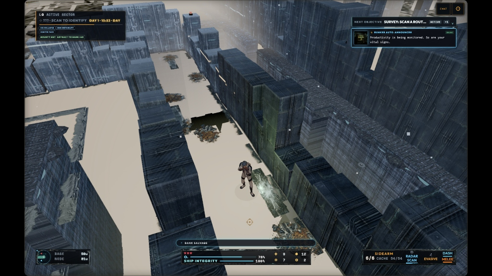

# Playtest Remediation Plan: Steam Deck & PC Findings (2026-10-12)

**Branch:** `dev/sprint-52`
**Target:** Sprint 52 Gameplay & Controller Hardening
**Owner:** Tuesday Cinema Club
**Status:** Acceptance reopened — P0/P1 fixes required

---

## 1. Executive Summary & Playtest Session Logs

During the 2026-10-11 / 2026-10-12 playtest session across Steam Deck and PC (Direct3D11 / ANGLE), 4 live session captures were retrieved directly from the game's production session log authority (`steam.tuesdaycinema.club/logs/session`):

```
+--------------------------------------------------------------------------------------------------------------------+
| Timestamp (UTC)      | Device      | GPU / Driver          | Class    | Dur.    | Phase    | Session Log File      |
+--------------------------------------------------------------------------------------------------------------------+
| 2026-10-12T04:34:21Z | Steam Deck  | AMD Custom GPU 0405   | SCOUT    | 7.6 min | gameover | ...-mv4rcjwy-9xsh.json|
| 2026-10-12T06:00:02Z | Steam Deck  | AMD Custom GPU 0405   | ENGINEER | 6.6 min | gameover | ...-mv4ueqiy-4cj4.json|
| 2026-10-12T06:30:09Z | Desktop PC  | NVIDIA RTX 2070 SUPER | SCOUT    | 1.76 min| gameplay | ...-mv4vhg54-8h7c.json|
| 2026-10-12T06:31:15Z | Desktop PC  | NVIDIA RTX 2070 SUPER | TANK     | 0.92 min| gameplay | ...-mv4vivlw-flpg.json|
+--------------------------------------------------------------------------------------------------------------------+
```

### Key Telemetry Observations
1. **Steam Deck Runs (`v2.4.16-beta-920f240647e4`):**
   - Both runs operated in Gaming Mode on the Deck controller (`primaryControllerType: SteamDeckController`, Electron 44.4.4).
   - The Scout run covered 395m in Sector 1 (Bio Sector) before game over.
   - The Engineer run covered 843m in Sector 1 (Bio Sector) with 5 snail hostiles eliminated. It recorded multiple `PLAYER: depenetrated` warnings (`x: 4943, z: 4942` and `x: 118, z: 118`), consistent with collision recovery but not enough by itself to identify which collider caused the owner's arch report.
2. **PC Runs (`v2.4.16-beta-920f240647e4`):**
   - Captured in Active Sector (Sector 0) on Desktop PC (`NVIDIA GeForce RTX 2070 SUPER`, Direct3D11 ANGLE).
   - The screenshot was supplied with these playtests, but it contains no embedded session ID. Treat it as same-build visual evidence without claiming which of the two PC sessions produced the frame.
   - `…06-31-12-513Z…` and `…06-31-15-951Z…` are progressive exports of the same Tank session. Count them once; there are two distinct PC playtests, not three.
   - Both manifests completed and the retained logs contain no asset-load error matching the visible defects. Start with deterministic geometry, material readiness, and placement—not a download/CDN theory.

### Performance comparison and acceptance result

Presented-frame intervals are retained wall-clock intervals, not pure GPU timings. They include CPU work, stalls, and presentation pacing.

| Run | p50 | p95 | Approx. FPS | Long tasks | Notable load |
|---|---:|---:|---:|---:|---|
| Deck Scout `04-34-21` | 59.1 ms | 104.8 ms | 15.8 | 718; max 2.59s | 20 chunks / 1,101 props; peak heap 1.22 GiB; peak GPU-memory estimate 1.69 GiB |
| Deck Engineer `06-00-02` | 59.2 ms | 100.9 ms | 15.6 | 1,481; max 3.22s | up to 38 chunks / 1,367 props; peak GPU-memory estimate 1.85 GiB |
| PC Scout `06-30-09` | 29.7 ms | 47.5 ms | 29.0 | 56; max 2.42s | GPU EMA 11.65 ms; 20 chunks; final GPU-memory estimate 1.76 GiB |
| PC Tank `06-31-15` | 29.7 ms | 104.9 ms | 20.2 | 56; max 1.69s | average interval 49.6 ms; GPU EMA 7.96 ms; stable window 16 chunks / 1,094 props |
| [Earlier Deck report](../reports/session-log-review-2026-10-08.md) | 46–78 ms | 73–177 ms | 13–22 | repeated stalls | Every earlier run also missed the 30 FPS target. |
| Earlier PC report | 21–33 ms | 29–57 ms | 30–48 | repeated stalls | The new Scout run is within the old band; the Tank run is worse. |

The new Deck p50 is in the middle of the earlier range. Its p95 is better than the worst earlier 142–177 ms captures but worse than the best 73–88 ms captures. This is not acceptance: both new runs remain around 15–16 FPS and are shorter than the required 20–25-minute soak.

The Deck logger still points to a CPU/main-thread limit. Median `renderFrame` work is about 22 ms, and other update systems lift gameplay windows to roughly 39–40 ms before presentation stalls. Automatic quality lowered world detail, landmarks, effects, and shadows, then repeatedly reported `graphics-auto-nothing-left` at roughly 8–26 FPS. The second run also reached 38 active chunks, contradicting the earlier claim that the installed long walk remained bounded and flat.

The [Netlify deploy `6acc7bec4c12830008bb97b2`](https://app.netlify.com/projects/hunkerbunker/deploys/6acc7bec4c12830008bb97b2) is the same tagged code: `v2.4.16-beta` points to `920f240647e4`. Its three local `.lighthouseci` reports score 96–97 with FCP 509–521 ms, LCP 1.32–1.38s, and TBT 16–22 ms. Lighthouse exercises a desktop, initial static web load with GPU-disabled headless Chrome; it does not exercise Electron gameplay, world streaming, combat, controller input, or Deck hardware. The strong web-shell score therefore does not contradict the poor gameplay logs.

Performance gates:

- [ ] Split the large `renderFrame` bucket into scene traversal, wall/floor/decal submission, shadows, EffectComposer, and renderer submit.
- [ ] Record mounted, retained, and visible chunks separately; bound residency during travel and budget GLB/chunk mounting across frames.
- [ ] Repeat one 25-minute fixed-route Deck run and one 10-minute RTX 2070 SUPER run on the same installed commit. Deck p95 ≤33 ms, PC p95 ≤16.7 ms outside tagged transitions, no gameplay stall >250 ms, and no exhausted automatic-quality loop.

---

## 2. In-Run Visual Audit (PC Playtest Screenshot)



### Observed Defects in Screenshot:
1. **Missing Floor (Beige Void):** The hallway between high bunker walls displays a completely flat, untextured beige void plane matching the background sky/clearColor, with dark polygonal pit holes puncturing through walkable pathways.
2. **Gun Backwards and Sideways:** The Scout operator's sidearm weapon is inverted 180° along its pitch/yaw axis, with the muzzle pointing backwards into the character's torso/elbow and canted sideways instead of aiming forward along the line of fire.
3. **Floating Decals:** Wall decals (such as biological growth and skeletal grates) are spawned floating in midair at head height (`y ~ 1.34m`) without a backing wall surface, or clipped horizontally above void boundaries.
4. **Buried Wall Props:** Props placed along the wall perimeter penetrate deep into solid wall meshes, with rear volumes submerged inside wall geometry.
5. **Doorway Obstruction:** Archways and modular props spawn directly in doorway lanes or create invisible blocking volumes that trap players attempting to traverse room thresholds.
6. **Mismatched Texture Scaling & Texel Density:** Adjacent modular wall sections show starkly mismatched texel proportions (e.g. coarse, low-resolution green metal panels immediately bordering ultra-fine dark fluted paneling).
7. **Overlapping / Unsupported Architecture:** Tall wall masses, wall-top ledges, and trim bands intersect or extend beyond credible support, producing stacked faces and implausible overhangs.
8. **Bad Floor-Edge Placement:** Debris, grates, and stain decals cross floor/wall/void boundaries; some are partly buried while others visibly hover. This is a support-surface validation problem in addition to decal orientation.

---

## 3. Detailed Root Cause Analysis & Code References

### Defect 1: Gun Backwards and Sideways
- **Symptom:** In gameplay, the player's weapon is pointed backwards into the character model and rotated sideways.
- **Responsible code / leading hypothesis:** [src/weaponCalibration.js](../../src/weaponCalibration.js) and [src/player3dOverlay.js](../../src/player3dOverlay.js)
  ```javascript
  // src/weaponCalibration.js
  talon: Object.freeze({
      rotation: Object.freeze([0, -Math.PI / 2, -Math.PI / 2]),
      position: Object.freeze([0.03, 0.02, -0.10]),
  ...
  ```
  The weapon is attached directly to `rightHand` (`mixamorig1:RightHand`) after every weapon archetype receives the same gameplay Euler rotation. The screenshot proves the resulting transform is wrong, but the precise bone-local axis must be measured from the loaded model rather than assumed from Mixamo naming.
- **Required Fix:**
  1. Add explicit grip and muzzle/forward metadata per weapon asset, then calibrate the grip socket in hand-bone local space. Do not assume that `Object3D.getWorldDirection()` equals the authored barrel axis.
  2. Add automated orientation verification asserting that the transformed muzzle-to-breech vector points within 15° of the operator aim vector, plus front/side/back gameplay captures for every class and skin.

---

### Defect 2: Missing Floor & Pit Cutouts in Walkable Corridors
- **Symptom:** Walkable corridors render with untextured beige void ground and black polygon holes.
- **Responsible code / hypotheses to verify:** [src/threeGame.js](../../src/threeGame.js), [src/floorSplat.js](../../src/floorSplat.js), and [src/architecturalMaze.js](../../src/architecturalMaze.js)
  ```javascript
  // src/threeGame.js
  const instancedFloor = landform === LANDFORMS.MAZE || hasExteriorCanyon;
  if (instancedFloor) {
      ...
      for (let localY = 0; localY < this.chunkSize; localY += 1) {
          for (let localX = 0; localX < this.chunkSize; localX += 1) {
              const tileChar = grid[localY][localX];
              if (tileChar === LEDGE_TILE) exteriorGroundCells.push(...);
              else if (tileChar !== EXTERIOR_CANYON_TILE && tileChar !== CLIFF_TILE) floorCells.push(...);
          }
      }
      const floors = new THREE.InstancedMesh(this.floorGeometry, floorSplatMaterial ?? this.floorMaterial, floorCells.length);
  ```
  1. In `instancedFloor` mode, `EXTERIOR_CANYON_TILE` (`'X'`) and `CLIFF_TILE` (`'C'`) receive no normal floor instance. Confirm whether the black hole is a wrongly walkable canyon/cliff tile, a chunk seam, or a mount/material race before changing generation semantics.
  2. The pale surface is consistent with a floor-layer fallback/material readiness problem, but the logs contain no asset-load error. Capture the tile value, floor mask, material readiness, and chunk mount state at the screenshot seed/position to distinguish bad geometry from bad shading.
- **Required Fix:**
  1. Provide a guaranteed base floor mesh under all walkable corridors.
  2. Assert that every walkable/critical-path cell has opaque floor coverage; forbid or repair uncovered canyon/cliff cells at doors, thresholds, and critical corridors.
  3. Ensure `floorSplatMaterial` has an immediate textured fallback material instead of clear/untextured beige.

---

### Defect 3: Floating Wall Decals
- **Symptom:** Wall decals float unsupported in midair in corridors and rooms.
- **Responsible code / confirmed unsafe fallback:** [src/threeGame.js](../../src/threeGame.js) and [src/roomDressingRenderer.js](../../src/roomDressingRenderer.js)
  ```javascript
  // src/threeGame.js
  if (!Number.isFinite(nx) || !Number.isFinite(nz) || (nx === 0 && nz === 0)) {
      const neighbors = [
          { dx: 0, dz: -1, nx: 0, nz: 1 },  // North wall -> faces South (+Z)
          ...
      ];
      const foundNeighbor = neighbors.find((n) => this.getTileType?.(tileX + n.dx, tileZ + n.dz) === '#');
      if (foundNeighbor) {
          nx = foundNeighbor.nx;
          nz = foundNeighbor.nz;
      } else {
          nx = 0;
          nz = 1; // <--- Hardcoded fallback!
      }
  }
  ...
  const wallY = this.wallHeight ? this.wallHeight * 0.48 : 1.34;
  decalMesh.position.set(decalX, wallY, decalZ); // Floats at 1.34m in open space!
  ```
  1. The neighbor scan only tests for `'#'`. If the adjacent wall is a `'W'` tile (destructible/room wall) or an instanced modular wall piece, `foundNeighbor` is `undefined`.
  2. The code defaults to `nx = 0, nz = 1`, positioning the decal at `wallY = 1.34m` floating in midair without any wall behind it.
- **Required Fix:**
  1. Expand wall neighbor detection to test for all wall types: `this.isWallTile?.(x, z) || ['#', 'W'].includes(this.getTileType(x, z))`.
  2. If no wall neighbor exists, **abort decal placement** or re-project it onto the floor plane (`isFloorOverlay: true`).

---

### Defect 4: Wall Props Buried Inside Walls
- **Symptom:** Cabinets, consoles, lockers, and drills penetrate 0.2m–0.4m into solid walls.
- **Responsible code / leading hypothesis:** [src/roomDressing.js](../../src/roomDressing.js), [src/roomDressingRenderer.js](../../src/roomDressingRenderer.js), and the model bounds in [src/world3dOverlay.js](../../src/world3dOverlay.js)
  ```javascript
  // src/roomDressing.js
  items.push({
      layer: 'wallProp',
      type,
      x: cell.x + wx * 0.28,
      y: cell.y + wy * 0.28,
      yaw,
  ...
  ```
  `[wx, wy]` points **toward the wall**. Adding `0.28` pushes the model's center toward the wall boundary (which is at `0.5m` from cell center). Any 3D prop whose bounding depth exceeds `0.44m` (`0.28 + depth/2 > 0.50`) penetrates directly into the solid wall mesh.
- **Required Fix:**
  1. Compute the prop model's bounding depth `halfDepth = getPropBoundingDepth(type)`.
  2. Clamp wall offset so the back surface of the prop aligns flush with the wall face (`0.50 - halfDepth - 0.02`), rather than using a static `0.28` scalar.

---

### Defect 5: Doorway Blockage by Props & Dressing
- **Symptom:** Doorways and room entrance thresholds are physically blocked by props.
- **Responsible code:** [src/roomDressing.js](../../src/roomDressing.js), [src/roomDressingKits.js](../../src/roomDressingKits.js), and [src/threeGame.js](../../src/threeGame.js)
  1. In `maintenanceHallPresentation` and various room dressing invocations, `reserved` is not consistently populated with door apron exclusion zones.
  2. Scatter prop instances generated by `roomSetPieces` do not check for door threshold reservations, allowing props to spawn directly within door swing corridors.
- **Required Fix:**
  1. Ensure every door tile has a mandatory 1.5-tile radius apron in `reserved` across all dressing, setpiece, and scatter passes.
  2. Reject any blocking prop placement whose distance to a door center is `< 1.6m`.

---

### Defect 6: Mismatched Texture Scaling & Texel Density
- **Symptom:** Adjacent wall sections feature wildly divergent texel densities and texture stretching.
- **Responsible code:** [src/threeGame.js](../../src/threeGame.js), [src/wallAutotile.js](../../src/wallAutotile.js), and [src/floorSplat.js](../../src/floorSplat.js)
  1. Triplanar wall projection uses disparate UV multipliers:
     `vec2 uvX = vec2(vWorldPos.z * 0.45, vWorldPos.y * 0.35);` (horizontal scale 0.45, vertical scale 0.35).
  2. Authored room wall suites (`uRoomStyleId > 0.5`) use atlas sampling:
     `vec2 localUv = ... * vec2(1.0 / 3.0, 1.0 / 2.8);` (horizontal scale 0.333, vertical scale 0.357).
  3. Modular kit pieces use authored UV layouts at 1m = 1 unit.
  When an instanced wall chunk meets a room style wall or modular asset, the UV coordinates scale at completely different frequencies, creating an obvious, jarring visual seam.
- **Required Fix:**
  Establish a metres-per-texel contract per material family, derive procedural UVs from a shared world origin, and calibrate authored modular assets to that contract. A single hardcoded multiplier is not sufficient because material families can intentionally have different real-world scales. Add a texel-density debug view and operator-scale reference captures.

---

### Defect 7: Archways Seen as Solid Under the Arch
- **Symptom:** Players cannot walk under archway props; the empty opening between pillars blocks movement.
- **Responsible code and confirmed documentation gap:**
  1. [src/threeGame.js](../../src/threeGame.js) has a legacy world-3D placement default:
     ```javascript
     isSolidProp: placement.isSolidProp ?? placement.type.startsWith('arch_'),
     collisionRadius: placement.collisionRadius ?? Math.max(0.3, scaleX * 0.35),
     ```
     Forces every prop starting with `arch_` to have a central solid spherical collider placed at `(placement.x, placement.z)`—the exact middle of the archway opening!
  2. [src/propBehavior.js](../../src/propBehavior.js):
     `WALK_THROUGH_ARCHES` only includes `arch_deco_archway_grand_01..04` and `prop_biomech_arch`. `src/propBehavior.test.js` explicitly expects `arch_bulkhead_frame` to be solid, contradicting the older Sprint 52 completion statement. The newer `hive_tendril_arch` is described in its asset plan as a non-blocking doorway frame but is also absent.
  3. [src/threeGame.js](../../src/threeGame.js):
     ```javascript
     source.userData.pillarColliders = archPillarColliders({ x: center.x, z: center.z, width: size.x, depth: size.z });
     ```
     `measureArchPillars` does not pass `yaw` to `archPillarColliders`. Because the measured world-axis bounding box has already expanded/rotated, deriving posts from it can put colliders on the wrong axis or across the opening.
  4. `addRoomDressing` in [src/threeGame.js](../../src/threeGame.js):
     `addRoomDressing` creates single central colliders for all blocking items, ignoring dual pillar support.
- **Required Fix:**
  1. Replace the partial name whitelist with explicit aperture metadata per actual doorway model: local opening width/depth, post bounds, forward axis, and minimum player clearance. Do not automatically classify ribbed ceiling vaults or every `arch_*` asset as a doorway.
  2. Generate post colliders from local-space bounds and transform the resulting posts by the model world matrix. Do not combine a rotated world AABB with a second guessed yaw.
  3. Classify `arch_bulkhead_frame` and `hive_tendril_arch` after model inspection, then table-test every doorway family and extend `tests/e2e/walk-under-arch.spec.js` beyond the one grand-arch case.
  4. Reserve an expanded portal corridor during structural, dressing, and scatter placement so an otherwise-correct doorway cannot be sealed by another prop.

---

### Defect 8: Menu Controller Flow Disruption (Hero Select & Armory)
- **Symptom:** On Steam Deck, pressing Down in Hero Select or Armory does not navigate to the Next/Advance button (`#start-game` / `#armory-btn-embark`).
- **Responsible code:** [main.js](../../main.js), [src/inputActions.js](../../src/inputActions.js), and [tests/e2e/controller-focus.spec.js](../../tests/e2e/controller-focus.spec.js)
  1. In `main.js:1550` (`moveHeroSelectPanelFocus`), when focus is on `heroRail` (`.char-selection`):
     ```javascript
     if (isDown) {
         if (index < focusableElements.length - 1) target = focusableElements[index + 1];
         else target = document.getElementById('start-game');
     }
     ```
     If the player is on Scout (index 0) or Tank (index 1), Down selects the next character card. It does **not** proceed to `#start-game` unless the player has already moved down to Engineer (index 2). In `commandRail`, `!isRight` returns `true`, swallowing Down inputs.
  2. The command rail swallows every direction except Right (`if (!isRight) return true`), so Down cannot reach Initialize from there. The existing focus e2e blesses a Back-button detour in part of this graph rather than the owner's direct advance path.
  3. Armory delegates to generic rectangle-based `spatialFocusIndex`. When no target exists in the requested half-plane it wraps to an opposite edge; there is no semantic rule that terminal Down reaches `#armory-btn-embark`, so Back, Vault, or another tile can win based on layout.
  4. Session logs record controller/input mode but not focus edges. Add `{root, from, direction, to, inputSource}` telemetry before the next Deck validation.
- **Required Fix:**
  1. Define a semantic focus graph. Down from the selected Hero Select card or the bottom command row reaches `#start-game` directly; Back remains available through B/Escape and an intentional edge.
  2. Down from every terminal Armory control reaches `#armory-btn-embark`; Up from Embark returns to the last logical content control. Do not generic-wrap terminal Down.
  3. Test the real `gamepad-menu-nav`/Steam Input route at 1280×800 for every hero and every Armory tab/picker, including disabled and hidden controls.

---

### Defect 9: 2D Placeholder Images on Hero Screen
- **Symptom:** 2D placeholder portraits (`/Scout.full_v2.webp`, `/Tank.full_v2.webp`, `/Eng.Full_v2.webp`) and 2D canvas sprite appear in the hero select screen instead of the 3D pedestal character model.
- **Responsible code:** [index.html](../../index.html), [main.js](../../main.js), and [tests/e2e/character-preview.spec.js](../../tests/e2e/character-preview.spec.js)
  1. `index.html` mounts `#char-preview-fallback` and `#char-preview-sprite` as visible elements, while `#char-preview-3d` is set to `.hidden`.
  2. In `main.js:15947` (`syncHeroPreview`):
     ```javascript
     const is3dActive = scoutHeroPreview && preview3dCanvas && !preview3dCanvas.classList.contains('hidden');
     if (!is3dActive) {
         scoutHeroPreview?.setVisible(false);
         previewSprite?.classList.remove('hidden');
         if (previewFallback) {
             previewFallback.src = assetUrl(PREVIEW_PORTRAITS[type] ?? PREVIEW_PORTRAITS.SCOUT);
             previewFallback.classList.remove('hidden');
         }
         ...
     }
     ```
     When the menu opens, `scoutHeroPreview` is still loading asynchronously. `is3dActive` evaluates to `false`, immediately unhiding the 2D fallback portrait.
  3. `syncHeroPreview` does call and await `scoutHeroPreview.setType(type)`, but it races that against an eight-second timeout and intentionally keeps the posed sprite on rejection or timeout. The current e2e treats either the sprite or portrait fallback as success. The retained logs contain no preview-load error, so the normal asynchronous loading window alone can reveal 2D art.
- **Required Fix:**
  1. Remove the portrait/sprite fallback nodes, atlas decode, redraw timer, and timeout-to-2D behavior from Hero Select.
  2. Keep the blast door closed over a lightweight loading state until the selected 3D operator is validated and ready. On a real model failure, show a neutral 3D diagnostic silhouette/error state and log the failed URL—never 2D character art.
  3. Make visible 2D preview nodes an e2e failure. Cover first open, rapid class switching, slow loading, and a missing-model failure.

---

## 4. Implementation & Remediation Roadmap

```
+----+------------------------------------+------------------------------------------+-------------------------------------+
| ID | Task                               | Files Modified                           | Verification Gate                   |
+----+------------------------------------+------------------------------------------+-------------------------------------+
| T1 | Calibrate Gameplay Weapon Aim/Rot  | src/weaponCalibration.js                 | Unit test + screenshot aim inspect  |
| T2 | Fix Missing Floor & Canyon Carving | src/threeGame.js, architecturalMaze.js   | E2E test corridor floor integrity   |
| T3 | Fix Floating Wall Decals           | src/threeGame.js, roomDressing.js        | Decal normal unit tests             |
| T4 | Dynamic Prop Wall Inset/Depth      | src/roomDressing.js                      | Prop bounding penetration test      |
| T5 | Doorway Clearance / Apron Guard    | src/roomPopulation.js, roomDressing.js   | Zero props within 1.5m door apron   |
| T6 | Standardize Wall Texel Density     | src/threeGame.js (wall fragment shader)  | Visual shader inspection            |
| T7 | Walk-Under Archways Dual Colliders | src/propBehavior.js, src/threeGame.js    | tests/e2e/walk-under-arch.spec.js   |
| T8 | Menu Down-to-Advance Controller    | main.js, src/inputActions.js             | tests/e2e/controller-journey.spec.js|
| T9 | Remove 2D Hero Placeholders        | index.html, main.js, scoutHeroPreview.js | E2E character preview 3D test       |
| T10| Bound Gameplay Frame Pacing        | src/threeGame.js, performance telemetry  | Deck/PC fixed-route acceptance logs |
+----+------------------------------------+------------------------------------------+-------------------------------------+
```

Fix order: floor coverage and doorway traversal first; performance/residency second; controller and 3D-only Hero Select third; weapon/decal/prop/texel-density presentation fourth. Only mark this plan complete after the installed Steam build passes the automated gates, PC golden captures, and the 25-minute physical Deck route.

---

## 5. Artifact Links & Verification Assets

- **Playtest Screenshot (Repo):** [docs/reports/assets/playtest-pc-2026-10-12-issues.jpg](../reports/assets/playtest-pc-2026-10-12-issues.jpg)
- **Session Logs Downloaded to Repo:**
  - Steam Deck Scout Run: `logs/hunker-bunker-session-2026-10-12T04-34-21-207Z-mv4rcjwy-9xsh.json`
  - Steam Deck Engineer Run: `logs/hunker-bunker-session-2026-10-12T06-00-02-740Z-mv4ueqiy-4cj4.json`
  - Desktop PC Scout Run (Screenshot Session): `logs/hunker-bunker-session-2026-10-12T06-30-09-216Z-mv4vhg54-8h7c.json`
  - Desktop PC Tank Run: `logs/hunker-bunker-session-2026-10-12T06-31-15-951Z-mv4vivlw-flpg.json`

The session logs are intentionally ignored by Git and remain local evidence. The remediation plan and screenshot are the branch artifacts.
