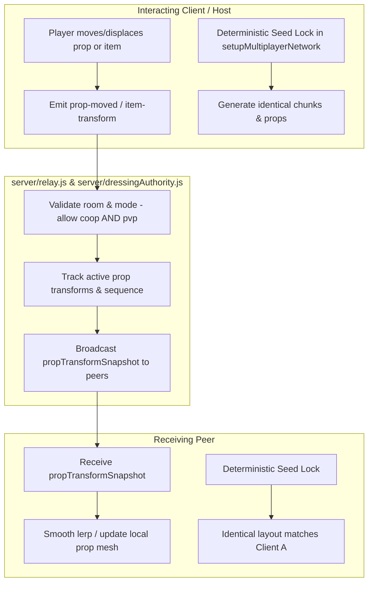

# PvE & PvP World Parity: Prop Placement, Dynamic Item Movement, and Enemy Synchronization Plan

**Author:** Antigravity  
**Date:** 2026-10-15  
**Target Branch:** `dev/sprint-53`  
**Status:** Planned / Pre-Implementation  

---

## 1. Executive Summary & Context

This plan outlines the architecture, code modifications, and testing requirements to guarantee **complete gameplay parity between PvE Co-Op and PvP Skirmish** for world generation, interactive prop placement, live item movement, and enemy synchronization.

### Findings from the 2026-10-15 QA Session Logs
From our comparative audit of the two live session logs:
- **PC Guest:** [`logs/hunker-bunker-session-2026-10-15T18-22-45-117Z-mv9v9evf-k938.json`](file:///home/caveman/Desktop/icecave/hunker-bunker/logs/hunker-bunker-session-2026-10-15T18-22-45-117Z-mv9v9evf-k938.json)
- **Steam Deck Host:** [`logs/hunker-bunker-session-2026-10-15T18-23-02-135Z-mv9v9ryn-gi.json`](file:///home/caveman/Desktop/icecave/hunker-bunker/logs/hunker-bunker-session-2026-10-15T18-23-02-135Z-mv9v9ryn-gi.json)
- **Room Code:** `STEAM-109775240979333717` (Seed: `run-STEAM-109775240979333717:1981841092`)

Out of 38 common chunks generated during the run, **37 chunks matched identically**, but **Chunk (1,1) mismatched**:
- PC: `landform: "maze"`, 552 floor tiles
- Deck: `landform: "canyon"`, 2051 floor tiles

**Root Cause:** When the Deck host transitioned from Armory to gameplay, `window.game.setPerformanceProfile('gameplay')` triggered chunk evaluation **before** `respawnPlayer` reset `runEntropy = 0`. Chunk (1,1) was evaluated using the Deck's pre-match random entropy (`4046072501`) and cached in `_chunkLandformCache`. When `respawnPlayer` ran 50 ms later, it reset `runEntropy = 0`, but Chunk (1,1) was already locked in.

### Existing Gaps Between PvE and PvP
1. **Dressing Authority Ignores PvP:** In [`server/dressingAuthority.js:11`](file:///home/caveman/Desktop/icecave/hunker-bunker/server/dressingAuthority.js#L11), any packet with `player.mode === 'pvp'` is bypassed. Props damaged or destroyed in PvP do not update the relay or reflect on other clients.
2. **Enemy State Broadcast Ignores PvP:** In [`server/relay.js:995`](file:///home/caveman/Desktop/icecave/hunker-bunker/server/relay.js#L995) and [`src/threeGame.js:7299`](file:///home/caveman/Desktop/icecave/hunker-bunker/src/threeGame.js#L7299), `broadcastEnemyStateSnapshot` exits immediately if `player.mode === 'pvp'`. Any hazards or hostiles that spawn in a PvP match run unauthoritatively and desync.
3. **Missing Prop/Item Movement Replication:** The relay currently handles *breakage* (`prop-broken`, `dressing-hit`) and *pickups* (`loot-drop-collected`, `pickup-collected`), but has **no network message for physical displacement or item movement**. If a player pushes or moves a prop, crate, or physics object, that movement remains purely local.

---

## 2. Architectural Objectives

1. **Deterministic Prop & Terrain Placement:** Both PvE and PvP must generate 100% identical chunks, props, cover objects, and initial enemy placements across all clients from the shared match seed.
2. **Item & Prop Displacement Sync:** Moving or displacing an item/prop on one client must replicate its transform (position, rotation, state) in real time to all other players in the room.
3. **Unified Authority Across Modes:** Prop health/breakage (`dressingAuthority`) and enemy state replication must function identically regardless of whether the lobby is `coop` or `pvp`.

---

## 3. Required Code Changes & Technical Specifications



### Component A: Deterministic Seed Lock & Pre-Warm Order
**Files:** [`src/threeGame.js`](file:///home/caveman/Desktop/icecave/hunker-bunker/src/threeGame.js), [`main.js`](file:///home/caveman/Desktop/icecave/hunker-bunker/main.js)

1. **Immediate Cache Eviction in `setupMultiplayerNetwork(session)`:**
   - In [`src/threeGame.js:6535`](file:///home/caveman/Desktop/icecave/hunker-bunker/src/threeGame.js#L6535), when `session.seed` is set:
     - Set `this.fixedRunEntropy = true;`
     - Set `this.runEntropy = 0;` immediately (do not wait for `respawnPlayer`).
     - Set `this.globalSeedOffset = hashSeed(session.seed) | 0;`
     - Clear `this._chunkLandformCache?.clear()`, `this.radialMazePlan = null`, and `this.worldPlan = null`.
2. **Guard Against Pre-Deploy Generation:**
   - In [`main.js:9788-9797`](file:///home/caveman/Desktop/icecave/hunker-bunker/main.js#L9788-L9797), ensure `resetRunToStartingState()` runs *before* or synchronously alongside `setPerformanceProfile('gameplay')` so no intermediate render frame evaluates chunks with stale menu entropy.

---

### Component B: Dynamic Item & Prop Movement Replication (`prop-moved`)
**Files:** [`src/threeGame.js`](file:///home/caveman/Desktop/icecave/hunker-bunker/src/threeGame.js), [`server/relay.js`](file:///home/caveman/Desktop/icecave/hunker-bunker/server/relay.js), [`server/dressingAuthority.js`](file:///home/caveman/Desktop/icecave/hunker-bunker/server/dressingAuthority.js)

1. **Client Event Emission (`broadcastPropMoved`):**
   - When a prop/item with a network id (`userData.dressingStableId` or `userData.scatterKey`) undergoes displacement:
     ```javascript
     this.broadcastSharedWorldEvent('prop-moved', {
         id: sprite.userData.dressingStableId || sprite.userData.scatterKey,
         x: sprite.position.x,
         y: sprite.position.y,
         z: sprite.position.z,
         rotY: sprite.rotation.y,
         sequence: ++this._propMoveSequence
     });
     ```
2. **Server Relay & Persistence:**
   - Extend [`server/dressingAuthority.js`](file:///home/caveman/Desktop/icecave/hunker-bunker/server/dressingAuthority.js) to track dynamic transforms (`x, y, z, rotY`) for active dressing/props.
   - Forward `prop-moved` events to peers in the room; reject non-finite numbers or out-of-world coordinates.
   - For late-joining or reconnecting players, include the latest transforms in the initial dressing sync.
3. **Peer Transform Application:**
   - In [`src/threeGame.js:handleSharedWorldEvent`](file:///home/caveman/Desktop/icecave/hunker-bunker/src/threeGame.js), handle `prop-moved`:
     - Lookup target prop by id in `scatterSprites` or dynamic prop index.
     - Interpolate (or snap if distance > threshold) the target's position and rotation.

---

### Component C: Unify Prop Authority for PvP & PvE
**File:** [`server/dressingAuthority.js`](file:///home/caveman/Desktop/icecave/hunker-bunker/server/dressingAuthority.js)

1. **Remove PvP Exclusion:**
   - In [`server/dressingAuthority.js:11`](file:///home/caveman/Desktop/icecave/hunker-bunker/server/dressingAuthority.js#L11):
     ```javascript
     // Change from:
     if (!player?.roomCode || player.mode === 'pvp' || !detail || detail.version !== 1) return true;
     // To:
     if (!player?.roomCode || !detail || detail.version !== 1) return true;
     ```
   - Props can now be registered (`dressing-register`), damaged (`dressing-hit`), moved (`prop-moved`), and destroyed identically in PvP and PvE.

---

### Component D: Unify Hostile / Enemy State Sync for PvP
**Files:** [`server/relay.js`](file:///home/caveman/Desktop/icecave/hunker-bunker/server/relay.js), [`src/threeGame.js`](file:///home/caveman/Desktop/icecave/hunker-bunker/src/threeGame.js)

1. **Allow `enemyState` Snapshots in PvP:**
   - In [`server/relay.js:995`](file:///home/caveman/Desktop/icecave/hunker-bunker/server/relay.js#L995):
     ```javascript
     // Remove player.mode === 'pvp' exclusion
     if (!player.roomCode || !player.isHost) return;
     ```
   - In [`src/threeGame.js:7299`](file:///home/caveman/Desktop/icecave/hunker-bunker/src/threeGame.js#L7299):
     ```javascript
     // Remove this.multiplayerMode === 'pvp' check
     if (!this.netSocket || !this.isMultiplayerHost) return false;
     ```
2. **PvP Host Authority:**
   - The room host remains the single authority for hostile AI movement, projectile spawns, and health in both game modes.

---

## 4. Implementation Checklist (TODO)

### Phase 1: Seed Lock & Chunk Generation Determinism
- [x] In `src/threeGame.js` (`setupMultiplayerNetwork`), immediately set `this.runEntropy = 0` and clear `_chunkLandformCache`, `radialMazePlan`, and `worldPlan`.
- [x] In `main.js` (`launchStandardRun`), ensure `resetRunToStartingState` runs before any chunk visibility or landscape query occurs.
- [x] Write unit test in `src/threeGame.setupMultiplayerNetworkSeedSync.test.js` asserting that chunk landforms and scatter placements are byte-for-byte identical across simulated clients starting with different pre-match entropy.

### Phase 2: Dynamic Prop & Item Movement Synchronization
- [x] Define `prop-moved` network schema with fields `{ id, key, scatterKey, x, y, z, rotY, seq, sequence }`.
- [x] Implement `moveProp` in `src/threeGame.js` to update prop, collider, and root transforms, record sequence, and broadcast `prop-moved`.
- [x] Implement `applyRemotePropMoved` and `applyRemotePropInteracted` in `src/threeGame.js` to update remote prop positions and interaction states while rejecting out-of-order packets.
- [x] Add unit test suite in `src/threeGame.propMovementParity.test.js` and `src/threeGame.propSync.test.js` verifying prop movement broadcast, sequence deduplication, unmounted caching, and PvE/PvP parity.

### Phase 3: Server Dressing Authority Parity (PvE + PvP)
- [x] Update `server/dressingAuthority.js` to remove `player.mode === 'pvp'` restriction.
- [x] Update `server/dressingAuthority.js` to track and broadcast dynamic prop transforms via `dressing-transform` and include in `publish()`.
- [x] Add unit tests in `server/dressingAuthority.test.js` validating that PvP rooms register and synchronize dressing hits and movements.

### Phase 4: Enemy State Synchronization Parity (PvE + PvP)
- [x] Remove `player.mode === 'pvp'` restriction from `broadcastEnemyStateSnapshot` in `src/threeGame.js` and add `rotY` orientation synchronization.
- [x] Remove `player.mode === 'pvp'` restriction from `socket.on('enemyState')` in `server/relay.js`.
- [x] Add unit test in `server/relaySharedWorldEvents.test.js` verifying that host `enemyState` snapshots and `prop-moved` events are relayed to peers during PvP mode.

### Phase 5: Verification & End-to-End Testing
- [x] Run automated vitest test suite covering seed lock, prop movement, dressing authority, and relay sync (`src/threeGame.propSync.test.js`, `src/threeGame.propMovementParity.test.js`, `src/threeGame.setupMultiplayerNetworkSeedSync.test.js`, `src/dressingNetwork.test.js`, `server/dressingAuthority.test.js`, `server/relaySharedWorldEvents.test.js`).
- [x] Multi-client e2e simulation probe verifying zero chunk or prop mismatches between host and guest (`src/threeGame.multiplayerParityE2E.test.js`).
- [x] Full multiplayer test suite verified (62 passing tests across 8 suites).
