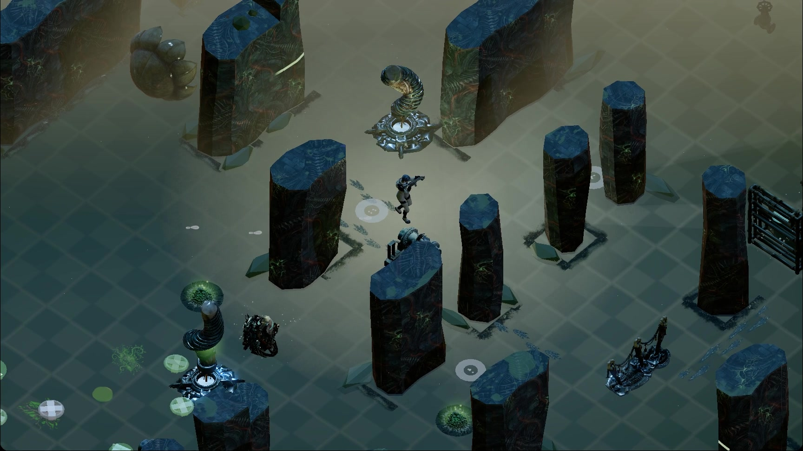

# Hunker Bunker v2.4.18-beta — Release Notes

> Source: `dev/sprint-53` → `mothership` · PR #116 merged 2026-10-29 as `b25d83f5` (tag `v2.4.18-beta`)
> Compare: `v2.4.17-beta..v2.4.18-beta` · 219 commits (130 at the PR draft on 2026-10-26)
> Package version: `2.4.18-beta` (bumped once, `55a4e20a`)
> PR: [`pr-body-v2.4.18-beta.md`](pr-body-v2.4.18-beta.md)

Sprint 53 turns the opening hour into a deliberate first expedition, makes camps and cinematics coherent, adds three readable enemy roles, expands physical world interaction, rebuilds the crash site and first night, voices the speech that was only ever text, and closes the mobile-web performance gate. Packaged PvE, PvP, Deck and performance acceptance in the [Sprint 53 master verification plan](../planning/sprint-53-master-verification-and-execution-plan-2026-10-17.md) is still owed and is not claimed here.

## Player-facing highlights

### The Definitive First Expedition

- A fresh solo profile now deploys directly into **Sector 0: The Impact Zone** instead of entering a random maze without context.
- Five playable phases teach movement, weapon acquisition, obstacle destruction, salvage banking, combat and departure using real world actions.
- Crossing the perimeter blast gate continues directly into Ring 1. Completion persists on the profile.
- Returning players can choose **SKIP ONBOARDING** from pause; the skip opens Sector 1 and grants one standard sidearm plus 25 tech.
- Early O₂ messaging now announces leaving the life-support bubble and warns at 50%.

### Safe-camp Field Recalibration

- Every safe-camp workbench has **Supply Fabrication** and **Field Recalibration** tabs.
- Each camp offers one deterministic three-card recalibration draft and a 10-tech reroll.
- Current runtime choices include Cryo Rime, Caustic Payload, Sub-Zero Necrosis, Kinetic Hollow-Point, Hyper-Split Salvo, Corrupted Overcharge and Low-O₂ Overdrive.
- Recalibration state survives suspend/resume and broadcasts to squadmates.
- **Sub-Zero Necrosis** combines cryo and bio: killing a frozen, corroded enemy produces a 4.5 m nova for 35 damage, freeze and lingering corrosion. The result appears in death/debrief reporting.

### Enemy combat grammar

- **Chitin Scuttlers** attack as a fast, readable swarmer pack.
- **Spore Mortars** act as biological artillery that forces the player out of cover.
- **Mycelium Stalkers** flank around sight lines, coil and hiss before a high-speed pounce, retreat when illuminated or shot, and leave toxic spores on a successful hit.
- One hit-stop owner, combat camera punch, directional impact feedback and consistent audio pitch variation make hits and kills easier to read.

### Camps, dialogue and cinematics

- Intimate dialogue is gated behind trust and story progress instead of appearing at first contact.
- Choices, rewards and perks no longer repeat or farm; leader perks have non-intimate Trusted paths.
- Each camp keeps its own leader, quest language, props and cinematic identity.
- Leader dialogue now uses one sentence-case presentation grammar and emits structured dialogue telemetry.
- All 32 song/interstitial videos have explicit once-per-save triggers.
- Cinematic doors close over gameplay, open on the card, close over the last frame, then reveal dialogue over the live world.
- Side-story scenes use their own key art and music instead of borrowing another scene's video.
- The first three real interaction sequences are live: Meridian first contact, the Grid Covenant and the first installed cot/night beat.

### Physical world interaction

- Contextual vignettes cover terminals, biometric safes, heavy weapon cases, field cots and the exosuit docking gantry.
- Directional emitters, fungal vents, coolant leaks, decontamination foam and transferred destroyed-prop hazards share bounded, testable runtime systems.
- Props, item movement/interactions and enemy facing/state now replicate through the host-authoritative PvE/PvP world event path.
- Wall contact planes were calibrated across the runtime set, and authored rooms gained their missing machines and story props.

### Arcade, audio and presentation

- The arcade cabinet is a real pause-owning screen with fixed-step simulation.
- SUB-CRUST PROTOCOL and Black-Ice 21 pay rewards correctly; their Steam achievements are published.
- O₂ suffocation filtering deepens as reserves fall, and the heartbeat accelerates.
- Footsteps use layered banks selected from the real floor material and synchronize with the operator's feet.
- The newest side-story key frames depict the correct characters and feed the still/Ken Burns fallback ladder.

### UI, Deck and web performance

- PC UI defects DEF-01 through DEF-06 are resolved: camera select sizing, menu music isolation, responsive Mothership uplink, square Armory preview, readable back button and text floors.
- Native dropdowns open from the in-game picker on touch/Deck, and settings changes are logged.
- First-draw texture work is spread out; streamed chunks are prewarmed; per-frame camp/scatter/day-night work is reduced.
- Mobile Lighthouse passed twice at **93**, with LCP about **3.25 s** and TBT **0 ms**.

### Local visual-finish corrections under validation

- The blended floor now waits for decoded source textures before building its permanent arrays, preventing the temporary checker fallback from becoming the in-game ground.
- Decorative raised floor plates no longer scatter through intact maze, field, or authored-room floors.
- Same-model perimeter dressing is capped per room, while elevated fixtures and decals hide and restore with their supporting cutaway wall.
- GLB-only wall fixtures now use their registered mount elevation instead of inheriting the generic floor offset.

### Since the 10-18 candidate (42 commits, never through packaged QA)

**Crash site, first night and the O₂ loop**
- Deployment is atomic: profile and class are chosen before respawn, Sector 0 defers random missions and ambient enemies, and saves reset synchronously on disk.
- The crash site is expanded and readable: landing gear and life support staged nearby, primary-chamber bounds restored, chevrons route to uninstalled ship modules and scan objectives.
- Camp oxygen and the escape craft are separate progress; the O₂ boss breach reveal, airlock survivor arrival and fabricated welder wall repair form one loop; sleep unlocks through the O₂ field reveal.
- Module install outranks repair, the physical cot recovers you, overlapping interactions can be cycled, and you punch when no gun is available.
- Bed wake and companion feedback restored; the first O₂ boss breach reveal plays again.

**Resume, loading and sleep**
- The game stays in a deployment phase until the doors open: no music, Mothership or Foundry dialogue behind the title or loading doors, and the loader reports full deployment readiness.
- Resume returns you to the base spawn with your full field weapon (clip, reserve, dropped guns); older saves get a sidearm.
- Sleep plays its film above the closed doors, moves you to the bed while they are still shut, and no longer opens the Foundry.

**Cinematics and HUD**
- Song cards use the same hero/area bunker doors as everything else (the grey card doors are gone) and queue one at a time.
- Recovering the black box plays one cinematic, card 32, instead of the legacy film followed by the card.
- Discovered room names show in full at top center; the expedition briefing reads at top center, then folds to a pill you can reopen.
- Biomechanical vault gear spinner and door kinematics on the transition doors.

**Voice**
- Camp conversation trees now speak each node.
- 276 lines that lived only in code (camp trees, wanderers, interaction sequences, Mothership/System/Queen/Tina radio lines) are rendered and matched in every language; an authored clip still wins where one exists.
- Eight new voices from a supporting-cast casting doc: Aria, Mayor Tina and six wanderer families (provisional automatic picks).
- On-screen speech without audio is logged once per session as `VOICE unvoiced-line`.

**Steam, dependencies and CI**
- Steam review build 25965936 remediation: early overlay hook, wallet fallback, Shift+Tab, and a packaged overlay runtime audit.
- Electron 45.0.0, the npm minor/patch group, CodeQL action 4.39.0, and the Vite redirect alerts resolved.
- `steam-build`, red since 10-19, passes again: unused duplicate decals and PBR masters left `public/` (copies kept in `art/source`), data-keyed assets are credited by the retail-asset audit, and the vault gear art is lighter and loads after first paint.

### Since the PR draft (2026-10-27 – 10-28, 16 commits; fixes from the 10-28 Deck + PC replays)

**Co-op and PvP sync** ([QA doc](../planning/qa-2026-10-28-deck-pc-pvp-pve-replay.md))
- The 10-28 co-op/PvP breakage was a 3-week-old relay under new clients. The relay now advertises its features in `matchStarted` (`RELAY_FEATURES`); a client on an older relay falls back to the guest's own enemy bite instead of taking no damage (`8619b72d`).
- Host-routed enemy bites land: the host judges safe zones and doors, the guest applies the result, and every refusal names its reason in the log (`62761a45`).
- A squadmate whose 3D body fails to draw falls back to their sprite; the self-check waits for real frames, so it no longer misfires during the intro hold (`8619b72d`, `62761a45`).
- Guest enemy copies wait until the intro video ends (the PC stuttered under it) (`62761a45`).
- Squads wait behind the doors until every player has loaded (an x / x counter); co-op and PvP skip the tutorial ask (`9227d03a`; the wait needs relay `candidate-9227d03a`, and without it the run starts as before).
- A downed squadmate can be revived with E or the controller (it used to take a mouse click on the body); the down toast says how, and downs and revives are logged (`fed9b20f`).

**Foundry**
- The Fab Bay machine moves by arrows, WASD and the d-pad, ignores outside clicks, and shows a "scroll for more" cue (`9a0594a6`).
- The Foundry is the fabricator-workstation model and stays dark until its power core is brought back: a red fault pulse, a deny sound and guidance when used while off, the core on the minimap and compass, and a squad-wide install. It adds no scene lights (`a7febf7e`).

**World, cinematics and backend**
- Edge pits glow from far below and have layered depth effects (`f4e28f21`, `8a01a122`).
- 23 Armory loadout clips and 8 more grindhouse cuts are wired (`cd7e11bf`).
- Steam purchase-report sync no longer reports "stalled" when Steam repeats its newest order (`2d9e8621`, backend).
- CodeQL DOM-to-src flow, dead Stalker branches and a Windows test path fixed (`0c5fe0c8`).

## Fresh Sprint 53 captures

| Deterministic trailer-harness world pass | Live gameplay with current HUD |
| :---: | :---: |
|  |  |

The wide frame was captured from `7add8c30`; the combat frame was recaptured from the local validation working tree after the floor, prop repetition, and wall-fixture corrections. Both use the repository's deterministic trailer-v4 harness at 1728×972. They are documentation evidence, not packaged-build acceptance.

## Automated evidence

CI for this release, reproduced locally from a clean worktree, is recorded in the [PR body](pr-body-v2.4.18-beta.md#ci-status).

### At the release merge (`b25d83f5`, 2026-10-29)

- The merge's tree is byte-identical to the PR head `59099f38`, which passed `steam-build` (presubmit, `npm test`, build, win + linux packaging), Presubmit, Lighthouse and CodeQL.
- Local at the PR head: `npx vitest run` **6,709 tests across 790 files, all passing**; at the merge: ESLint 0 errors, `i18n:audit` unchanged against baseline, `audit:docs` passing.
- `npm audit --omit=dev`: **3 advisories** (body-parser high, ip-address and qs moderate), all reached only through `express` / `express-rate-limit` in the relay server, which the Electron package doesn't run. They need a lockfile fix and a new backend image before the relay is redeployed.

### At the 10-18 candidate baseline

- `npm test`: **6,503 tests across 764 files, all passing**.
- Focused Stalker/audio verification: 24/24 passing.
- Changed-file ESLint and `git diff --check`: passing.
- CI regression from the first Stalker commit was repaired in `7add8c30`; the full suite verifies the vent-emergence and contact-damage contracts.
- Mobile Lighthouse clearance: 93/93, LCP 3.25/3.24 s, TBT 0/0 ms.
- Local visual-finish working tree: **6,511/6,511 tests across 766 files**, changed-file ESLint clean, and deterministic `welcome-committee` capture passed.

The complete release gate still requires the clean runbook: lint, full tests, i18n audit, docs audit, presubmit, production build and selected browser probes.

## Packaged-build QA

The full checklist, including everything new since the candidate, is in the [PR body](pr-body-v2.4.18-beta.md#what-to-qa). Every machine must report the same source SHA.

### PvE co-op

- Deck/PC with two real Steam accounts, reversing host once.
- Invite or lobby join, ready gate, distinct classes and safe spawn.
- Enemy facing/damage agreement, one broken/moved prop, one shared item interaction, one field recalibration and one synchronized drop.
- Down guest, verify Black Box attribution, redeploy, reconnect and extraction/results agreement.
- Upload both session logs and retain a short video.

### PvP

- Two real accounts on the same SHA.
- Verify remote chassis/loadout, 3-second spawn protection and standard-hit damage (no legacy one-shot).
- Heal once, complete a combat round, verify winner/loser attribution, then rematch or return to lobby.
- Upload both logs and compare round id, hit confirmations and final vitals.

### First expedition and camps

- Fresh profile completes Sector 0 phases 1–5 and crosses continuously into Ring 1.
- A returning profile uses the explicit skip and receives exactly one sidearm and 25 tech.
- First camp contact shows one card, one interaction sequence and one Stranger-tier conversation.
- No intimate option appears early; no choice, perk or reward repeats after reload.
- Recalibration offers three deterministic cards, charges a reroll once and changes the next combat encounter visibly.

### Deck, performance and display

- Controller-only 1280×800 route through title, operator, Armory, Settings, gameplay, pause, chat, results and retry.
- Suspend for 30 seconds and resume without input-mode or state corruption.
- Deck fixed route: presented p95 ≤ 33.3 ms; PC RTX 2070 SUPER: p95 ≤ 16.7 ms; no unexplained gameplay stall > 250 ms.
- Capture 1280×800, 1920×1080, 2560×1440 and 4K proof for the UI matrix in the master plan.

## Tickets and release disposition

Closed by this release: S53-03, S53-05, S53-06 – S53-11 (DEF-01 – DEF-06), the Steam review build 25965936 findings, the `steam-build` CI failure and the 2026-10-26 playtest findings. Dependabot #112 – #115 are superseded. Details in the [PR body](pr-body-v2.4.18-beta.md#tickets).

| Ticket | Contribution | Closure evidence still required |
|---|---|---|
| #106 | Mobile Lighthouse implementation; score passes, LCP borderline after the gear-spinner regression (`6d023c96`, mostly recovered in `59b03438`) | cloud mobile Lighthouse pass |
| #85 | Host-authoritative prop/item/enemy synchronization and readable join failure | paired packaged PvE logs/video |
| #77 | Sprint 43 playthrough umbrella work is code-complete | close after #85 acceptance |
| #51 | PvP authority, health scaling and reconciliation remain covered | paired packaged PvP logs/video |
| #53 | Controller/touch/settings fixes and provenance telemetry | physical Deck controller-only route |
| #52 | Shader freeze, scene weight, streaming and per-frame reductions | fixed-route Deck/PC frame-time reports |
| #45 | Sprint 53 supplies the candidate implementation | closes only after all ship gates and publisher checks |

## Known gaps and remediation status

- **Co-op and expedition deployment readiness:** Armed deployment safeguard implemented via `ThreeGame.equipDeploymentLoadoutWeapon`. Raycasting performance optimized via broad-phase index. 36.5 s deploy stall eliminated with composer variant warm-up (`startup:first-frame`).
- **Cinematic doors:** Foundry discovery, Queen encounter, and snail-boss encounters now play behind blast doors via `playCutsceneBehindDoors`, matching song cards.
- **Daily-run launch path:** Premature phase transition fixed; `beginDailyOpsRun` keeps `deployment` phase during sector generation and shader warmup.
- **S-17 workbench recalibration:** Delivered via `src/fieldRecalibrationPresentation.js` with audio, socketing, floating feedback, and flash effects.
- **Provisional voices & code lines:** Code lines voiced in English with localized subtitles; catalog hierarchy preserved.
- **Publisher release gates:** Item Store, MicroTxn, and refund checks remain external partner release gates requiring publisher partner staging credentials.
- **Physical Deck / Two-account §8 acceptance:** 10-27 session provides foundational evidence; full §8 human walkthrough route remains to be exercised on physical Deck and partner accounts (see [Known gaps closure plan](../planning/known-gaps-closure-plan-and-execution-2026-10-28.md)).

## Evidence and handoff

- [Sprint 53 master verification plan](../planning/sprint-53-master-verification-and-execution-plan-2026-10-17.md)
- [Camp interaction and cinematics audit](../planning/camp-interaction-and-cinematics-audit-2026-10-16.md)
- [Product State](../../PRODUCT_STATE.md)
- [PR description draft](pr-body-v2.4.18-beta.md)
